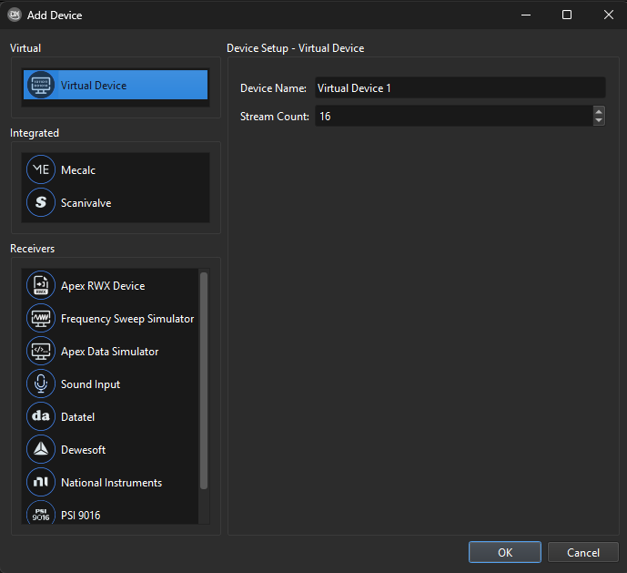

# Devices

*Add Device dialog*

The **Devices** section configures the data sources that feed the DAQ design. Devices are added through the **Add Device** dialog and are grouped into three categories:

* [**Virtual**](virtual.md) — software-only devices that produce simulated streams without any hardware.
* [**Integrated**](integrated.md) — devices that DX+ controls and configures directly through their native APIs.
* [**Receivers**](receivers.md) — devices and data sources that DX+ receives streams from, including hardware receivers, simulators, and file replay.

> [!NOTE]
> Some processors are only available for certain device categories — for example, [Raw Units](../processors/raw-units.md) can only be applied when a **Virtual Device** is selected.
