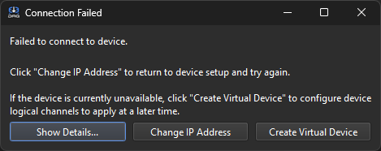
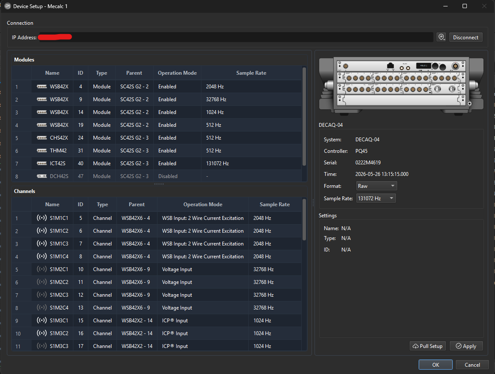
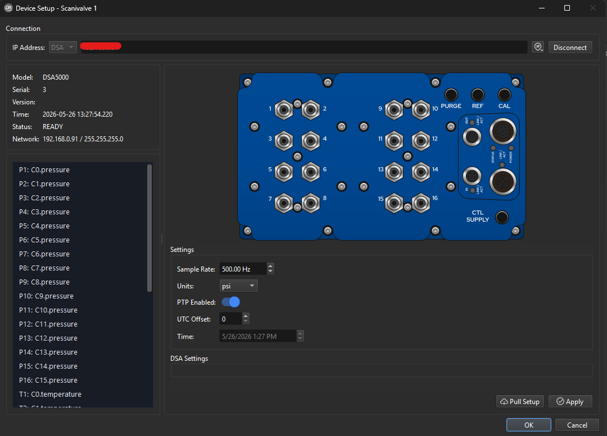

# Integrated

**Integrated** devices are hardware systems that DX+ controls and configures directly through their native APIs. Rather than passively receiving streams, DX+ pushes channel setup, sample rates, and per-module options to the device and reads back its current state. The full set of available settings — and which models, modules, and channels are supported — comes from the vendor's hardware.

After an integrated device is added, a **Device Setup** dialog opens (titled *Device Setup - \<device name>*). This page covers how to navigate that dialog. For the meaning of specific module / channel settings, refer to the vendor's own documentation:

* **Mecalc:** [https://mecalc.com/support](https://mecalc.com/support)
* **Scanivalve:** [https://scanivalve.com/support/](https://scanivalve.com/support/)

The integrated devices are [Mecalc](#mecalc), [Scanivalve](#scanivalve), [Pacific Instruments](#pacific-instruments), [HGL Dynamics](#hgl-dynamics), and [Datatel](#datatel).

## Navigating the Device Setup Dialog

Every integrated device's Device Setup dialog follows the same overall layout, even though the contents vary by device and model.

### Connection

At the top of the dialog is the **Connection** row.

* **IP Address** — address of the device on the network. For Scanivalve, an additional dropdown selects the scanner family (e.g. DSA).
* **Locate** — pings/identifies the device on the network (typically by flashing an LED on the unit).
* **Connect / Disconnect** — opens or closes the connection. Most fields below the Connection row are populated only once a connection is established.

### Connection Failed

If DX+ can't reach the device, a **Connection Failed** dialog appears:

*Connection Failed dialog*

* **Show Details...** — shows the underlying connection error.
* **Change IP Address** — returns to the Device Setup dialog so you can correct the address and try again.
* **Create Virtual Device** — use this when the device is currently unavailable. DX+ creates a [Virtual Device](virtual.md) so you can configure the device's logical channels now and apply them to the hardware later (see [Convert Device to...](virtual.md#convert-device-to)).

### Device View (SVG)

The right side of the dialog shows a scaled SVG render of the physical device. When you select a module or channel in the tables on the left, the corresponding port or slot on the SVG is highlighted, providing a visual link between the configuration UI and the physical hardware.

### Module / Channel Tables

Integrated devices expose their configuration as tables of **Modules** and/or **Channels**, with columns such as Name, ID, Type, Parent, Operation Mode, and Sample Rate. Selecting a row populates the **Module Settings** / **Channel Settings** panel on the right, where the row's editable settings appear.

> [!NOTE]
> Different module types expose different settings — for example, a strain bridge module will surface bridge-specific options that don't appear on a voltage-input module. Refer to the vendor's documentation for the meaning of each module's settings.

### Pull Setup

The **Pull Setup** button reads the current configuration from the device and populates the dialog with it. Use this after first connecting, or any time the device's configuration may have been changed outside of DX+.

### Apply

The **Apply** button writes the current dialog settings back to the device. Settings remain pending in the dialog until Apply is clicked.

### OK / Cancel

* **OK** — attempts a connection (if not already connected) and accepts the dialog. If you have unapplied changes when closing, DX+ prompts:
  > *You have unapplied changes. Do you want to discard them and exit?*
* **Cancel** — closes the dialog without saving.

---

## Mecalc

*Device Setup — Mecalc*

Mecalc integrated DAQ hardware (DECAQ controllers and their attached modules). The dialog exposes the connected chassis, its module list, and each module's channels.

* **Connection** — IP Address of the controller.
* **Device info panel** — System (e.g. `DECAQ-04`), Controller, Serial, Time, Format, and overall Sample Rate of the chassis.
* **Modules table** — every connected module with its operation mode and sample rate.
* **Channels table** — every channel on every module, with its operation mode and sample rate. The supported operation modes depend on the module type (e.g. *Voltage Input*, *ICP Input*, *WSB Input: 2 Wire Current Excitation*).
* **Module Settings panel** — settings for the currently selected module.

For module catalogs, supported operation modes, and detailed setting definitions: [https://mecalc.com/support](https://mecalc.com/support).

## Scanivalve

*Device Setup — Scanivalve*

Scanivalve pressure-scanning DAQ hardware. The scanner family is selected next to the IP Address (DSA, DTS, MPS).

* **Connection** — Scanner family dropdown + IP Address.
* **Device info panel** — Model (e.g. `DSA5000`), Serial, Version, Time, Status, Network.
* **Stream list** — auto-populated list of pressure (`P*`) and temperature (`T*`) channels exposed by the scanner.
* **Settings panel** — common settings such as Sample Rate, Units (e.g. `psi`), PTP Enabled, UTC Offset, and Time.
* **Family-specific settings** — additional groups appear below for the selected scanner family (e.g. *DSA Settings*).

For scanner specifications, supported units, and detailed setting definitions: [https://scanivalve.com/support/](https://scanivalve.com/support/).

## Pacific Instruments

Pacific Instruments 6000/6700 series DAQ systems.

* **Connection Settings** — IP Address and Port of the system (default port `4086`), and **Connect**.
* **Cards / Modules** and **Channels** tables — the cards in the system and their channels.
* **System Settings:**
  * **Series** — the system series (6000/6700).
  * **System ID** — read from the system.
  * **Master Rate** — the system sample rate: `1000`, `5000`, `10000`, `50000`, or `100000`.
  * **Sync Mode** — **None** or **IRIG**.
* **Pull Setup** / **Apply** — read the configuration from the system, or write the dialog settings to it.

## HGL Dynamics

HGL Dynamics DAQ systems.

* **Connection Settings** — IP Address and command Port of the controller (default port `14002`), and **Connect**. Select **Single module** when the system has only one module. **Power Cycle** restarts the hardware.
* **Modules** and **Channels** tables — the modules in the system and their channels.
* **System Settings:**
  * **Series** and **System ID** — read from the system.
  * **Sample Rate (all)** — the sample rate for every channel: `5000`, `10000`, `25000`, `50000`, `100000`, `128000`, `200000`, or `256000`.
  * **Sync Mode**, **Data Format**, and **Extended Data**.
* **Pull Setup** / **Apply** — read the configuration from the system, or write the dialog settings to it.

## Datatel

Datatel telemetry hardware. Datatel channels are configured in Datatel's own web setup page rather than in a DX+ setup dialog.

* **Address** — IP address and port of the Datatel unit (default port `80`).
* **Launch Datatel Setup** — opens the unit's web setup page in your browser.
* **Pull Setup** — reads the current channel configuration from the unit into the table. Pull the setup again after changing the configuration on the unit.
