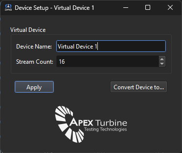

# Virtual

**Virtual** devices are software-only data sources that produce streams without any underlying hardware. They are typically used as **pre-configured placeholders**: you can lay out a full DAQ design — channel counts, processors, units, outputs — against a Virtual Device, then later swap it for the real hardware once it's available, keeping the rest of the design intact.

## Virtual Device

A generic virtual device with a configurable number of output streams.

### Device Setup

These fields appear both when first adding the device and when editing it later. To edit them later, click the **Settings** button on the device in the [Devices / Sources](../general/devices-panel.md) panel, which opens **Device Setup - Virtual Device 1**.

*Device Setup — Virtual Device*

* **Device Name** — display name for this device in the design. Defaults to `Virtual Device`, auto-incremented (`Virtual Device 1`, `Virtual Device 2`, …) when other Virtual Devices already exist.
* **Stream Count** — number of output streams the device should produce.
  * Default: `16`
  * Minimum: `1`
  * Maximum: `4096`

> [!NOTE]
> Virtual Device is the only device type that allows the [Raw Units](../processors/raw-units.md) processor to override the streams' engineering units. This makes it well-suited to mocking up real sensors during design — set the channel count, assign realistic raw units, and the rest of the processing pipeline behaves as it would against the real device.

### Apply

The **Apply** button commits the current **Device Name** and **Stream Count** to the design and closes the dialog. Changing the stream count after the design is built will add or remove streams in place; downstream processors and outputs remain wired to streams that still exist.

### Convert Device to...

The **Convert Device to...** button replaces the Virtual Device with a real hardware (or receiver) device in the same position in the design.

When clicked:

1. The **Add Device** dialog opens with the title *Convert Device to...*.
2. Select the target device type and configure it as you would when adding a new device.
3. On accept, DX+ converts the virtual source into the chosen device type and preserves the existing stream layout:
   * Logical names of the existing streams are preserved.
   * Existing stream names are kept (no reconnection is performed if streams are already named).
   * The new device's settings dialog is opened automatically so you can finish any hardware-specific setup (IP address, sample rates, etc.).
4. The Virtual Device is removed from the device list and replaced with the new device. Downstream processors and outputs remain wired to the converted streams.

> [!NOTE]
> Because logical names are preserved on conversion, any references to the virtual streams from elsewhere in the design (processors, outputs, plots configured later in the Viewer) continue to resolve to the corresponding streams on the real device.
