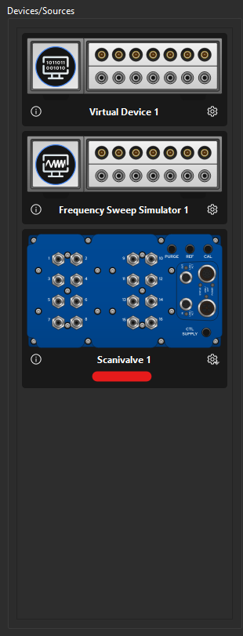

# Devices / Sources Panel

The **Devices / Sources** panel lists every device currently in the DAQ setup. Each device is shown as a widget with a visual representation, its name, and quick-access controls.

*Devices / Sources panel*

## Device Widget

Each widget contains:

* **Device image** — a graphical representation of the device. The image depends on the device type and, for hardware devices, the specific model (e.g. a Scanivalve DSA5000 shows the DSA scanner image; a Mecalc chassis shows its module rack).
* **Device name** — the display name assigned when the device was added (e.g. `Virtual Device 1`, `Frequency Sweep Simulator 1`, `Scanivalve 1`). The name is editable directly in the widget — click the textbox and type a new name to rename the device.
* **Info button** *(left, ⓘ)* — opens an information popup with details about the device and its current settings.
* **Settings button** *(right, ⚙)* — reopens the device's setup dialog (or device settings dialog), letting you change configuration after the device was added. On a Mecalc or Scanivalve device the button opens a menu instead:
  * **Device Setup** — the full device setup dialog.
  * **Device Settings** — the device's connection settings.
  * **Health Stats** *(Mecalc only)* — opens the **Health & Stat Channels** dialog, where you choose which health and status channel types are sent to **Store**, **Transmit**, and **Viewer**.

## Interactions

* **Click** a device to select it. The widget highlights, and every stream produced by that device is outlined in green in the DAQ table — a quick way to see which streams belong to which device.
* **Double-click** a device widget to reopen its setup / settings dialog. This is the fastest way to edit an existing device's configuration.
* **Del** key, with a device selected, removes the device from the setup after you confirm the **Delete Device** prompt. This is equivalent to clicking **Remove** in the [Ribbon](ribbon.md#device).

## Collapsing the Panel

The Devices / Sources panel is collapsible — collapse it to reclaim screen space for the DAQ table when you don't need to interact with the device list. Expand it again at any time to access the device widgets.
