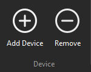
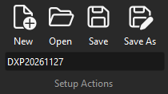
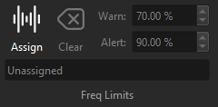
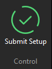

# Ribbon

The **Ribbon** at the top of the DAQ tab exposes the actions you'll use most often: adding and removing devices, managing setup files, assigning frequency limits, and submitting the configured table.

## Device

*Device ribbon group*

* **Add Device** — opens the [Add Device](../devices/README.md) dialog where you select a Virtual, Integrated, or Receiver device and configure its initial settings.
* **Remove** — removes the currently selected device from the table. If DAQ is running, DX+ asks you to confirm before removing the device.

## Setup Actions

*Setup Actions ribbon group*

The Setup Actions group saves and loads DAQ table configurations to and from disk.

* **New** — clears the current table and starts a fresh, empty setup.
* **Open** — loads a previously saved DAQ setup from disk.
* **Save** — saves the current setup.
* **Save As** — saves the current setup under a new name.
* **Setup Name** — shows the name of the current setup file, or **Untitled** if the setup hasn't been saved yet. An unnamed setup is given a default name of `DXP` followed by the current date in `yyyyMMdd` form — e.g. `DXP20261118`.

Setups are saved as `.dxt` files. Recently used setups are listed under **Recent Setups** in the File menu.

If the current setup has unsaved changes when you choose **New** or **Open**, DX+ shows an **Unsaved Setup** prompt so you can save the changes, discard them, or cancel.

> [!WARNING]
> Saved setups are specific to DX+ Data Acquisition. A design file from DX+ Online or Offline Analysis cannot be loaded here (DX+ reports *Legacy graph format is not supported in the tabular setup*), and a DAQ setup cannot be opened in another application.

## Freq Limits

*Freq Limits ribbon group*

The Freq Limits group assigns a frequency limits file to the setup. Frequency limits are checked against the output of the [Spectral](../processors/spectral.md) processor.

* **Assign** — choose a limits file. Only CSV (`.csv`) files are accepted. The signal names in the file must match the **Logical Names** in the table.
* **Clear** — removes the assigned limits file. The label below the buttons shows the assigned file name, or **Unassigned**.
* **Warn** — the percentage of a limit at which a value is flagged as a warning. Default: `70 %`.
* **Alert** — the percentage of a limit at which a value is flagged as an alert. Default: `90 %`.

The Freq Limits group is disabled while a setup is being submitted.

> [!NOTE]
> Frequency limits need a Spectral processor. If a limits file is assigned but no stream has Spectral enabled, DX+ warns that the limits can't be applied and submits the setup without them.

## Control

*Control ribbon group*

* **Submit Setup** — submits the configured DAQ table for acquisition. Once submitted, DX+ can view, record, and/or transmit data according to the [Outputs](../outputs/README.md) you've enabled in the table. A **Submitting Setup...** progress dialog is shown while the setup is applied. If DAQ is already running, DX+ asks whether to stop it before submitting.
