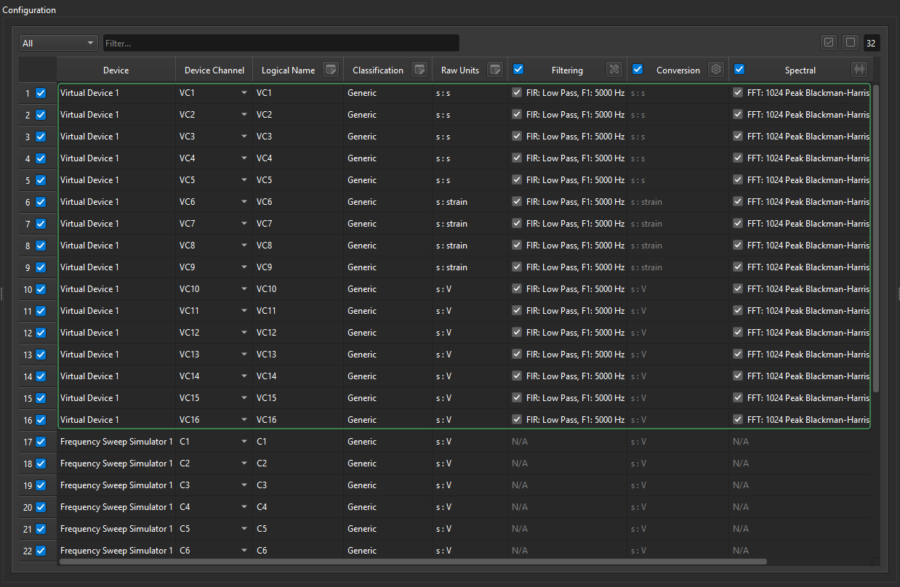
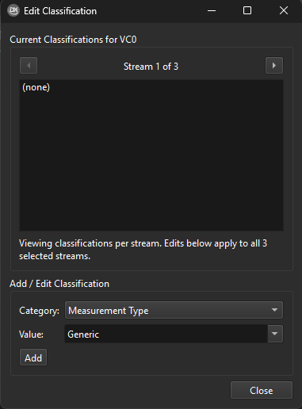

# Table Operations

The **Configuration** table is the central view of DX+ DAQ. Each row is a single stream and each column either describes that stream's identity (device, channel, logical name, classification) or shows the processing and outputs applied to it (Range Limits, Raw Units, Filtering, Conversion, Spectral, Statistics, Store, Transmit). This page covers how to work with the table itself; for processor settings see the [Processors](../processors/README.md) section.

*Configuration table*

## Toolbar

The toolbar above the table lets you scope and filter the visible rows:

* **Source filter** *(left dropdown, defaults to "All")* — limits the table to streams from a single device, or shows all devices at once.
* **Filter** *(textbox)* — narrows the table to rows whose values match the entered text.
* **Check selected / Uncheck selected** *(top right)* — enables or disables the selected streams.
* **Stream count** *(right)* — total number of streams in the table, including both enabled and disabled streams (`32` in the screenshot above).

Each row also has its own checkbox on the left. Unchecking a row disables that stream from being processed and forwarded to the outputs.

## Columns

### Device

The device that owns this row. Set automatically when the device is added; not editable from the table.

### Device Channel

A dropdown that maps a physical channel on the device to this row's **Logical Name**. The mapping is decoupled from the row order so that physical channels can be wired to logical names independently of how the rows are arranged.

*Example:* Suppose a Mecalc has 16 physical channels named `C1`–`C16`. You can edit the Logical Name on row 16 to `test1`, then go to the Device Channel dropdown on row 1 and select `C16` — now physical channel `C16` feeds the logical name `test1` regardless of which row that logical name lives on.

Two visual cues help track unfinished wiring:

* **Unassigned device channels** are shown with a **darker (near-black) background**, signaling that the row's logical slot is not currently driven by any physical channel.
* **Unused logical names** are marked with a leading **`*`**, signaling that the logical name exists but no physical channel is currently mapped to it.

### Logical Name

The name users will see during testing (in the Viewer). Click any cell to rename a stream to something more meaningful (e.g. `bearing_accel_x` instead of `C1`).

The button in the column header opens a **sequential rename** dialog: select multiple rows in the Logical Name column, click the header button, and apply a name + numbering pattern to all selected rows at once.

> [!NOTE]
> The Logical Name column accepts **paste from a Microsoft Excel spreadsheet** — copy a column of names from Excel and paste it into the Logical Name column to rename many streams in one operation.

### Classification

Adds metadata classifications to a stream. Click a cell — or the button in the column header to apply across multiple selected rows — to open the **Edit Classification** dialog.

*Edit Classification dialog*

* **Current Classifications** — the top section lists existing classifications on the stream(s) being edited. When multiple streams are selected, use the arrows to page through each one and inspect its current classifications.
* **Category** — the classification category (e.g. *Measurement Type*).
* **Value** — the value to assign within the chosen category (e.g. *Generic*).
* **Add** — applies the chosen Category/Value pair to every selected stream.

Custom categories and values can be created from this dialog — you're not limited to the built-in list.

### Range Limits

Sets the expected range of each stream. Click a cell — or the button in the column header to apply across multiple selected rows — to open the **Range Limits** dialog:

* **Min Value / Max Value** — the lower and upper limits of the stream's range.
* **Warn** — the percentage of the range at which a value is flagged as a warning.
* **Alert** — the percentage of the range at which a value is flagged as an alert.
* **Reset** — restores the default limits.

For frequency-based limits, see [Freq Limits](ribbon.md#freq-limits) in the Ribbon.

### Raw Units, Filtering, Conversion, Spectral, Statistics

These columns show the current processor settings for each stream. Use the button in each column header to open the processor's settings dialog, where edits apply to every selected row.

See the [Processors](../processors/README.md) section for the details of each processor:

* [Raw Units](../processors/raw-units.md)
* [Filtering](../processors/filtering.md)
* [Conversion](../processors/conversion.md)
* [Spectral](../processors/spectral.md)
* [Statistics](../processors/statistics.md)

### Store, Transmit

These columns show whether each stream is recorded by the [Store](../outputs/sqlite.md) output and published by the [Transmit](../outputs/transmit.md) output.

> [!NOTE]
> The checkbox in a processor or output column header turns that column on or off for the streams in the table.
