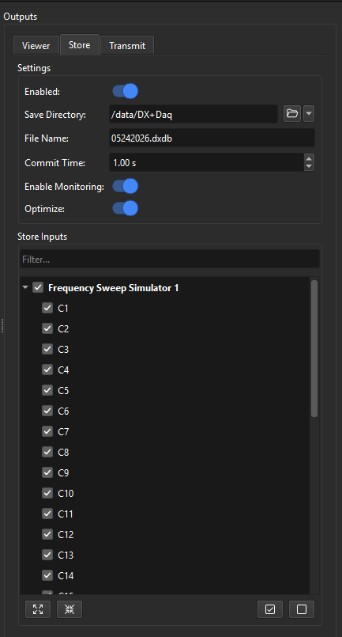

# Store (SQLite)

The **Store** tab records selected streams to a SQLite database (`.dxdb`) on disk.

## Settings

* **Enabled** — master toggle for the Store output. When off, no data is written regardless of the stream selections below.
* **Save Directory** — the folder where the database file will be created. Defaults to `/data/DX+Daq`. Use the folder icon to browse, or the dropdown arrow for recent locations.
* **File Name** — the name of the `.dxdb` file to write. Defaults to the current date in `yyyyMMdd` form (e.g. `20261118.dxdb`). If you leave out the extension, `.dxdb` is added.
* **Commit Time** — how often (in seconds) buffered data is flushed to the database. Applies to all store instances. Lower values reduce data loss on an unexpected shutdown; higher values reduce disk I/O.
* **All Data** — when enabled, the configured streams are recorded whenever recording is active, including outside events. When disabled, data is written only while event recording is active.
* **Optimize** — indexes the data table for faster queries. Applies to all store instances.

### File Splitting

* **Remove Indexes** — removes database indexes while writing, for better write performance.
* **Partition Data By** — partitions the data table groups in the database index by **None**, **Sources**, or **Streams**. Partitioning by sources or streams can degrade write performance.
* **Split Files By** — when the writer starts a new database file: **None**, **Size**, **Time**, or **Event**. Event-based splitting uses event-only recording.
* **Split Value** — the split threshold, in bytes, seconds, or events depending on **Split Files By**.

## Store Inputs

The Store Inputs tree lists every stream available to record, grouped by source element.

* Each stream's checkbox controls whether it is written to the database.
* Group checkboxes toggle every stream under that group.
* Use the **Filter** field to narrow the tree by name.
* The toolbar buttons expand/collapse all groups and enable/disable the selected streams.

> [!NOTE]
> The resulting `.dxdb` file can be opened in [DX+ Data Viewer](../../DX+DataViewer/README.md) for playback, managed in [DX+ DB Manager](../../Tools/DB%20Manager/README.md), or processed in [DX+ Offline Analysis](../../DX+OfflineAnalysis/README.md).
