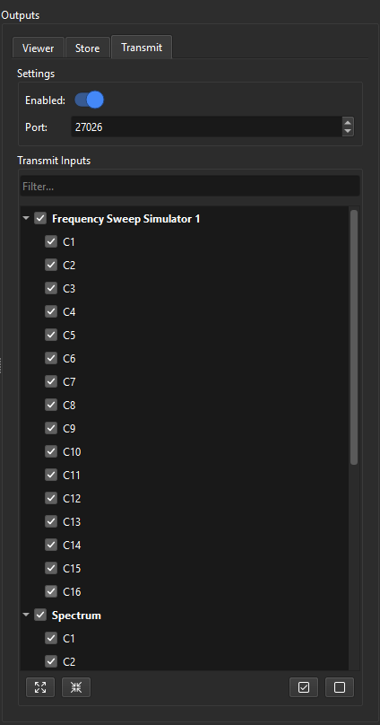

# Transmit

The **Transmit** tab publishes selected streams over the network so that [DX+ Remote Viewer](../../DX+RemoteViewer/README.md) or [DXNet Bridges](../../Services/DXNet%20Bridge%20%28OPCUA%29/README.md) can subscribe and plot or forward the data live.

## Settings

* **Enabled** — master toggle for the Transmit output. When off, no data is published regardless of the stream selections below.
* **Port** — the TCP port that DX+ will listen on for Viewer connections. Defaults to `27026`.

## Transmit Inputs

The Transmit Inputs tree lists every stream available to publish, grouped by source element.

* Each stream's checkbox controls whether it is sent over the network.
* Group checkboxes toggle every stream under that group.
* Use the **Filter** field to narrow the tree by name.
* The toolbar buttons expand/collapse all groups and enable/disable the selected streams.

> [!NOTE]
> Make sure the configured port is reachable from any machine running DX+ Remote Viewer — you may need to open the port in your firewall.
