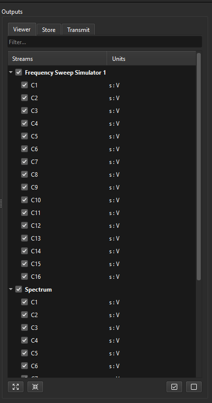

# Viewer

The **Viewer** tab selects which streams from the DAQ setup are forwarded to the embedded [Viewer](../../DX+RemoteViewer/live-plots.md) for live plotting.

## Streams

The Streams tree lists every stream produced by the current design, grouped by the element that produced it (for example `Frequency Sweep Simulator 1` and `Spectrum`).

* Each stream's checkbox controls whether it is sent to the Viewer.
* Toggling a group checkbox enables or disables every stream under that group.
* The **Units** column shows the stream's domain and range units (e.g. `s : V` — seconds vs. volts).

## Filter

Use the **Filter** field at the top of the tab to narrow the tree to streams whose names match the entered text.

## Toolbar

* **Expand All / Collapse All** — expand or collapse every group in the tree.
* **Enable Selected / Disable Selected** — enable or disable the selected streams.

> [!NOTE]
> Only streams enabled here will appear in the Viewer's Signal Tree. Disabling a stream does not stop it from being processed — it only prevents it from being forwarded to the Viewer.
