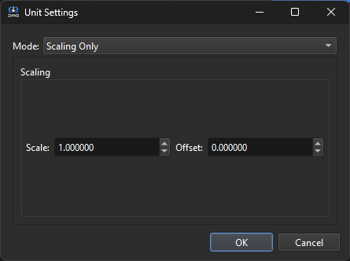
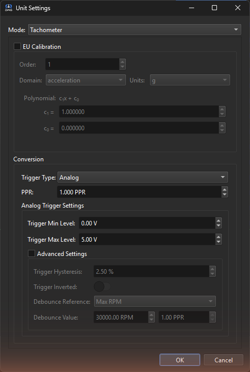
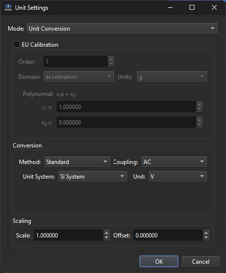
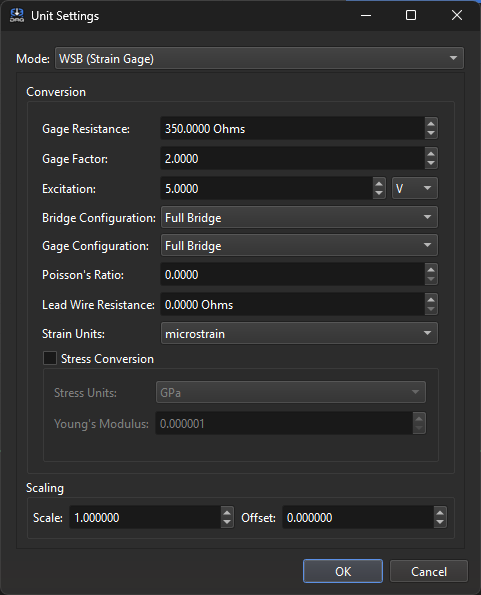

# Conversion

The **Conversion** processor (Unit Settings) converts the raw input signal into engineering units. It supports four modes selected from the **Mode** dropdown at the top of the dialog:

* [**Scaling Only**](#scaling-only) — apply a linear scale and offset, no unit change.
* [**Tachometer**](#tachometer) — convert a tach pulse signal into RPM.
* [**Unit Conversion**](#unit-conversion) — convert between engineering units within the same domain, optionally with EU calibration.
* [**WSB (Strain Gage)**](#wsb-strain-gage) — convert a Wheatstone bridge signal into strain (and optionally stress).

A **Scaling** section is present in every mode except **Tachometer** and is applied as the final step.

---

## Scaling Only

*Unit Settings — Scaling Only*

The simplest mode. The input signal is multiplied by **Scale** and offset by **Offset** with no other processing applied.

### Scaling

* **Scale** — multiplicative factor applied to the input signal. Default: `1.000000`.
* **Offset** — additive offset applied after scaling. Default: `0.000000`.

---

## Tachometer

*Unit Settings — Tachometer*

Converts a tachometer pulse signal into RPM. The output stream has units of `s : RPM`.

### EU Calibration

With the **Analog** trigger type, Tachometer mode shows the same **EU Calibration** group as Unit Conversion — enable it to apply a polynomial calibration to the raw input before pulse detection. See [EU Calibration](#eu-calibration) below for field details. The group is not shown with the **Digital** trigger type.

### Conversion

* **Trigger Type** — how pulses are detected.
  * **Analog** *(default)* — pulses are detected by threshold crossing on an analog input. Exposes the additional trigger fields below.
  * **Digital** — pulses are read from a digital input line. Only **PPR** is required.
* **PPR** — Pulses Per Revolution of the tachometer. Default: `1.00`.

When **Trigger Type** is **Analog**, an **Analog Trigger Settings** group is shown:

* **Trigger Min Level** / **Trigger Max Level** — the signal levels, in V, that define the trigger range. The switching level is the midpoint of this range.
* **Advanced Settings:**
  * **Trigger Hysteresis** — a dead band around the switching level, as a percentage of the trigger range, that improves noise rejection. Default: `2.5 %`.
  * **Trigger Inverted** — toggle to invert the trigger polarity.
  * **Debounce Reference** / **Debounce Value** — how extra crossings shortly after a pulse are rejected, for example by maximum RPM together with the PPR.

> [!NOTE]
> Tachometer mode has no **Scaling** section; the output is the RPM value.

---

## Unit Conversion

*Unit Settings — Unit Conversion*

Converts the input signal between engineering units, optionally pre-applying an **EU Calibration** polynomial.

### EU Calibration

Enable the **EU Calibration** group to apply a polynomial calibration to the raw input before unit conversion.

* **Order** — polynomial order. Setting the order generates that many coefficient fields (`c₀` through `cₙ`). Default: `1` (linear, with `c₁` and `c₀`).
* **Domain** — the physical domain of the calibrated output (e.g. `acceleration`, `pressure`, `voltage`).
* **Units** — the engineering units of the calibrated output (filtered by the selected Domain).
* **Polynomial** — the polynomial expression (e.g. `c₁x + c₀`) and the coefficient fields. `c₀` is the constant term and `cₙ` is the highest-order coefficient.

### Conversion

* **Method** — conversion method.
  * **Standard** — applies only scaling and offset transformations.
  * **Integrate** — integrates the signal once (e.g. acceleration to velocity).
  * **Integrate (x2)** — integrates the signal twice (e.g. acceleration to displacement).
  * **Differentiate** — differentiates the signal.
* **Coupling**
  * **AC** *(default)* — uses filter-based integration, which removes the DC component.
  * **DC** — uses numerical integrators and preserves the DC component. When DC is selected, the **1st Integral Initial** (and, for Integrate (x2), **2nd Integral Initial**) fields set the starting values of the integrals.
* **Unit System** — the system of units for the output.
  * **SI System** *(default)*
  * **US Customary System**
* **Unit** — the specific output unit, filtered by the selected Unit System and the input's domain.

### Scaling

The standard Scale / Offset are applied to the output value.

> [!NOTE]
> If you don't pick an output unit explicitly, DX+ chooses the best-matching unit for the resulting domain based on the input units, the selected coupling, and the chosen unit system.

---

## WSB (Strain Gage)

*Unit Settings — WSB (Strain Gage)*

Wheatstone Strain Bridge conversion. Converts the raw bridge voltage into strain, with optional conversion to stress.

### Conversion

* **Gage Resistance** — nominal resistance of the strain gage, in Ohms. Default: `350.0000 Ohms`.
* **Gage Factor** — strain sensitivity of the gage. Default: `2.0000`.
* **Excitation** — bridge excitation voltage or current, with a units dropdown (`V`, `mV`, `uV`, `A`, `mA`, or `uA`). Default: `5.0000 V`.
* **Bridge Configuration** — physical bridge configuration (e.g. **Full Bridge**, **Half Bridge**, **Quarter Bridge**).
* **Gage Configuration** — specific gage arrangement within the bridge (filtered by Bridge Configuration).
* **Poisson's Ratio** — Poisson's ratio of the test specimen. Required only for configurations that depend on it. Default: `0.0000`.
* **Lead Wire Resistance** — resistance of the lead wires, in Ohms. Used to compensate for lead-wire effects in quarter- and half-bridge configurations. Default: `0.0000 Ohms`.
* **Strain Units** — output strain unit: **Strain**, **Millistrain**, or **Microstrain**.

#### Stress Conversion

Enable the **Stress Conversion** checkbox to convert strain to stress using Hooke's law. When enabled, the output stream's units become the chosen stress unit instead of strain.

* **Stress Units** — output stress unit (e.g. **GPa**, **MPa**, **psi**).
* **Young's Modulus** — Young's modulus of the test specimen, in the selected Stress Units.

### Scaling

The standard Scale / Offset are applied to the final strain (or stress) value.

---

## Scaling (common)

The **Scaling** section appears at the bottom of every mode except Tachometer and is applied last.

* **Scale** — multiplicative factor applied to the converted output. Default: `1.000000`.
* **Offset** — additive offset applied after scaling. Default: `0.000000`.
