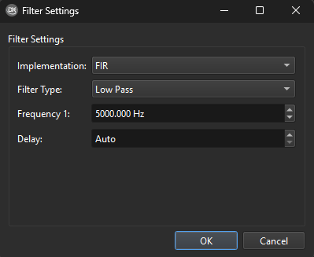
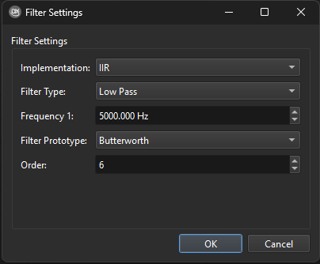

# Filtering

The **Filtering** processor applies a digital filter to the selected streams. Both **FIR** (Finite Impulse Response) and **IIR** (Infinite Impulse Response) implementations are supported, each with its own set of fields.

## Implementation

* **FIR** — Finite Impulse Response. Linear-phase, always stable; exposes the **Delay** (size) field.
* **IIR** — Infinite Impulse Response. Lower computational cost for a given roll-off; exposes the **Prototype** and **Order** fields, plus optional ripple parameters.

*Filter Settings — FIR implementation*

*Filter Settings — IIR implementation*

## Filter Type

Selects the pass shape of the filter. The fields shown below the type change with this selection.

| Filter Type   | Fields shown                                            |
| ------------- | ------------------------------------------------------- |
| **Low Pass**  | Frequency 1 (cutoff)                                    |
| **High Pass** | Frequency 1 (cutoff)                                    |
| **Band Pass** | Frequency 1 (lower), Frequency 2 (upper)                |
| **Notch**     | Frequency 1 (lower), Frequency 2 (upper)                |
| **Octave**    | Band Number → Frequency 1, Frequency 2 *(read-only)*    |
| **1/3-Octave**| Band Number → Frequency 1, Frequency 2 *(read-only)*    |

### Frequency 1 / Frequency 2

The cutoff frequencies (in Hz) for the selected pass type. Defaults: `5000.000 Hz` and `10000.000 Hz`.

For **Octave** and **1/3-Octave** filters these values are computed automatically from the **Band Number** and are not editable.

### Band Number *(Octave / 1/3-Octave only)*

The standard band index. The midband frequency is computed as:

$$
f_m = 1000 \cdot 2^{(N - 30) / s}
$$

where `N` is the band number and `s` is the number of subdivisions per octave (`1` for Octave, `3` for 1/3-Octave). Frequency 1 and Frequency 2 are then derived from the midband using the half-band ratio.

Default: `30` (which corresponds to a midband of 1 kHz).

## FIR-specific Fields

### Delay

The duration of data collected before the filter is applied. Setting this to **Auto** allows DX+ to choose an appropriate value automatically.

## IIR-specific Fields

### Filter Prototype

The analog prototype used to design the IIR filter.

* **Butterworth** *(default)* — maximally flat passband, no ripple.
* **Papoulis** — monotonic passband, optimized for transition-band roll-off.
* **Chebyshev** — sharper roll-off at the cost of passband ripple; exposes the **Passband Ripple** field.
* **Inv. Chebyshev** — flat passband with stopband ripple; exposes the **Stopband Ripple** field.

### Order

The filter order. Higher orders give a sharper roll-off at the cost of additional computation and group delay. Default: `6`.

### Passband Ripple *(Chebyshev only)*

Maximum allowable ripple in the passband, in dB. Default: `0.01`.

### Stopband Ripple *(Inv. Chebyshev only)*

Minimum attenuation in the stopband, in dB. Default: `48`.

> [!NOTE]
> Changing **Implementation** swaps the entire field set — settings from the previous implementation are not carried over. Apply the desired implementation first, then configure its fields.
