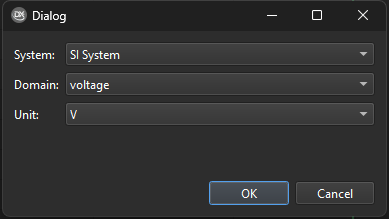

# Raw Units

The **Raw Units** processor assigns the engineering units of the raw signal *as it enters* the processing pipeline — before any filtering, conversion, or spectral processing.

> [!WARNING]
> **Raw Units is only available when the selected device is a Virtual Device.** For hardware devices, the raw units are determined by the device's channel configuration and cannot be overridden from this dialog.

*Raw Units picker*

## Fields

* **System** — the unit system the raw unit belongs to (e.g. **SI System**, **US Customary**).
* **Domain** — the physical domain of the raw signal (e.g. **voltage**, **acceleration**, **pressure**). The Unit dropdown is filtered to units in this domain.
* **Unit** — the specific raw unit (e.g. **V**, **mV**, **g**, **Pa**). Filtered by the selected System and Domain.

Click **OK** to apply the chosen units to every selected stream.
