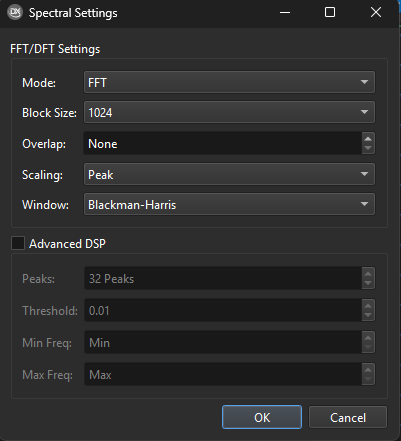
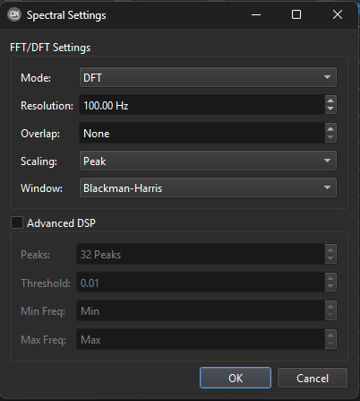
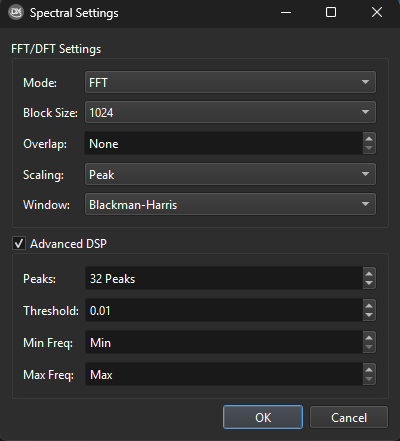

# Spectral

The **Spectral** processor produces frequency-domain output from the selected streams. It supports both FFT and DFT modes and offers optional peak detection through the **Advanced DSP** section.

## FFT / DFT Settings

### Mode

* **FFT** — Fast Fourier Transform. Operates on fixed-size blocks of samples; exposes the **Block Size** field.
* **DFT** — Discrete Fourier Transform. Computes the transform at an arbitrary frequency resolution; exposes the **Resolution** field.

*Spectral Settings — FFT mode*

*Spectral Settings — DFT mode*

### Block Size *(FFT mode)*

The number of samples processed per FFT, chosen from a list of powers of two from `128` to `131072`. The spectral resolution of a stream is its sample rate divided by the block size. Default: `1024`.

### Resolution *(DFT mode)*

The frequency resolution of the transform, in Hz. It may not exceed half the sample rate (the Nyquist rate) of the input streams. Default: `100.00 Hz`.

### Overlap %

The percentage by which consecutive blocks overlap, from `0` to `99`. Higher overlap improves temporal resolution at the cost of additional CPU. Default: `0` (shown as **None**).

### Scaling

How the output magnitude is scaled.

* **P2P** — Peak-to-Peak
* **Peak** *(default)*
* **RMS** — Root Mean Square
* **Average**

### Window

The window function applied to each block prior to the transform. Reduces spectral leakage.

* **None**
* **Hamming**
* **Blackman-Harris** *(default)*
* **Nuttall**
* **Blackman**
* **Flat-Top**

## Trigger Reference

Enable the **Trigger Reference** group to use a tachometer or digital pulse stream as the phase trigger reference for the spectrum.

* **Trigger Stream** — the tachometer or digital pulse stream to use as the reference.
* **Trigger PPR** — pulses per revolution of the trigger reference.

## Advanced DSP

Enable the **Advanced DSP** group to add peak detection to the spectral output. When disabled, no peak processor is attached to the selected streams.

*Spectral Settings — Advanced DSP enabled*

### Peaks

Maximum number of peaks reported per spectrum. Default: `32`.

### Threshold

Minimum magnitude (in the spectrum's units) for a value to be considered a peak. Default: `0.01`.

### Min Freq

Lower bound of the frequency range searched for peaks. Use `Min` (`0`) to search from DC.

### Max Freq

Upper bound of the frequency range searched for peaks. Use `Max` (`0`) to search up to the Nyquist frequency.

> [!NOTE]
> The peak detector runs on the output of the FFT/DFT stage, so any change to **Mode**, **Block Size**, **Resolution**, **Window**, or **Scaling** also affects the values reported by the peak detector.
