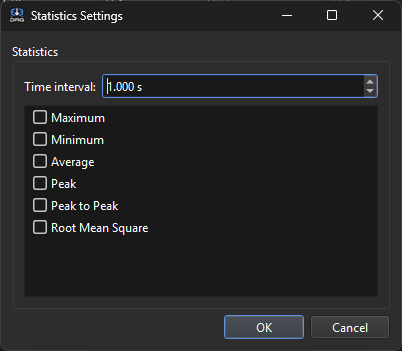

# Statistics

The **Statistics** processor calculates summary statistics for each selected stream over fixed time intervals. Select one or more cells in the **Statistics** column, then click the column header button to open **Statistics Settings**. The settings apply to every selected row.

Double-clicking a single **Statistics** cell opens a quick checklist instead, where you can enable which statistics that stream calculates without opening the full dialog.

## Statistics Settings

*Statistics Settings dialog*

* **Time interval** — the length of each interval, in seconds, used to calculate the statistics. Default: `1.000 s`.
* **Statistics** — the statistics calculated for each selected stream:
  * **Maximum** — maximum output of the signal.
  * **Minimum** — minimum output of the signal.
  * **Average** — average output of the signal.
  * **Peak** — maximum magnitude of the signal output.
  * **Peak to Peak** — maximum difference between the signal output peaks.
  * **Root Mean Square** — square root of the mean of the squares of the signal output.
