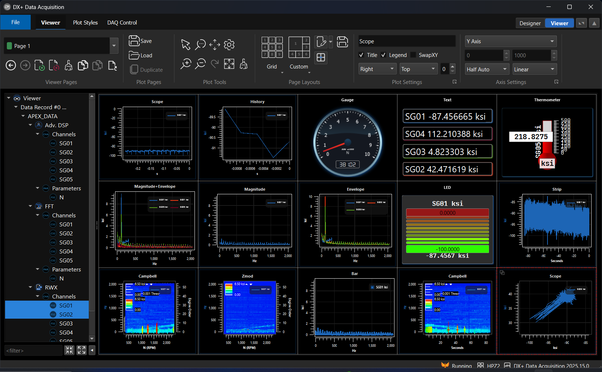

# DX+ Data Viewer

**DX+ Data Viewer** (`DX+DataViewer.exe`) is the standalone post-test visualization application for inspecting recorded **DX+** telemetry across **SQLite (`.dxdb` / `.dxdb.index`)** and **PostgreSQL** databases as well as **`.datx` / `.datx_index`**, **`.rwx`**, **`.pkx`**, and **`.h5`** binary files.

*DX+ Data Viewer displaying multiple time-domain and frequency-domain plot types*

---

## Key Capabilities

- **Unified File & Database Access**: Connect simultaneously to multiple local database archives, remote PostgreSQL servers, and binary test files via **File → Connect**.
- **Synchronized Interactive Playback**: Scrub across full recordings or selected event intervals using interactive playback sliders, **Time Sync**, and cursor-tracked seek/rewind without redundant queries.
- **Comprehensive Engineering Plot Suite**: Drag any channel onto multi-page canvases to render `Scope`, `History`, `Strip`, `Scatter`, `Graphic` (`Gauge`, `Text`, `Thermometer`, `LED`, `Bar`), `Magnitude`, `Envelope`, `Mag+Env`, `Campbell` (Time & Speed), `Zmod`, `Tracking`, `Bode`, and sortable `Table` displays.
- **Reusable Plot Templates**: Save complex multi-monitor plot layouts and trace assignments (**Plots → Plot Actions → Save**) and reload them across other recordings or tests.

> [!NOTE]
> `DX+ Data Viewer` visualizes **recorded files and databases**. To monitor live streaming data over the network, use **[DX+ Remote Viewer](../DX+RemoteViewer/README.md)**; to edit records/events or export columnar `.csv` files, use **[DX+ DB Manager](../Tools/DB%20Manager/README.md)**.

---

## Licensing

- **DX+ Data Viewer**: Checks out `DX+DATAVIEWER` (`"dx+dataviewer"`) at startup with a 5-second **ApexLM** heartbeat, alongside `APEX-FILE-STANDARD` *(included)* and `DBMS` / `VIRTUAL-MODELS` / `VIDEO-STREAM` entitlements when opening databases, 3D models, or synchronized video. See [Installing & Licensing](../introduction/installing-and-licensing.md).

---

## In This Section

- [Loading Data Stores & Playback](loading-and-playback.md) — connecting databases and binary files, querying time/event ranges, multi-part archives, and playback controls.
- [Plots Ribbon & Common Plot Options](ribbon-and-options.md) — `Pages`, `Plot Actions`, `Plot Tools`, `Page Layouts`, `Plot Settings`, `Axis Settings`, `Plot Styles`, zoom/pick shortcuts, and `General` / `Axes` / `Traces` options.
- [Time-Based & Graphic Plots Reference](time-based-plots.md) — `Scope (Time)`, `History`, `Strip`, `Scatter`, `Graphic` (`Gauge`, `Text`, `Thermometer`, `LED`, `Bar`), and `Table`.
- [Frequency-Based Plots Reference](frequency-based-plots.md) — `Scope (Frequency)`, `Magnitude`, `Envelope`, `Mag+Env`, `Campbell`, `Zmod`, `Bar`, `Tracking`, and `Bode`.
