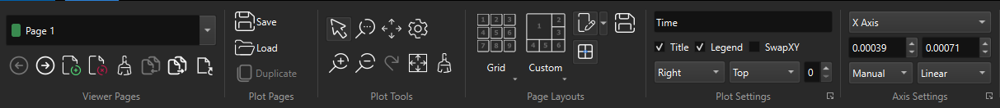
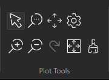
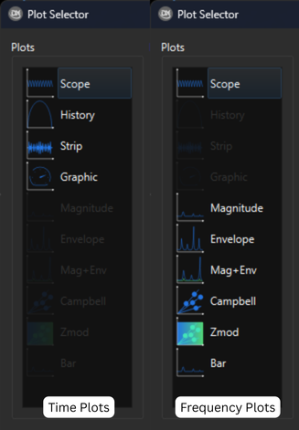
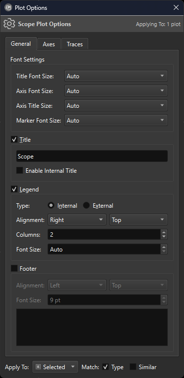
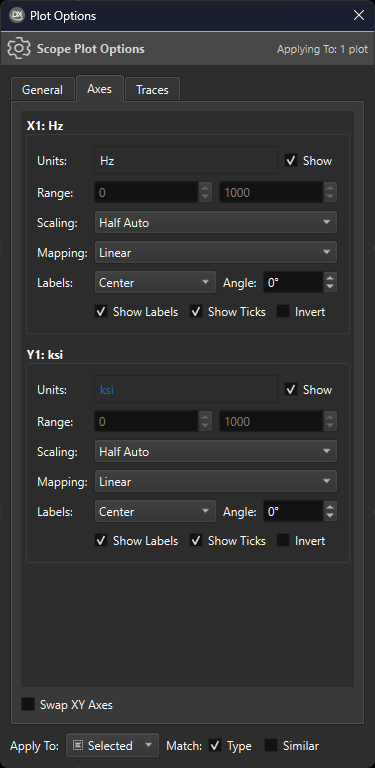
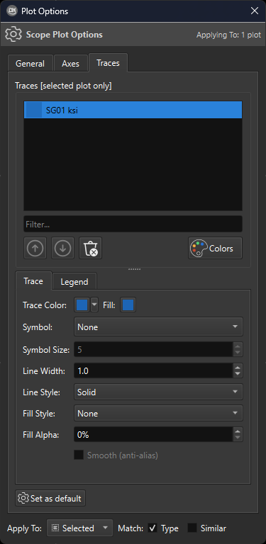

# Plots Ribbon & Common Plot Options

All Viewer visualization tools share the **Plots** and **Plot Styles** ribbon tabs and the **Common Plot Options** dialog (`General`, `Axes`, `Traces`).

*The Plots ribbon tab*

---

## Plots Ribbon Controls

Controls in **Plot Tools**, **Plot Settings**, and **Axis Settings** activate whenever you click a plot space on the canvas.

### Pages

- **Add Page** / **Delete Page**: Create or delete multi-plot dashboard pages.
- **Prev Page** / **Next Page** and **Move Page Up** / **Move Page Down**: Switch or reorder pages.
- **Popout Page**: Detach a page into its own independent window *(includes page zoom controls)*.
- **Clear All Pages**: Resets to one blank page *(with confirmation)*.
- **Clear All Docks**: Removes plots from all docks on the active page.

### Plot Actions

- **Save**: Exports your Viewer pages, layouts, plot types, and trace selections to disk.
- **Load**: Reloads saved pages — including onto designs or data stores other than the original recording as long as channel names match.
- **Export**: Exports or prints the active viewer pages *(see [Known Issues](../release-notes/known-issues.md) for current ZMod/export advisories)*.

### Plot Tools

- **Pointer**: Select traces and drop points/markers onto curves. Hold **`Shift`** while clicking to place multiple markers simultaneously.
- **Zoom** / **Zoom In** / **Zoom Out**: Box-zoom or step-zoom into a waveform or spectrum.
- **Pan**: Drag to pan across plots.
- **Expand**: Maximizes the selected plot to fill the entire page; toggle again to restore.
- **Settings**: Opens the full tabbed **Plot Options** dialog.
- **Plot Linking**: Links cursors and axis windows across plots on the current page.
- **Time Sync**: Synchronizes playback timestamps across recorded plots *(available in **DX+ Data Viewer** and **DX+ Offline Analysis**)*.
- **Clear Current Traces** / **Reset Current Page Trace Data** / **Reset All Trace Data**: Clear traces or reset buffered/peak-hold trace data.

### Page Layouts

- **Grid**: Arrange spaces cleanly (`2x2`, `2x3`, `3x3`, etc.).
- **Custom** / **Edit Layout** / **Show Layout Grid** / **Save Layout**: Place and resize spaces freely on an optional snap grid.
- **Show or hide plot docks**: Toggle plot dock borders cleanly.

### Plot Settings & Axis Settings

- **Plot Settings**: Toggle **Title**, **Auto Title** *(on by default; derives titles automatically from plotted traces)*, **Legend**, **Swap XY**, **Legend Alignment** (`Internal`: Left/Right/Center + Top/Bottom/Center; `External`: Right/Left/Top/Bottom), and **Legend Columns**.
- **Axis Settings**: Pick **Selected Axis** (**X Axis**, **Y Axis**, **Y2 Axis**), set **Start Time / End Time** (absolute-time plots) or **Min Range / Max Range**, pick **Scaling Mode** (**Manual**, **Half Auto**, **Full Auto**), and toggle **Scale Mapping** (**Linear** or **Logarithmic**).
- **Plot Styles Ribbon**: Applies color palettes, backgrounds, grid contrast, and styling presets across plots.

---

## Mouse & Keyboard Navigation Shortcuts

- **Mouse Wheel**: Zoom **X and Y axes** together *(holding both `Ctrl+Shift` behaves identically)*.
- **`Shift` + Mouse Wheel**: Zoom **Y-Axis** only.
- **`Ctrl` + Mouse Wheel**: Zoom **X-Axis** only.
- **Middle Mouse Button (`Mouse 3`)**: Performs an immediate **Zoom Reset**.
- **`Shift` + Pointer Click**: Drops multiple independent **Markers** *(Multi Mode)*.
- **`Ctrl + A` in Canvas**: Selects all plot spaces on the current page (required when applying **`1 Trace Per`** across all spaces).

---

## Common Plot Options Tabs

Drag a stream onto an empty space to see compatible plot types, then double-click a plot or click **Plot Tools → Settings** to configure **General**, **Axes**, **Traces**, and any plot-specific tabs.

*Compatible plot types offered when dragging a signal onto a plot space*

### General Tab

### Axes Tab

### Traces Tab

