# Time-Based, Graphic & Table Plots Reference

Dragging time-domain or scalar streams onto a plot space opens the **Time-Based Plots** menu, offering waveform charts, decimated session histories, XY scatter plots, **Graphic** meters, and tabular displays.

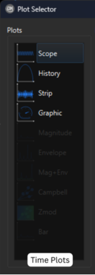
*Time-based plot options available when dragging time-domain streams*

---

## 1. Scope (Time)

Displays raw or processed time-domain waveform blocks on a per-block basis.

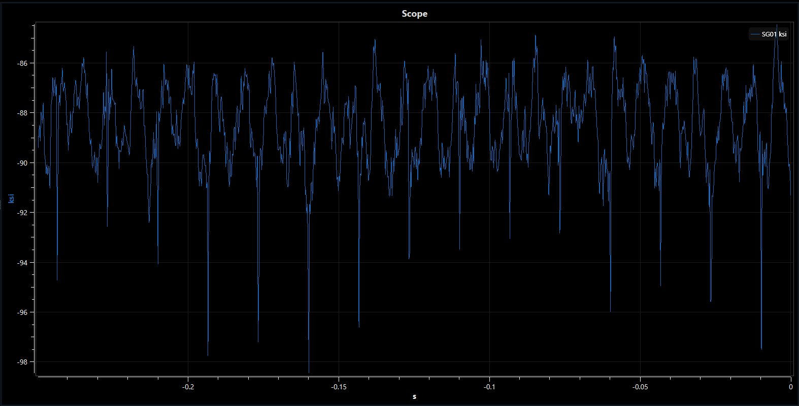

- **Axes**: X-axis can show block time (`s`, `ms`) or another dragged signal (XY waveform).
- **Plot Options**: Uses the standard `General`, `Axes`, and `Traces` tabs from [Common Plot Options](ribbon-and-options.md#common-plot-options-tabs).

---

## 2. History

Plots time-domain data over a configurable sliding time window.

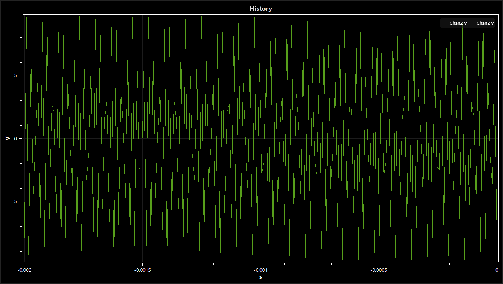

- **Axes**: X-axis can display time or another signal.
- **Automatic `32,768`-Point Min/Max Decimation**:
  - Once plotted data exceeds **32,768 points**, History automatically computes pairwise extrema over consecutive 4-point groups (**`4 points -> min + max = 2 points`**) and re-applies decimation as new samples arrive.
  - This preserves true peak-to-peak signal envelopes while capping memory and maintaining smooth 60 Hz rendering regardless of sample rate:
    - At **`1 S/s`**, History displays up to **32,768 seconds** (~9.1 hours) undecimated.
    - At **`100 kS/s`**, min/max envelope decimation engages above **`0.32768 seconds`**.
- **History Plot Options**: Adds a dedicated **History** options tab for controlling window duration.

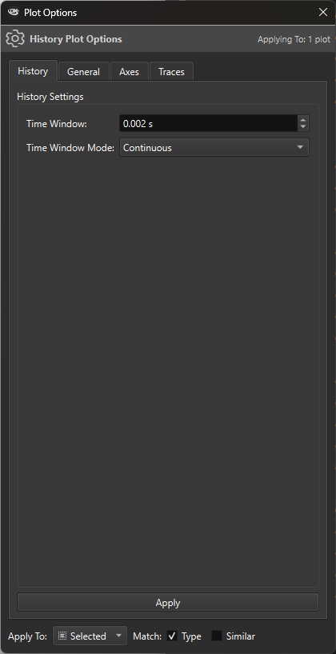

---

## 3. Strip Chart

Displays an overview strip chart across the full duration of a test or recording.

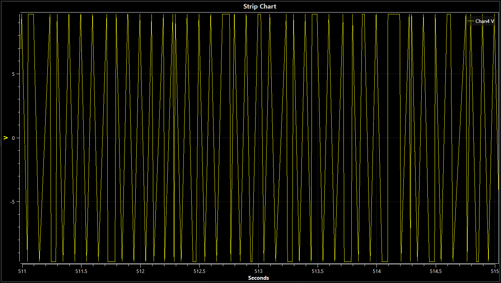

- **Axes**: X-axis can display elapsed/absolute time or another signal.
- **Automatic `32,768`-Point Min/Max Decimation**: Applies the same `4 -> 2` min/max envelope decimation algorithm as **History** once buffered points exceed `32,768`, allowing continuous full-test overview plots without slowdown.
- **Strip Plot Axes Options**: The **Axes** tab adds **Absolute Time** formatting controls for UTC/IRIG wall-clock X-axis labels.

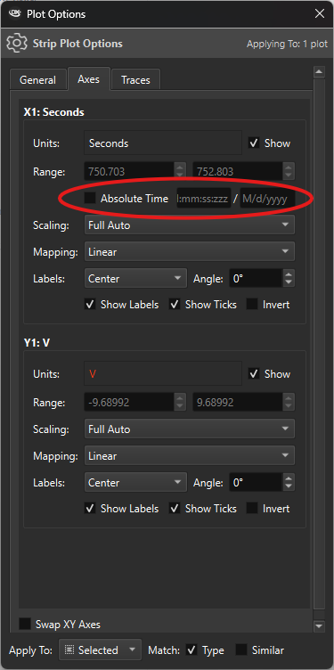

---

## 4. Scatter

Displays the current value of each signal as an individual plotted marker point.

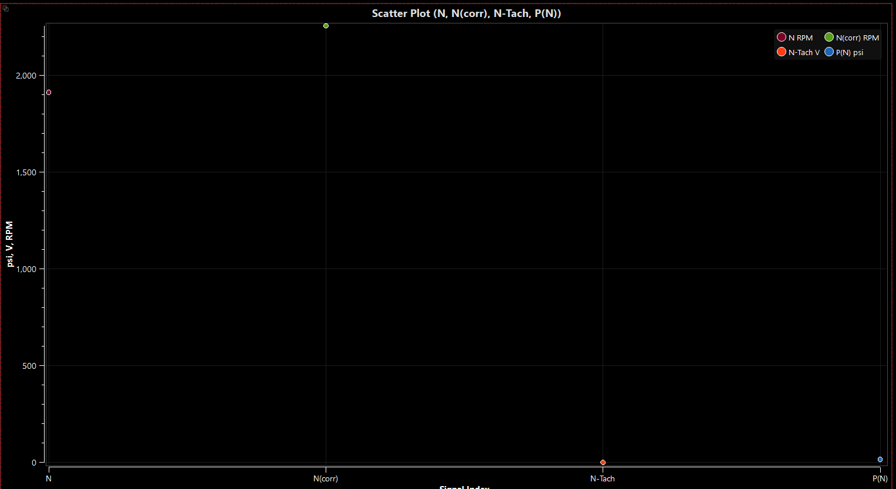

- **Two Operating Modes**:
  1. **Signal Index Mode**: Drag one or more signals onto the plot to plot each signal's current value against its index/order.
  2. **Reference Mode**: Drag a signal together with a reference parameter simultaneously to plot the signal's current value versus the reference's current value.
- **Scatter Trace Options**: The **Traces** tab includes a **Scatter** sub-tab where individual traces can be pinned to fixed X-axis positions (defaults to index order).

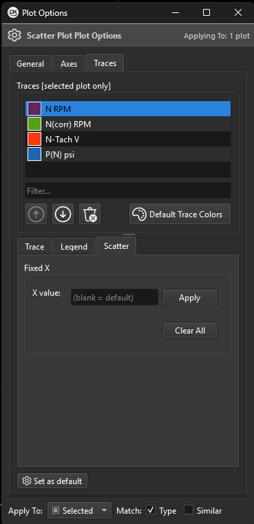

---

## 5. Graphic Meters (`Gauge`, `LED`, `Text`, `Thermometer`, `Bar`)

**Graphic** elements visualize scalar or reduced values as instrument gauges rather than Cartesian axes. Notice that Graphic Plot Options omit the `Axes` tab and provide a tailored **General** tab alongside meter-specific tabs.

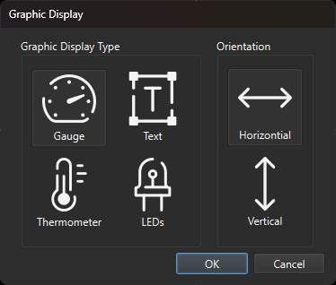

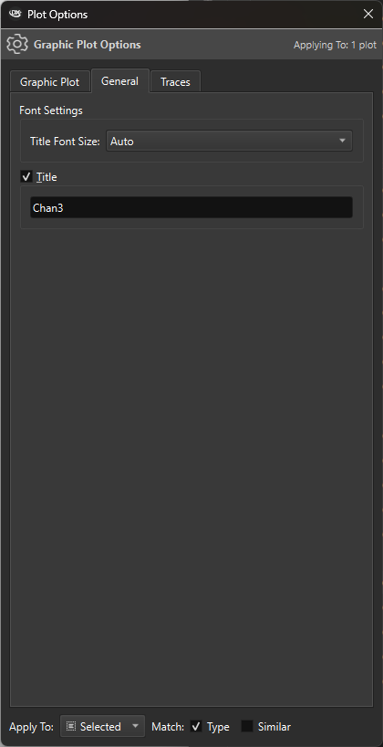

### Gauge

Meter-style radial dial with customizable scale arcs and thresholds.

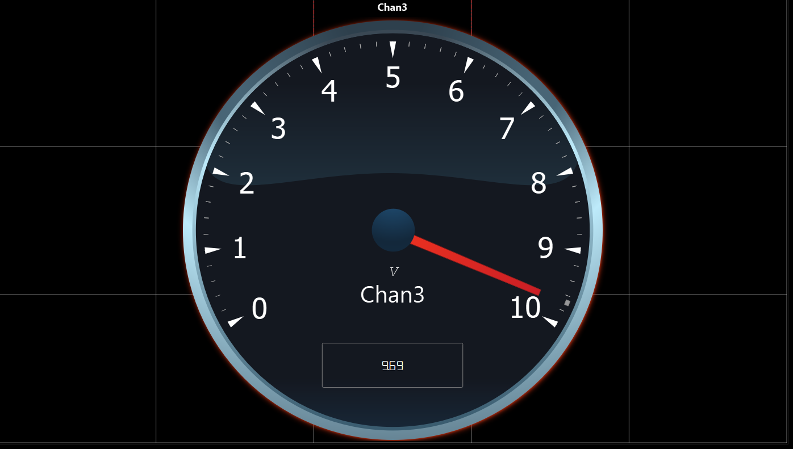

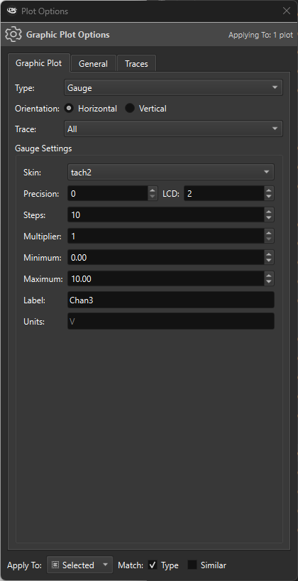

### LED

Multi-segment LED bar or status indicator. *(Note: right-clicking and editing settings when an LED was saved vertically requires re-confirming Vertical orientation; see [Known Issues](../release-notes/known-issues.md).)*

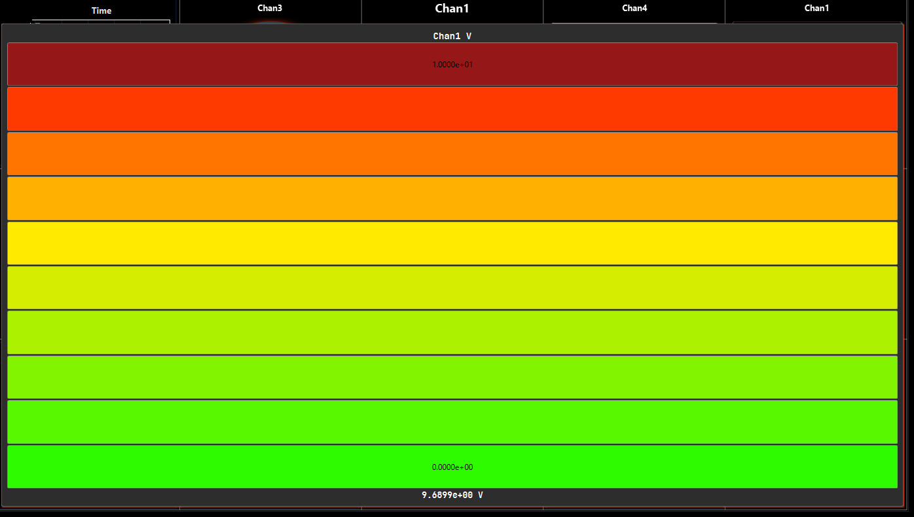

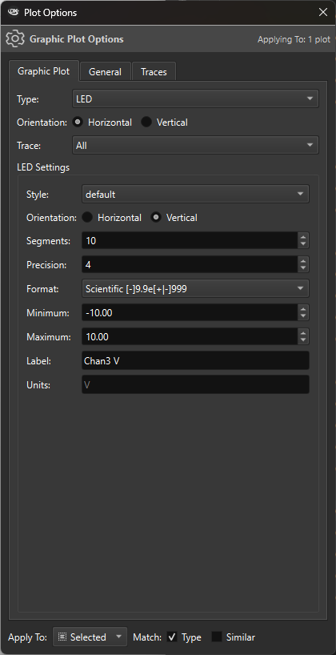

### Text

High-visibility digital text readout for scalar measurements and health statuses *(offered automatically when dragging text-type streams)*.

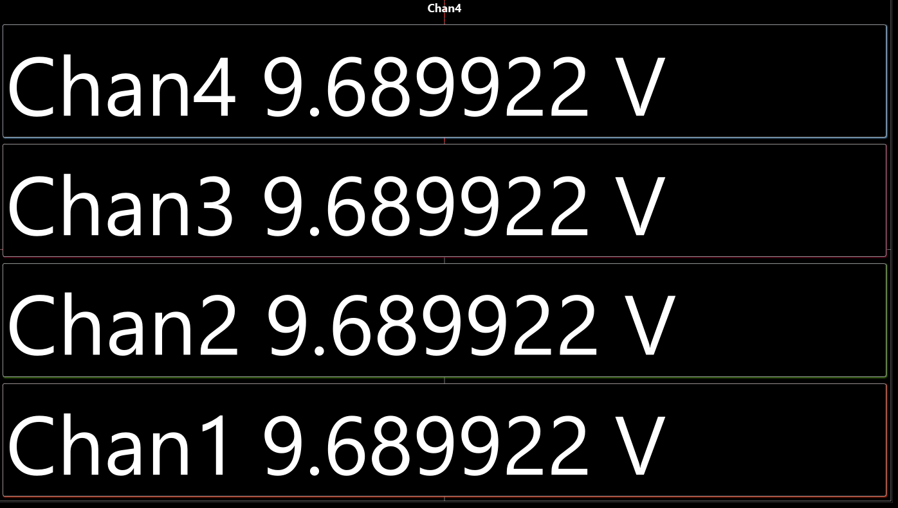

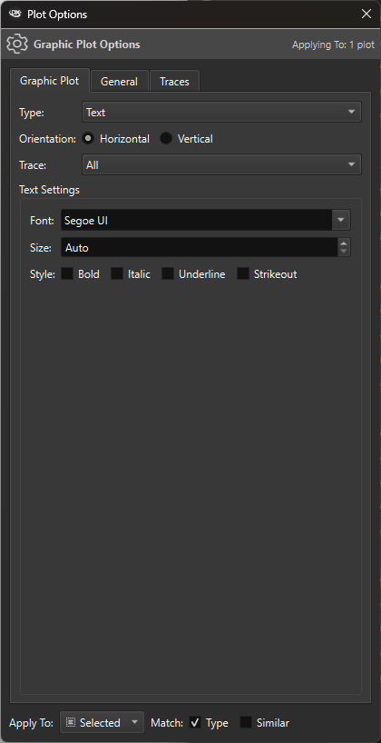

### Thermometer

Vertical thermometer column indicator with threshold styling.

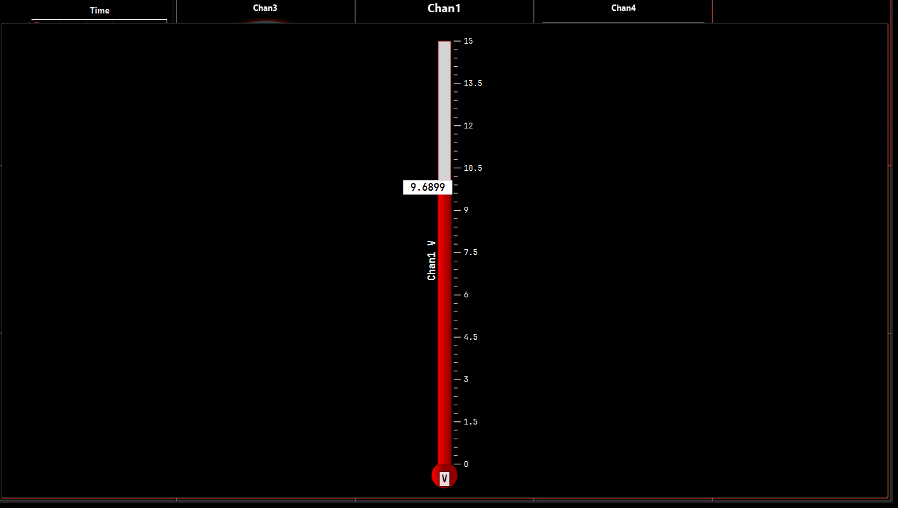

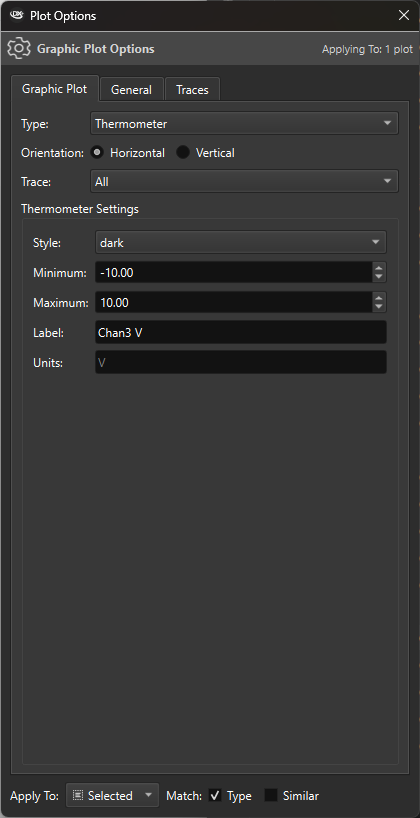

### Bar (Graphic Meter)

Filled horizontal or vertical magnitude bar meter *(switchable via **Right-Click → Display Types → Bar**)*. Configurable **Bar Settings** include:

- **Bar Style** and **Orientation** (`Horizontal` / `Vertical`)
- **Bar Minimum / Bar Maximum** and per-trace **Bar Label**
- **Format** (`Scientific`, `Fixed-point`, `General (most concise)`) and **Field Width** (`Auto` or minimum characters)

---

## 6. Table Plot

Displays both time-domain and frequency-domain stream values in a sortable spreadsheet-style table *(click any column header to sort)*.

- **Right-Click → Numeric Format**:
  - **Alignment**: `Left`, `Center`, or `Right`
  - **Format**: `Fixed`, `Scientific`, or `General`
  - **Precision**: Decimal places (or significant digits in General format; default `3`)
  - **Field Width**: Minimum width per value (`0` = no padding)
- **Notes**: Table plots have no axes, legend, or trace options. Combining incompatible vector dimensions in one table emits an **Incompatible Table Data** warning.
