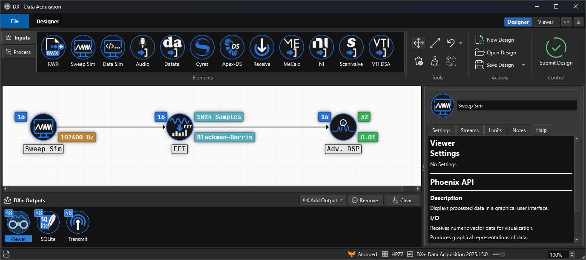

# DX+ Offline Analysis

**DX+ Offline Analysis** (`DX+AnalysisOffline.exe`) executes post-test signal processing and batch derivations across recorded **SQLite (`.dxdb` / `.dxdb.index`)** and **PostgreSQL** databases as well as **`.datx`**, **`.rwx`**, and **`.h5`** file inputs. Instead of re-running entire datasets upfront, Offline Analysis resolves multi-source records interactively on submission and compiles targeted per-trace pipelines lazily on demand when plots are opened or scrubbed.

*DX+ Offline Analysis Designer canvas for building post-test processing designs*

---

## Core Architecture & Benefits

- **Reusable Logical Designs (`.dpd` / `.json`)**: Author one template graph with `Stream Select`, wire `Signal Math`, `FDFT`, `Rev Resample`, `Order FFT`, `Mode Fit`, or `Statistics`, and apply that design across any record, event, or database archive.
- **Multi-Record & Multi-Event Filtering**: Select multiple database records and discrete events in `DxProcessDialog` and clamp analysis strictly to custom start/end date-time windows.
- **Per-Record Disambiguation (`Select Sources`)**: Resolve channels recorded under multiple sources (such as `RAW` and `Scaled`) or pick exact trigger/phase/math inputs per record before computation runs.
- **Lazy Subgraph Compilation (< 10 ms Submit)**: Graph submission registers lightweight per-record pipeline descriptors and opens zero heavy DB scans upfront. Database disjunction queries and DSP pipelines compile strictly for the streams you plot or export.
- **Headless CLI Automation (`DX+OfflineQueryCli`)**: Run offline `.dpd` graphs, multi-match disambiguation, and automated playback checks from scripts and CI pipelines without a GUI.

---

## Licensing

- **License Entitlement**: Requires `DX+OFFLINEANALYSIS` (or `DXPLUS` / `ANY`) in **ApexLM** (`dx+offlineanalysis`, 5-second heartbeat). Downstream DSP processors and database/file adapters check out their respective `ANALYSIS` pool or file/DB feature tokens on demand. See [Installing & Licensing](../introduction/installing-and-licensing.md).

---

## In This Section

- [Designer & Stream Select](designer-and-stream-select.md) — configuring `Stream Select`, `Connect To` / `Design From`, and offline file/database readers.
- [Record Selection & Multi-Match Disambiguation](record-selection-and-disambiguation.md) — `DxProcessDialog`, date-time clamping, `OfflineSourceSelectDialog` (`Select Sources` & `Processor References`), missing-stream warnings, and Viewer tree grouping.
- [Processors & Offline Outputs](processors-and-outputs.md) — downstream DSP workflows and offline database/file writers.
- [Headless Offline Query CLI (`DX+OfflineQueryCli`)](offline-query-cli.md) — command-line flags, multi-match switches, plot simulation, and exit codes.
