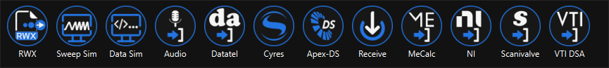
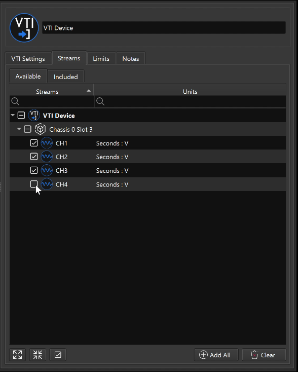

# Designer & Stream Select

In **DX+ Offline Analysis**, most post-test designs begin with the **`Stream Select`** source component rather than fixed hardware device elements, allowing one `.dpd` design to evaluate recordings from different test runs, databases, or hardware configurations.

---

## Working with `Stream Select`

`Stream Select` acts as a logical template matching database channel names inside each selected record at submission time.

### Adding and Populating `Stream Select`

1. Click **Connect To** (or **Design From**) in the **Inputs** ribbon group, or drag **`Stream Select`** from the **Inputs** palette onto the Designer canvas.
2. In the **`Stream Select`** configuration panel:
   - Choose a database connection (or click **Manage Data** inside the database browser to add a `.dxdb`, `.dxdb.index`, or PostgreSQL store).
   - Select the desired **Domain** (`time`, `frequency`, etc.), **Units** (`volts`, `g`, `psi`, etc.), **Data Type** (`number`, etc.), and **Message Type** (`vector`, `point3d`, etc.).
   - Check or type the logical stream names (`stream_names`) your downstream DSP pipeline expects. Duplicate logical names across multi-source records are automatically deduplicated.
3. Click **Output Streams** to inspect or toggle exported channels cleanly; the element badge reflects the active stream count.

### 4-Tier Stream Routing Resilience

You can freely assign custom logical output names on `Stream Select` without breaking data flow during offline execution. At runtime, `StreamSelectComponent` resolves channels across four ordered tiers:

1. **Tier 0**: Exact `streamName` or `(source_index, stream_index)` match stored in stream settings.
2. **Tier 1**: Base stream name parsed from `<Component>/<SelectedName>` or `<Component>/<DBSource>/<SelectedName>`.
3. **Tier 2**: Custom stream `logicalName()`.
4. **Tier 3**: 1:1 positional alignment fallback against the mapped database sources.

> [!CAUTION]
> **RWX Files with `Stream Select`:** Do **not** load an `.rwx` file into **`Stream Select`** — doing so is a known crash vector in Offline Analysis. Use **SQLite (`.dxdb` / `.dxdb.index`)** or **PostgreSQL** databases with `Stream Select`, or inspect `.rwx` files directly in **[DX+ Data Viewer](../DX+Viewer/DX+DataViewer/README.md)**.

---

## File & Database Input Components

Depending on your design workflow, the Phoenix offline ecosystem also defines dedicated file and database ingress components:

| Component | Supported Inputs | Key Settings |
| :--- | :--- | :--- |
| **`Stream Select`** *(Primary)* | `.dxdb`, `.dxdb.index`, PostgreSQL records | `stream_names`, `stream_domain`, `stream_units`, `stream_dtype`, `stream_mtype`; pairs with `DxProcessDialog` on Submit |
| **`DATX File Reader`** | `.datx`, `.datx_index` | `file` / `filename` path to single file or multi-part index |
| **`APEX RWX File Reader`** | `.rwx` | Direct offline block reader for RWX binary files |
| **`SQLite Input`** | `.dxdb`, `.dxdb.index` | `uri`, optional **Start Time** / **End Time**, **Only Events** (`only_data_points`), SQLite mmap/thread tuning |
| **`APEX-H5 Input`** | `.h5` | `uri`, **Only Events** (`only_data_points`) |

---

## Building the Pipeline Graph

- Switch between **Move Element Mode** and **Connect Element Mode** in the **Tools** ribbon to drag elements and wire connections from **`Stream Select`** to downstream [processors](processors-and-outputs.md).
- Attach **`APEX Viewer`** or offline writer components from **DX+ Outputs → Add Output**.
- Save designs as `.dpd` or `.json` files (**Actions → Save Design**). Dragging a `.dpd`, `.json`, or `.dxdb`/`.sqlite` file directly onto the Designer canvas is also supported.
