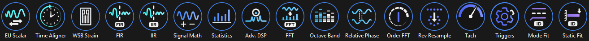
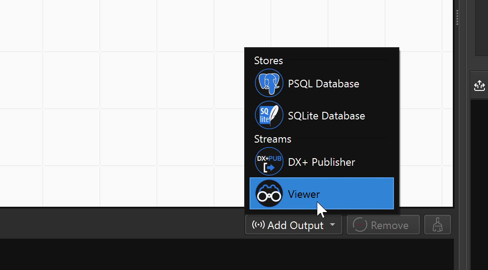
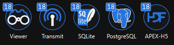

# Processors & Offline Outputs

**DX+ Offline Analysis** runs the same C++ Phoenix DSP engine used in live Online mode against historical databases and recordings, executing only the exact subgraph required when you plot or export a stream.

---

## Signal Processing in Offline Pipelines

All `ANY`-domain processors documented in the [DX+ Online Analysis Processors Reference](../DX+OnlineAnalysis/processors.md) work identically offline, with additional **multi-source perturbation awareness**:

- **Linear & Rotating Pipelines (`FDFT`, `Order FFT`, `FIR`, `IIR`, `Order Filter`, `OctaveBand`, `Statistics`, `Peak`, `Poly`, `WSB`, `Tach`, `Triggers`)**: Inherit resolved database units, range limits, and origin provenance automatically through downstream stages and inside `DATA_MESSAGES` containers (`Statistics`, `OctaveBand`).
- **Multi-Input & Reference Processors (`Signal Math`, `FDFT` Trigger Reference, `Rev Resample`, `Relative Phase`)**:
  - When upstream records contain multiple database sources (`RAW`, `Scaled`), each resolved channel choice or reference selection from **`Select Sources`** compiles into an isolated subgraph annotated with its `processor_path_label` (e.g., `C1: RAW, C6: Scaled -> Math FFT`).
  - Trigger references on `FDFT`, `Rev Resample`, and `Relative Phase` automatically pull required auxiliary reference streams via targeted SQL disjunction queries without exposing digital trigger timestamps as unwanted primary plots.
- **Modal & Solution Analysis (`Mode Fit`, `Static Fit`, `Frequency Binner`)**: Evaluate FEA limits files post-test across entire records or clamped event intervals.

---

## Offline Outputs & Exports

Attach one or more sinks in the **DX+ Outputs** dock (note that pure sinks such as file/database writers are filtered out of the interactive Viewer Signal Tree so only plottable streams appear for graphing):

| Offline Output | Destination / Role | Key Configuration |
| :--- | :--- | :--- |
| **`APEX Viewer`** | Interactive embedded post-test Viewer | Supports all [Time-Based](../DX+Viewer/General/time-based-plots.md), [Frequency-Based](../DX+Viewer/General/frequency-based-plots.md), `Table`, 3D `Model Viewer`, and `Video` plots with **Time Sync**, playback slider, and single-step controls. |
| **`DXDB Offline Writer`** | New SQLite `.dxdb` / `.dxdb.index` database | Writes processed offline results to disk for archiving, sharing, or opening in [DX+ Data Viewer](../DX+Viewer/DX+DataViewer/README.md) and [DX+ DB Manager](../Tools/DB%20Manager/README.md). |
| **`Postgres DB Offline Writer`** | PostgreSQL server | Writes processed results directly back into an enterprise PostgreSQL telemetry repository. |
| **`DATX File Writer`** | `.datx` / `.datx_index` | Exports processed streams into Dewesoft DATX containers (`Single File`, `Channels`, `Sample Rate`, or split thresholds). |
| **`APEX RWX File Writer`** | `.rwx` | Exports processed streams into APEX RWX binary files (streams grouped into one `.rwx` must match in sample rate or differ by a power of 2). |

---

## Interactive Offline Query & Playback

When you drag a processed stream onto a Viewer plot:

1. DX+ compiles only the minimal dependency chain for that trace (`ensurePipelineCompiled`) and binds the required database `(source_index, stream_index)` inputs into `Stream Select`.
2. Forward playback micro-steps reuse prefetched row spans seamlessly; rewinding or jumping outside the buffered window re-queries cleanly without blocking other traces.
3. Use **Plots → Plot Tools → Time Sync** to align sliders across time-domain plots, spectrograms, and synchronized video frames.
