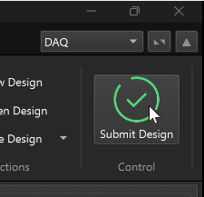
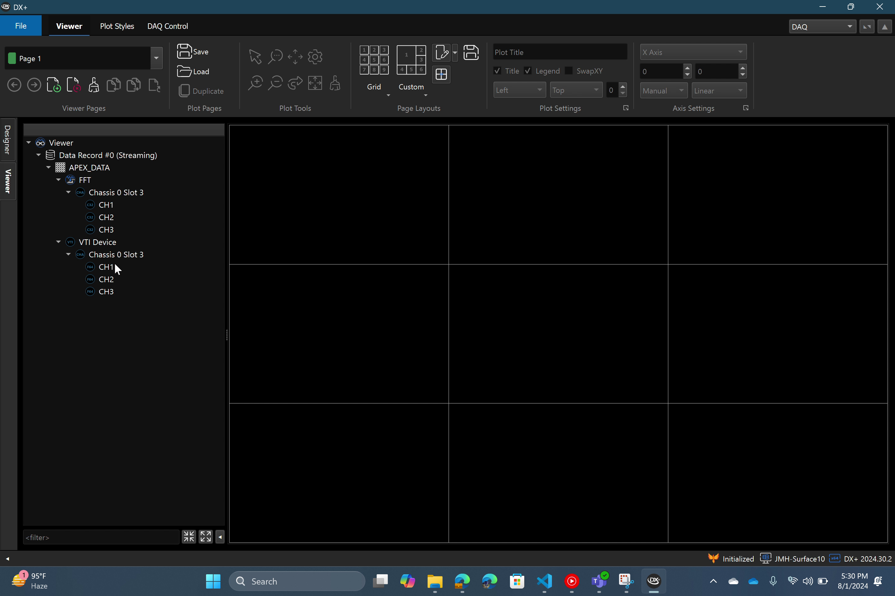

# Record Selection & Multi-Match Disambiguation

When you click **Submit Design** in **DX+ Offline Analysis**, DX+ guides you through selecting the target database records/events, filtering time windows, and resolving any duplicate channel names or multi-source references before building plots.

---

## Step 1: Database Record & Event Selection (`DxProcessDialog`)

Clicking **Submit Design** opens the offline record/event picker (`DxProcessDialog`):

1. **Choose or Add Database Connections**:
   - Pick a configured SQLite (`.dxdb` / `.dxdb.index`) or PostgreSQL connection (your most recently used connection is remembered across sessions), or click **Manage Data** to register another database in place.
2. **Select Records & Events**:
   - Expand any record (`Record 1`, `Record 2`, ...) to check the full record and/or specific recorded **Events** (`Event 1`, `Event (Unnumbered)`, or multiple distinct occurrences sharing the same event number).
   - Events are tracked individually by row so overlapping or unnumbered events keep their exact `[startTime, stopTime]` bounds.
3. **Optional Date-Time Filtering & Window Clamping**:
   - Enable **Start Time** and/or **End Time** filters to hide records and events outside your window of interest.
   - Any selected record or event whose duration extends past the active filter bounds is automatically **clamped** to:
     - `startTime = max(setStartTime, recordOrEventStartTime)`
     - `endTime = min(setEndTime, recordOrEventEndTime)`

---

## Step 2: Resolving Multi-Matched Sources & Processor References (`Select Sources`)

If a selected record contains **multiple database sources** providing the same logical stream name (for example, `CH1` stored under both **`RAW`** and **`Scaled`** sources), or if downstream processors (`Signal Math`, `FDFT` with Trigger Reference, `Rev Resample` with Trigger Reference, or `Relative Phase`) reference a multi-matched channel, DX+ opens one consolidated **`Select Sources`** dialog (`OfflineSourceSelectDialog`) covering every ambiguous parent record.

> [!NOTE]
> Unambiguous records are skipped automatically, and choices made for a parent record apply automatically to that parent record and all selected events within it.

### Dialog Controls & Workflow

- **Record Navigation (`Database / Record`, `Previous` / `Next`)**:
  - Review each listed record (`Needs review`, `Needs attention`, or `Reviewed`). Records from different databases sharing the same record number appear as separate entries.
  - The status indicator uses yellow while records still need review or valid selections, and turns green once every record is visited and valid so **OK** becomes enabled.
  - Clicking **Cancel** aborts submission cleanly without partial changes.
- **Top Group — `Select sources` & `Details...`**:
  - Check at least one database source (e.g., `RAW`, `Scaled`) whose primary channels should propagate from **`Stream Select`** through the processing graph and appear in the DataViewer tree.
  - Click **`Details...`** to inspect the full tree of `Stream Select` components, multi-matched channel logical names, and matching database sources in the current record.
- **Bottom Group — `Processor references` Tree**:
  - Displayed automatically when downstream reference-capable processors detect multiple candidate inputs:
    - **`Signal Math`**: Lists each synthesized output stream and lets you bind each input variable (e.g., `C1` from `RAW` vs `Scaled`) independently.
    - **`FDFT` *(Triggered FFT)***: Selects which upstream source drives **Trigger Reference**.
    - **`Rev Resample`**: Selects which source supplies **Trigger Reference** *(digital trigger timestamp streams are automatically excluded from primary resampled channel output)*.
    - **`Relative Phase`**: Independently selects **`Phase Reference`** (target reference FFT stream/path) and **`Trigger Reference`** (digital trigger timestamp stream).
  - Reference combo boxes retain **all** matched sources (`RAW`, `Scaled`, etc.) even if you unchecked a source in the top `Select sources` checklist, letting you derive math or triggers against a reference source without cluttering primary channel branches.
- **Help**: Click **Help** inside the dialog anytime for an interactive Markdown explanation tailored to the active record.

---

## Step 3: Unavailable Streams Warning & Viewer Tree Materialization

- **Missing Streams (`MissingStreamsMessageBox`)**: If some channels defined in your `.dpd` design do not exist in a selected record, DX+ prunes only those missing channels, keeps all valid channels running, and displays a scrollable warning listing the unavailable streams per record.
- **Compact Multi-Source Grouping in Viewer Tree**:

  - Matching root channels from multiple sources (such as `RAW` and `Scaled` versions of `CH1`) collapse under a shared expandable `CH1` tree node.
  - Independent math/processor perturbation variants (such as `TestStream` under `Signal Math`) collapse under one shared stream item, and container streams (`Statistics`, `Octave Bands`) merge cleanly underneath each primary channel (`C1 -> Statistics -> Max, Min, RMS`).
  - Dragging a multi-variant channel onto a plot opens the **Plot Source Selector** displaying clear provenance labels (for example: `RAW`, `Scaled`, `RAW -> FFT`, `RAW -> Triggered FFT (Trig: RAW)`, or `C1: RAW, C6: Scaled -> Math FFT`).
