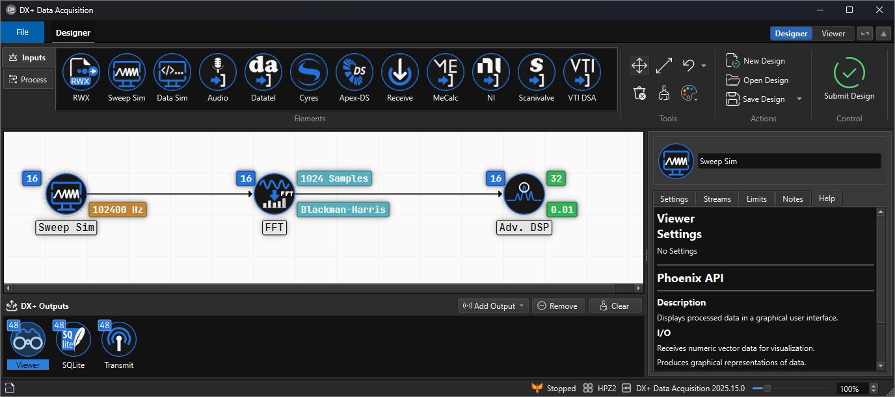

# DX+ Online Analysis

**DX+ Online Analysis** (`DX+AnalysisOnline.exe`) is the graphical node-graph environment for building, submitting, and monitoring **real-time streaming signal processing pipelines**. While [DX+ DAQ](../DX+DAQ/README.md) configures physical hardware acquisition in a tabular grid (`.dxt`), DX+ Online Analysis lets engineers wire arbitrary multi-stage DSP DAGs (`.dpd`) across live network streams, evaluate solution fits and math expressions in real time, and route results simultaneously to embedded plots, databases, binary files, 3D model viewers, and downstream DXNet subscribers.

*DX+ Online Analysis graphical Designer workspace*

---

## Key Capabilities

- **Visual Node-Graph Pipeline (`.dpd`)**: Drag inputs, processors, and outputs onto an unlimited canvas, toggle individual streams, annotate nodes, and wire parallel or branching processing chains.
- **Real-Time Streaming DSP**: Execute spectral FFT/DFT and Order FFT, digital FIR/IIR and Order filters, tachometer & angular resampling, relative phase alignment, octave bands, frequency binning, modal/static fit, and multi-stream `Signal Math`.
- **Simultaneous Multi-Sink Fan-Out**: Forward streams concurrently to the embedded live **Viewer**, **SQLite (`.dxdb`)**, **PostgreSQL**, **APEX-H5**, **DATX**, **RWX**, **3D Model Viewer/Publisher**, **DX+ IDDS Publisher**, and **DX+Net Transmitter** (for [DX+ Remote Viewer](../DX+Viewer/DX+RemoteViewer/README.md) or [OPC UA](../Services/DXNet%20Bridge%20%28OPCUA%29/README.md) / [PLC](../Services/DXNet%20Bridge%20%28PLC%29/README.md) bridges).
- **Integrated Live Viewer & DAQ Control**: Submitting a design compiles and starts the Phoenix runtime graph and switches directly to the embedded real-time Viewer and **DAQ Control** ribbon.

---

## Licensing & Startup

- **License Entitlement**: Requires `DX+ONLINEANALYSIS` (or `DXPLUS` / `ANY`) in **ApexLM** (`dx+onlineanalysis` checked out at startup with a 5-second connection heartbeat). Individual processor groups and storage/stream sinks check out feature tokens from the `ANALYSIS` pool or add-on entitlements as configured in your license; see [Installing & Licensing](../introduction/installing-and-licensing.md).
- **Hardware Graphics**: Uses desktop OpenGL sharing for hardware-accelerated 60 Hz spectral waterfalls and VTK 3D model rendering.

---

## In This Section

- [Designer Workspace & Ribbon](designer-workspace.md) — canvas tools, `Actions` and `Control` ribbons, `Inputs`/`Process`/`Outputs` docks, channel toggling, and `Submit Design`.
- [Inputs & Stream Receivers](inputs-and-streams.md) — connecting `DX+Net Receiver`, `APEX DS Receiver`, `APEX Cyres Subscriber`, and optional local sources.
- [Signal Processors Reference](processors.md) — complete settings guide for filtering, spectral/rotating machinery, acoustics, triggers, math, and modal/static fit components.
- [Outputs & Storage Sinks](outputs.md) — configuring `Viewer`, `DX+Net Transmitter`, SQLite/PostgreSQL/H5/file writers, `Model Viewer`, and iDDS output.
- [Live Submission & Monitoring](live-monitoring.md) — submitting graphs safely, using **DAQ Control** & limits, and troubleshooting runtime logs in the Console dock.
