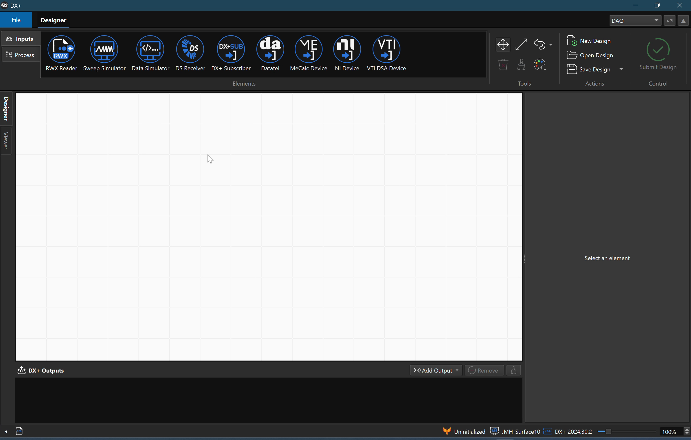
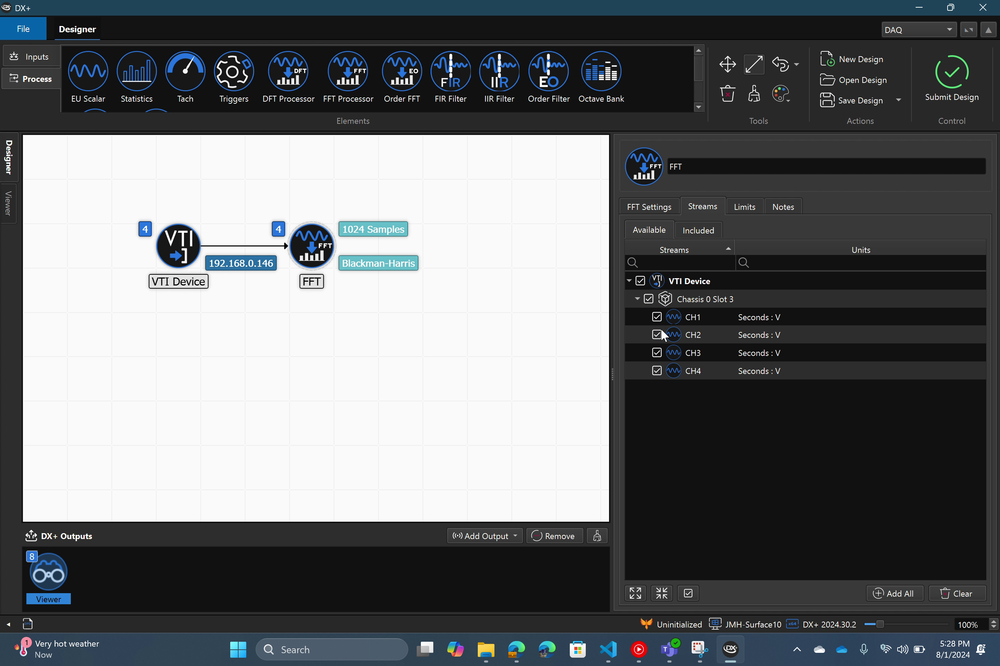
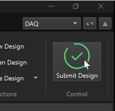
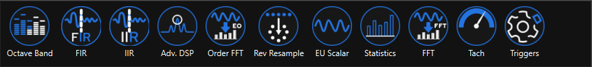
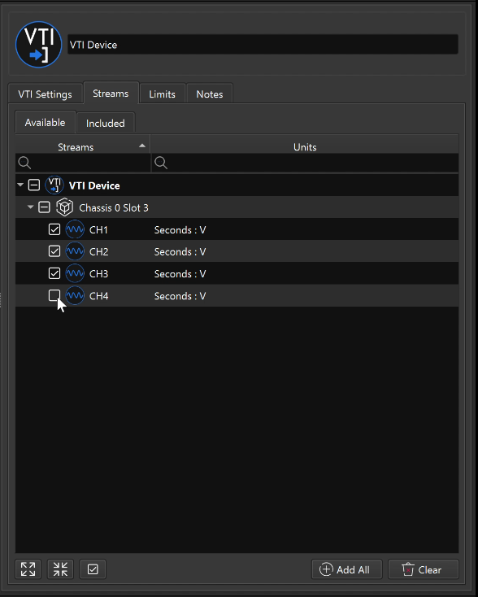
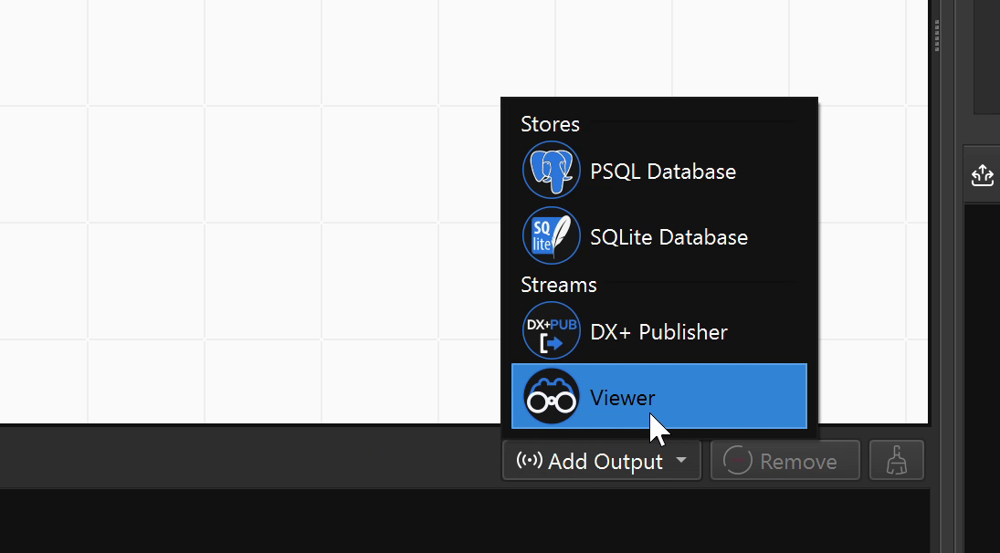

# Designer Workspace & Ribbon

The **Designer** view in **DX+ Online Analysis** pairs a node-graph canvas with left-hand element palettes, a top ribbon bar, a right-hand **DX+ Outputs** dock, and bottom/side inspection panels for settings, streams, limits, and diagnostics.

---

## Ribbon Bar Controls

The Designer ribbon is organized into four functional groups:

### 1. Actions

- **New Design**: Clears the current graph and resets the canvas to an empty design. Prompts to save if unsaved changes exist.
- **Open Design**: Opens a saved `.dpd` or `.json` design graph file from disk (drag-and-drop onto the canvas is also supported for `.dpd` and `.json` files).
- **Save Design** / **Save Design As**: Serializes the complete graph topology, element positions, channel selections, range limits, and output configurations to a `.dpd` (or `.json`) project file.

### 2. Tools

- **Move Element Mode**: Default canvas pointer mode for selecting, dragging, and arranging element nodes.
- **Connect Element Mode**: Draws directed data-flow connections by clicking and dragging from an upstream component (Input or Processor) to a downstream component (Processor).

*Connecting an upstream input stream to an FFT processor element*

- **Undo / Redo**: Steps backward or forward through graph edits (add, delete, move, connect, disconnect, enable/disable, rename, notes).
- **Connection Color**: Customizes wire color for visual organization in complex multi-bus designs.
- **Delete Element**: Removes selected elements and their attached connections from the scene.
- **Clear Design**: Removes all nodes and wires from the current canvas.

### 3. Inputs *(Design Ribbon Group)*

- **Connect To**: Opens connection dialogs for stream/data sources.
- **Design From**: Builds an initial graph scaffold from an existing data file.
- **Open Files**: Opens supported file inputs directly.

### 4. Control

- **Submit Design**: Compiles the visual graph into Phoenix runtime `GraphJson` (`MODE_ONLINE_ANALYSIS`), validates licensing and component settings, initializes upstream hardware/stream connections, and transitions cleanly into the embedded **Viewer** tab.

> [!IMPORTANT]
> **Model Loading Submit Guard:** If a 3D FEA geometry model or Campbell/ModView visualization is currently loading on GPU/OpenGL worker threads, **Submit Design** blocks submission and alerts you until rendering finishes so the UI cannot deadlock. Always wait for **Submit Design** to finish before clicking **Start** in **DAQ Control**.

---

## Palettes, Docks & Side Tabs

### Left Palette (`Inputs` & `Process`)

- **Inputs Tab**: Houses stream receivers (`DX+Net Receiver`, `APEX DS Receiver`, `APEX Cyres Subscriber`) and, when enabled by installation configuration, direct device/simulator components. Drag elements onto the canvas to instantiate them.
- **Process Tab**: Lists all available DSP components grouped visually on the palette (`FFT/DFT`, `Order FFT`, `FIR`, `IIR`, `Order Filter`, `OctaveBand`, `Frequency Binner`, `Peak`, `Poly`, `RelativePhase`, `Rev Resample`, `SignalMathProcessor`, `Mode Fit`, `Static Fit`, `Stats`, `Units Processor`, `Tach`, `Time Aligner`, `Triggers`, `Wheatstone Bridge - Strain`).

### Center Canvas & Badges

- **Stream Count Badges**: Every placed element displays a blue badge indicating the count of active enabled output streams propagating out of that node.
- **Right-Click Context Menu**: Rename element labels, toggle **Enabled / Disabled** state, add sticky documentation notes, or remove connections.
- **Enabling & Disabling Individual Streams**: Select any element and use the bottom/side **Output Streams** inspector tab to uncheck unneeded channels so they do not consume CPU, network bandwidth, or disk space downstream.

*Unchecking channels in an element's stream list updates its badge count and prunes downstream traffic*

### Bottom Inspector Tabs

Selecting a node on the canvas populates two side/bottom inspector tabs alongside component-specific settings:

- **Output Streams**: Inspect or toggle individual output channels, inspect units (`domain : unit`), and verify stream names.
- **Range Limits**: Configure per-stream `Min Value`, `Max Value`, warning `%`, and alert `%` thresholds evaluated in real time during acquisition and surfaced in the Viewer.
- **Component Settings & Help**: Adjust component parameters (many components also expose an embedded **Help** reference).

### Right Dock (`DX+ Outputs`)

Click **Add Output** in the **DX+ Outputs** dock to attach one or more sink endpoints (`Viewer`, `SQLite Database`, `PostgreSQL`, `APEX-H5`, `DX+ Transmit`, `DATX/RWX File Writer`, `Model Viewer`, `Model Publisher`, `IDDS Publisher`). Expand an output card to select which upstream source groups and individual streams flow into that sink.

### `DX+ Console` Dock

Displays timestamped runtime logs (`phoenixLog`) and detailed component setup/execution errors (`phoenixError`), helping verify network discovery, sample-rate mismatches, or buffer warnings during live operation.
