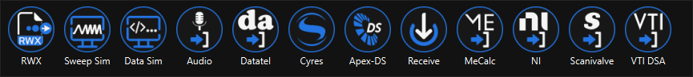

# Inputs & Stream Receivers

**DX+ Online Analysis** ingests live telemetry streams over network transports (and, depending on package configuration, optional replay or hardware sources). Drag an input element from the **Inputs** tab onto the Designer canvas, configure its connection parameters, and click **Pull Setup** to import its stream catalog before wiring downstream processors.

> [!NOTE]
> In standard **DX+** release installations (`DXPLUS_ONLINE_STREAM_INPUTS_ONLY`), direct chassis setup for Mecalc, Pacific, HGL, Scanivalve, VTI, NI, Dewesoft, PSI 9016, and Datatel hardware is centralized in **[DX+ DAQ](../DX+DAQ/README.md)**, while **DX+ Online Analysis** focuses on subscribing to live **`DX+Net`** and **`APEX DS`** network streams. This keeps hardware setup deterministic in one place while letting multiple Online Analysis workstations subscribe to live telemetry concurrently.

---

## Primary Online Stream Receivers

### `DX+Net Receiver` (`DXPNetReceiverComponent`)

Subscribes to live binary telemetry streams published by [DX+ DAQ (`Transmit`)](../DX+DAQ/outputs/transmit.md), another **DX+ Online Analysis** instance ([`DX+Net Transmitter`](outputs.md#dxnet-transmitter-dxpnettransmittercomponent)), [DXNet Bridge (OPC UA)](../Services/DXNet%20Bridge%20%28OPCUA%29/README.md), or [DXNet Bridge (PLC)](../Services/DXNet%20Bridge%20%28PLC%29/README.md).

- **Discovery & Addressing**:
  - **IP / Port**: Enter the publisher's IP address and control port (or use network discovery for `_dxnet._tcp.local`). Note that `DX+Daq` / `DX+AnalysisOnline` Transmit elements default to port **`27026`**, while standalone DXPNet bridge services (`dx+opcua`, `dx+plc`) default to ports **`27126`** and **`27136`** (within the `27126`–`27176` ZeroMQ range).
  - **Output Rate (`output_rate`)**: Target output dispatch cadence in Hz *(default `10 Hz`)*.
- **Pull Setup**: **Must be clicked** after entering or changing the endpoint address so Online Analysis queries `PUB_INFO` / `get_streams` and populates the channel list and engineering units for downstream wiring.
- **License Feature**: `DXNET-RX`.

### `APEX DS Receiver` (`DSNetReceiverComponent`)

Subscribes to legacy and high-speed **APEX DS (`DSNet`)** hardware servers using the `DSAPI` network protocol (`10995` default, range `10990`–`10999`).

- **IP Address**: IPv4 address of the DS host *(default `127.0.0.1`)*.
- **Port**: DS instance port *(default `-1` / **Auto** to discover the active DS server at the target IP)*.
- **Password**: Enter if the target DS server enforces password authentication.
- **Output Rate (`output_rate`)**: Dispatch cadence in Hz *(default `10 Hz`)*.
- **Pull Setup**: **Required** to negotiate peer setup and populate incoming channels.
- **License Feature**: `DS-RX`.

### `APEX Cyres Subscriber` (`CyresWsComponent`)

Connects to a **Cyres WebSocket** telemetry server (`ws://`).

- **Host / Port**: WebSocket server address and port *(default `127.0.0.1:8080`)*.
- **Target Path**: WebSocket URL route *(default `/cyres`)*.
- **Pull Setup**: **Required** to establish the handshake and discover available streams.
- **License Feature**: `CYRES-RX`.

---

## Additional Input Sources *(When Enabled)*

Depending on your licensed installation profile, the **Inputs** palette may also include local replay, audio, simulation, or direct device elements documented in the [DX+ DAQ Devices Guide](../DX+DAQ/devices/README.md):

| Input Element | Description | Primary Settings |
| :--- | :--- | :--- |
| **`APEX Data Simulator`** | Synthesizes multi-channel simulated waveforms for testing graphs without live hardware. | Stream count, sample rate, waveform parameters |
| **`Frequency Sweep Simulator`** | Generates swept-sine test signals across channels to validate FFT, Order, and filter pipelines. | Sweep range, duration, amplitude, rate |
| **`APEX RWX Device`** | Replays an `.rwx` recording at `1x`, `10x`, `100x`, `1000x`, or `Max` speed *(optional Loop)*. | File path (`filename`), `playback`, `loop` |
| **`Audio Input`** | Streams live PCM audio from a host sound interface / microphone. | Audio device selection, sample rate |
| **Hardware Plugins** | Integrated and receiver drivers (`Datatel`, `Mecalc`, `Pacific 6000/6700`, `HGL`, `ScanivalveDevice`, `VTIDevice` / `VTI10xxADevice`, `NI`, `DewesoftNetComponent`, `PSI 9016`). | See [DX+ DAQ Integrated & Receiver Devices](../DX+DAQ/devices/README.md) |
