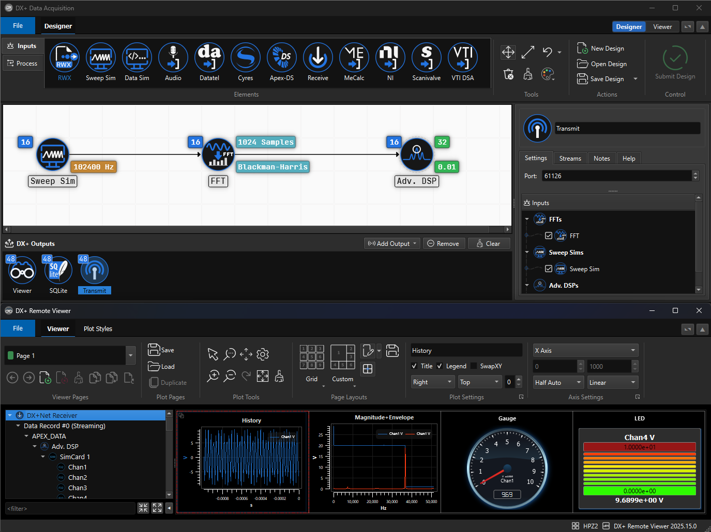
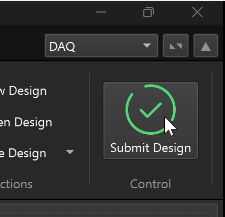
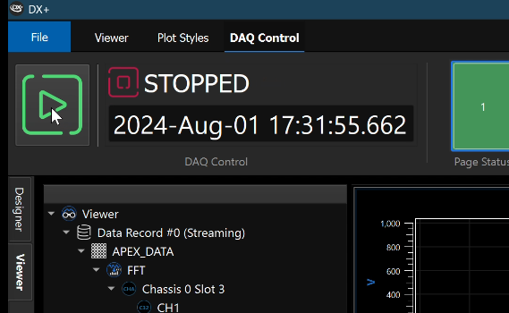

# Live Submission & Monitoring

Once your Online Analysis graph is wired and outputs are enabled, submit the design to start real-time execution and monitor telemetry in the embedded **Viewer**.

---

## Submitting a Graph

1. Verify every stream-receiver input (`DX+Net Receiver`, `APEX DS Receiver`, `APEX Cyres Subscriber`) has completed **Pull Setup** and shows non-zero channel badges.
2. Confirm at least one sink is enabled in **DX+ Outputs** (typically **Viewer**, plus optional **SQLite/PostgreSQL** storage or **DX+ Transmit**).
3. Save your `.dpd` design file (**Actions → Save Design**).
4. Click **Submit Design** in the **Control** ribbon group.

### What Happens on Submit

- DX+ checks `isAnyModelLoading()` to confirm no 3D FEA geometry or shader updates are mid-flight, builds a `MODE_ONLINE_ANALYSIS` `GraphJson`, and submits it to the native C++ Phoenix execution engine (`QtPhoenixOnlineCppInterface`).
- Previously cached limit alerts (`PhoenixAlertCache`) are cleared and prior Viewer data sources are replaced cleanly so only the active design's streams and thresholds appear.
- Stream routing uses unique 32-bit composite keys (`Message::getLongId(sourceIndex, streamIndex)`), preventing topic collisions even when multiple processors emit channels with identical logical names.
- DX+ automatically switches to the embedded **Viewer** tab ready for acquisition.

> [!NOTE]
> Switching back to **Designer**, changing any parameter, toggling channels, or editing connections requires clicking **Submit Design** again so the running engine receives the updated graph.

---

## Controlling Live Acquisition (`DAQ Control`)

Select the **DAQ Control** ribbon tab above the Viewer to control execution:

1. **Start / Stop**: Begins live pipeline processing (**RUNNING**). Click again to halt (**STOPPED**).
2. **Record**: Starts continuous writing to database/file outputs that have **All Data** enabled (**RECORDING**).
3. **Event / Next**: Opens and increments numbered test events (`APEX_DATAPOINT`) with event flags, **Metadata**, and **Notes** (**EVENT REC**).
4. **Limits (`R` / `F`)**: Click either status indicator to inspect per-channel **Range Limits (`R`)** and **Frequency/Modal Limits (`F`)** warnings and alerts.
5. **System Usage & Store Usage**: Track host `RAM`, `CPU`, `NET` utilization alongside active database `DISK` free space and ingestion `RATE`.

For complete details on live plot layouts, cursors, zoom shortcuts, and limit alert behavior, see the **[DX+ Remote Viewer Guide](../DX+RemoteViewer/README.md)** and **[DX+ Data Viewer Plot Reference](../DX+DataViewer/time-based-plots.md)**.

---

## Diagnostics & Error Recovery

- **`DX+ Console` Dock**: Monitor real-time sampling jitter notes, ZeroMQ queue watermarks, and receiver reconnection events (`phoenixLog`).
- **Error Popups**: Critical component failures surface once in the Error Dialog without UI lockup loops. If a network upstream publisher restarts, `DX+Net Receiver` or `Submit Design` re-synchronizes stream descriptors cleanly.
- **License Heartbeat**: `DX+AnalysisOnline` polls ApexLM every **5 seconds** and automatically reconciles checkouts across transient license-service restarts. If the license server becomes permanently unreachable, active acquisition halts safely with a notification.
