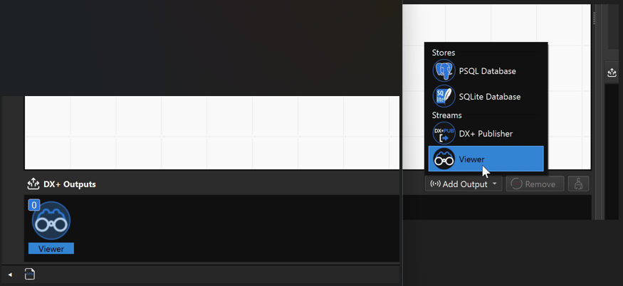
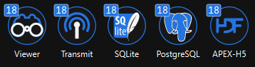

# Outputs & Storage Sinks

Add sinks from the right-hand **DX+ Outputs** dock using **Add Output** to route any combination of raw and processed streams to live viewers, databases, files, 3D model displays, or network subscribers concurrently.

---

## Live Visualization & Network Transmitters

### `APEX Viewer`

Forwards selected streams to the built-in real-time **Viewer** tab.

- Check groups or individual streams in the output card's **Inputs** tree.
- Disabling a stream in `APEX Viewer` hides it from the Viewer Signal Tree without stopping upstream DSP computation or database recording.

### `DX+Net Transmitter` (`DXPNetTransmitterComponent`)

Publishes selected streams over ZeroMQ (`REP`/`PUB`) with mDNS service discovery (`_dxnet._tcp.local`) for consumption by [DX+ Remote Viewer](../DX+RemoteViewer/README.md), [DXNet-Rx](../DX+RemoteViewer/connecting-and-streams.md#dxnet-rx-companion-viewer-windows--android), other **DX+ Online Analysis** systems, [DXNet Bridge (OPC UA)](../Services/DXNet%20Bridge%20%28OPCUA%29/README.md), or [DXNet Bridge (PLC)](../Services/DXNet%20Bridge%20%28PLC%29/README.md).

- **Port**: Control port (`27026` default in Designer UI; ZeroMQ port range `27126`–`27176` or auto-assigned `-1` supported in Phoenix).
- **Advanced Buffer Keys**: `zmq_maxdelay` (`0.1 s`), `zmq_maxbuffer` (`10,000,000` bytes), `zmq_maxalloc` (`1,000,000,000` bytes), `zmq_maxhistory` (`60.0 s`).
- **License Feature**: `DXNET-TX`.

### `Model Viewer` & `APEX DX+ Model Publisher`

- **`Model Viewer`**: Renders real-time structural/modal analysis outputs alongside 3D FEA geometry in the embedded VTK Model tab (requires `VIRTUAL-MODELS`).
- **`APEX DX+ Model Publisher`** *(Model Transmit)*: Broadcasts computed model analysis and solution fit packets over ZeroMQ (`port`, default `27026` / `-1` auto) to remote model viewers.

### `DX+ IDDS Publisher` (`IddsOutput`)

Publishes formatted telemetry packets to an **iDDS** network (`idds_node_id`, default `ApexDX+00001`; `max_transactions`, default `20`; requires `IDDS-TX`).

---

## Database & Binary File Sinks

| Output Component | Format / Target | Key Configuration Settings |
| :--- | :--- | :--- |
| **`DXDB Writer Component`** *(SQLite Output)* | `.dxdb` / `.dxdb.index` | **Store** path (`storename`), **Commit Time** (`1.0 s`), **All Data** *(checked = record continuously while recording is active; unchecked = `eventmode=true`, events only)*, **Optimize** (index on close), partitioning (`db_parts`: `none` / `sources` / `streams`), file splitting (`db_split_condition`: `none` / `size` / `time` / `event` + `db_split_value`). *License: `DBMS`* |
| **`Postgres DB Writer Component`** | PostgreSQL server | **Host** (`localhost`), **Port** (`5432`), **Username**, **Password**, **Database**, **Data Table** (`APEX_DATA`), **Insert Method** (`Standard`, `Pipeline`, `Copy`), **Connections** (`num_connections`), **Update Rate** (`commit_time` `1.0 s`), **All Data** (`eventmode`). *License: `DBMS`* |
| **`APEX-H5 Output`** | `.h5` HDF5 container | **H5 File Path** (`storename`), **Write Interval** (`commit_time` `1.0 s`), **Event Mode** (`eventmode`). *License: `APEX-FILE-STANDARD`* |
| **`DATX File Writer`** | `.datx` / `.datx_index` | **Monitor Directory** (`/data/monitor`), **Event Directory** (`/data/event`), **Events Only** (`eventmode`), **Group by Sample Rate**, **FileParts** (`Single File`, `Sample Rate`, `Channels`), **FileSplitCondition** (`None`, `Time`, `Size`, `Event`), **FileSplitValue**. *(`Single File` requires identical sample rates on all streams in the file.)* |
| **`RWX File Writer`** | `.rwx` | **Monitor Directory**, **Event Directory**, **Events Only**, **Group by Sample Rate**, **FileParts** (`Single File`, `Sample Rate`, `Channels`), **FileSplitCondition**, **FileSplitValue**. *(Combined streams in one `.rwx` must share a sample rate or differ by an exact power of 2.)* |

> [!NOTE]
> Database and file sinks only write telemetry while acquisition is **RECORDING** (or **EVENT REC** if **Events Only / All Data disabled** is active). Running acquisition (**Start**) without enabling **Record** or **Event** streams live plots without writing disk records.
