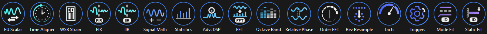

# Signal Processors Reference

All **DX+ Online Analysis** processors are domain-independent (`ANY`) components and behave identically in real-time Online pipelines and post-test [Offline Analysis](../DX+OfflineAnalysis/README.md). Drag any processor from the **Process** tab, connect an upstream element using **Connect Mode**, configure parameters, and re-click **Submit Design** to apply changes.

> [!TIP]
> Check **Output Streams** after wiring a processor to verify inherited units (`domain : unit`) and disable unused intermediate channels before sending data to disk or remote viewers.

---

## 1. Signal Conditioning & Engineering Unit Conversion

| Processor | Purpose | Key Settings & Modes |
| :--- | :--- | :--- |
| **`Units Processor`** | Assigns or overrides raw physical system/domain/unit metadata for virtual or untyped inputs. | **System** (`SI`, `US Customary`), **Domain**, **Unit** |
| **`Poly` *(EU Scalar)*** | Applies polynomial EU calibration, integration/differentiation, unit conversion, and final linear scaling. | **Scaling Only** (`Scale`, `Offset`); **EU Calibration** (polynomial `Order`, `c₀..cₙ`); **Unit Conversion** (`Standard`, `Integrate`, `Integrate x2`, `Differentiate`; `AC` or `DC` coupling with initial integral values; `SI` / `US Customary`) |
| **`Wheatstone Bridge - Strain`** | Converts raw bridge voltage/excitation into strain or stress (Hooke's Law). | **Gage Resistance** *(default `350 Ω`)*, **Gage Factor** *(`2.0`)*, **Excitation** (`5 V` etc.), **Bridge / Gage Configuration** (`Full`, `Half`, `Quarter`), **Poisson's Ratio**, **Lead Wire Resistance**, **Strain Units** (`strain`, `millistrain`, `microstrain`), optional **Stress Conversion** (**Young's Modulus**, stress unit) |
| **`SignalMathProcessor`** | Evaluates algebraic math expressions across one or more time-synchronized input streams to synthesize derived channels. | **Math Operations** (`result = {CH1} + {CH6}`, `units` override `Automatic` or registered unit). See details below. |
| **`Time Aligner`** | Shifts stream timestamps to synchronize mixed-latency hardware or apply IRIG timing. | **Mode**: `Offset` (**Time Offset** `h/m/s`) or `Irig` (**Irig Stream**) |
| **`Stats` *(Statistics)*** | Computes interval summary metrics packaged in an expandable container stream (`DATA_MESSAGES`). | **Time interval** *(seconds)*; checkboxes for **Maximum**, **Minimum**, **Average**, **Peak**, **Peak to Peak**, **Root Mean Square** |

### Using `SignalMathProcessor`

- Define each expression with output stream name (`result`), expression (`{StreamName}` tokens combined with standard arithmetic operators/functions), and optional **Output Unit** (`Automatic` preserves the inherited unit; explicit units relabel the result without rescaling numbers).
- At least one valid operation must be configured for `Signal Math` to emit output streams.

---

## 2. Digital & Order Filtering

| Processor | Purpose | Key Parameters |
| :--- | :--- | :--- |
| **`FIR`** | Linear-phase, unconditionally stable Finite Impulse Response filter. | **Filter Type**: `Low Pass`, `High Pass` (`Frequency 1`), `Band Pass`, `Notch` (`Frequency 1` & `Frequency 2`), `Octave`, `1/3-Octave` (**Band Number**, default `30` = `1 kHz` midband); **Delay** (`Auto` or custom duration) |
| **`IIR`** | Recursive Infinite Impulse Response filter for lower CPU cost. | **Filter Prototype**: `Butterworth` *(default)*, `Papoulis`, `Chebyshev` (**Passband Ripple** dB, default `0.01`), `Inv. Chebyshev` (**Stopband Ripple** dB, default `48`); **Order** *(default `6`)*; same **Filter Type** choices as FIR |
| **`Order Filter`** | Tracks and extracts or rejects specific engine orders relative to a tachometer RPM stream. | Target order center, bandwidth, and RPM/tach reference stream |

---

## 3. Spectral, Rotating Machinery & Peak Processing

| Processor | Purpose | Key Parameters & Behavior |
| :--- | :--- | :--- |
| **`FDFT` *(FFT / DFT)*** | Converts time or angle-domain streams to complex spectra (`Magnitude`, `Phase`, `Envelope`). | **Mode**: `FFT` (**Block Size** `128`–`131072`, default `1024`) or `DFT` (**Resolution** Hz, default `100 Hz`); **Overlap %** (`0`–`99`, default `0`); **Scaling** (`Peak` default, `P2P`, `RMS`, `Average`); **Window** (`Blackman-Harris` default, `None`, `Hamming`, `Nuttall`, `Blackman`, `Flat-Top`); optional **Trigger Reference** (**Trigger Stream** + **Trigger PPR**) |
| **`Order FFT`** | Computes order-domain spectra synchronized to rotational speed / angle-resampled inputs. | Order resolution, max order, overlap, window, and scaling |
| **`Tach`** | Converts analog threshold pulses or digital pulse timestamps into shaft speed (`s : RPM`). | **Trigger Type** (`Analog` / `Digital`), **PPR** *(default `1.0`)*, Analog **Min/Max Level** (`0 V`/`5 V`), **Hysteresis** (`2.5%`), **Inverted**, **Debounce Reference** (`Max RPM`, `Max Frequency`, `Min Period`, `Debounce Duration`) |
| **`Triggers`** | Extracts nanosecond trigger event timestamps from an analog pulse stream for downstream **FDFT**, **Rev Resample**, or **Relative Phase** components. | **Trigger Type** (`Analog`), **Trigger Reference Stream**, **Min/Max Level** (`0`–`5 V`), **Hysteresis** (`2.5%`, dead band around switching midpoint), **Inverted**, **Debounce Source & Value** |
| **`Rev Resample`** | Resamples uniformly time-sampled waveforms into fixed angular increments (`deg`) locked to shaft rotation. | **PPR** *(default `1.0`)*, **Angular Resolution** *(default `0.087890625°` = `360° / 4096` samples)*, **Trigger Type** (`Analog` or `Digital` timestamp stream — digital timestamps are automatically excluded from primary resampled outputs), analog hysteresis/debounce |
| **`RelativePhase`** | Aligns FFT phase per spectral bin relative to a reference FFT spectrum and/or a digital trigger stream while preserving magnitudes. | **Reference Stream** (`phase_ref_stream`, FFT), **Trigger Stream** (`ref_trigger_stream`, digital timestamps), **PPR** *(default `1.0`)*. *(Avoid enabling trigger phase correction in both `FDFT` and `Relative Phase` simultaneously to prevent double phase rotation.)* |
| **`Peak` *(Adv. DSP)*** | Extracts top spectral peaks per block from an upstream `FDFT` / spectrum stream. | **Peaks** *(max count, default `32`)*, **Threshold** *(default `0.01`)*, **Min Freq** / **Max Freq** (`0` = DC to Nyquist) |

---

## 4. Acoustics, Frequency Binning & Solution Fits

| Processor | Purpose | Key Parameters & License Feature |
| :--- | :--- | :--- |
| **`OctaveBand`** | ANSI fractional-octave acoustic filter bank emitting `DATA_MESSAGES` statistical band containers. | **Octave Ratio** (`Base 10` default, `Base 2`), **Bandwidth Fraction** (`1/3` default), **Min/Max Center Freq** (`20.0`–`20000.0 Hz`), **Weighting Scheme** (`None`, `A`, `C`, `Z`), **Filter Method** (`IIR`, `FIR`, `FFT`), **Stats** (`Max`, `Min`, `Avg`, `Peak`, `P2P`, `RMS`, `Signal Energy`, `Signal Power`) — *`ACOUSTICS-PROCESSING`* |
| **`Frequency Binner`** | Computes per-mode and per-part frequency-bin metrics, modal frequency/amplitude, fitness, and warning/alert limit percentages from a modal limits JSON file. | **Limits File Path** (`freqbin_limits_filepath`), **Warn Level** (`0.7`), **Alert Level** (`0.9`), **Limit Percent Basis** (`modal_amp` or `freq_range_abs_max`), per-stream **Freq Fit Weight** (`0.5`) & **MAC Fit Weight** (`0.5` — renormalized to `1.0`) — *`LIMITS-PROCESSING`* |
| **`Mode Fit`** | Matches experimental modal responses against FEA mode shapes from a limits JSON file. | **File Path** (JSON limits), **Threshold** (`0.01`), **Mode Fit Weight** (`0.5`), **Freq Fit Weight** (`0.5`), **Output Expected Signals** — *`SOLUTIONFIT-PROCESSING`* |
| **`Static Fit`** | Evaluates static strain/stress/deflection measurements against FEA static limit sets. | **File Path** (JSON limits), **Output Expected Signals** — *`SOLUTIONFIT-PROCESSING`* |
