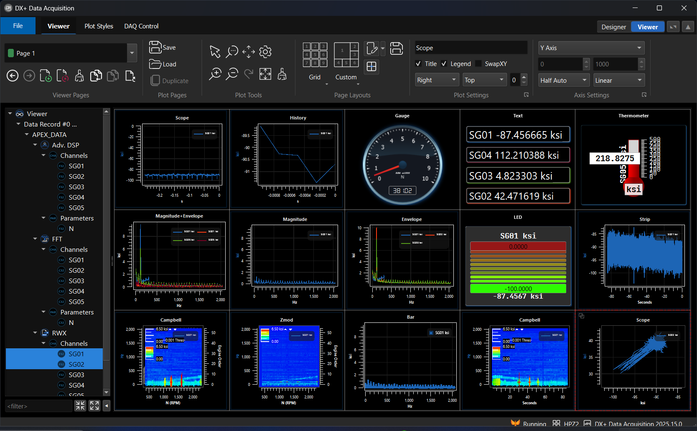

# DX+ Remote Viewer & DXNet-Rx

**DX+ Remote Viewer** (`DX+RemoteViewer.exe`) monitors **live network telemetry streams** broadcast from [DX+ DAQ](../DX+DAQ/outputs/transmit.md), [DX+ Online Analysis](../DX+OnlineAnalysis/outputs.md#dxnet-transmitter-dxpnettransmittercomponent), [DXNet Bridge (OPC UA)](../Services/DXNet%20Bridge%20%28OPCUA%29/README.md), or [DXNet Bridge (PLC)](../Services/DXNet%20Bridge%20%28PLC%29/README.md) — allowing engineering, control-room, and remote workstations to inspect test data in real time without touching the primary DAQ host.

For lightweight desktop, tablet, and Android field monitoring, the cross-platform **DXNet-Rx** (`DXPlus-ViewApp`) companion viewer connects to the same ZeroMQ (`tcp://`) and WebSocket (`ws://`) publishers with hardware-accelerated dashboards.

*DX+ Remote Viewer multi-page plotting workspace*

---

## Core Capabilities

- **Zero-Configuration LAN Auto-Discovery (mDNS)**: Automatically discovers active DX+ transmitters on the local subnet via `_dxnet._tcp.local` (UDP `224.0.0.251:5353`), or connects manually over routed subnets and VPNs via `Host/IP : Port`.
- **Event & Stream Filtering**: Filter active channels and discrete event streams on connect via the Query Filter dialog (`PhoenixQueryDialog`).
- **Full Real-Time Plotting & Telemetry**: Drag live streams into synchronized multi-page canvases (`Scope`, `History`, `Strip`, `Scatter`, `Graphic` dials/LEDs/thermometers/bars, `Magnitude`, `Envelope`, `Mag+Env`, `Campbell`, `Zmod`, `Tracking`, `Bode`, `Table`, and optional 3D `Model Viewer`).
- **Live Limit Alerts**: Displays time-domain **Range Limits (`R`)** and spectral **Frequency Limits (`F`)** warnings/alerts directly in status pills, channel indicators, and plot borders.

> [!NOTE]
> `DX+ Remote Viewer` connects **only to live stream publishers**. To inspect previously recorded `.dxdb`, PostgreSQL, `.datx`, `.rwx`, `.pkx`, or `.h5` files, use **[DX+ Data Viewer](../DX+DataViewer/README.md)**.

---

## Licensing

- **DX+ Remote Viewer**: Checks out `DX+REMOTEVIEWER` (`"dx+remoteviewer"`) with a 5-second **ApexLM** heartbeat and stream-receiver entitlements (`DXNET-RX` / `DS-RX`) as required; see [Installing & Licensing](../introduction/installing-and-licensing.md).

---

## In This Section

- [Connecting & Discovering Streams](connecting-and-streams.md) — LAN mDNS discovery, manual URI/port connection (`27026` vs `27126`–`27176`), firewall tips, and **DXNet-Rx** companion workflow.
- [Viewer Workspace & Ribbons](viewer-workspace.md) — `Plots` ribbon (`Pages`, `Plot Actions`, `Plot Tools`, `Page Layouts`, `Plot Settings`, `Axis Settings`), `Plot Styles`, and multi-page popouts.
- [DAQ Control, Status & Limits](daq-control-and-limits.md) — acquisition states (`UNINITIALIZED` through `EVENT REC`), `Page Status`, `Store Usage`, `System Usage`, and `R`/`F` Limit indicators.
- [Live Plotting & Interactions](live-plots.md) — building live monitoring pages, mouse/keyboard zoom & picking shortcuts, and cross-linking to plot option references.
