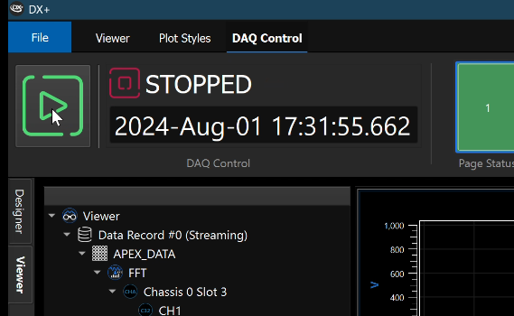

# DAQ Control, Status & Limits

When viewing live telemetry inside **DX+ DAQ** or **DX+ Online Analysis**, the **DAQ Control** ribbon tab controls acquisition state, recording triggers, limit monitoring, and system resource diagnostics.

---

## DAQ Control Group

A state badge displays the current acquisition engine lifecycle:

- **`UNINITIALIZED`**: Graph not yet submitted or cleared.
- **`STOPPED`**: Setup submitted and validated; acquisition paused.
- **`RUNNING`**: Live data acquisition and DSP streaming active (`Start` toggles between running and stopped). Data is plotted and transmitted, **not** written to disk unless recording is active.
- **`RECORDING`**: Active continuous recording to configured SQLite/PostgreSQL/file sinks (**All Data** enabled).
- **`EVENT REC`**: Active discrete test event (`APEX_DATAPOINT`) recording.

### Acquisition & Event Buttons

- **Start**: Starts or stops live pipeline acquisition (**RUNNING** $\leftrightarrow$ **STOPPED**).
- **Record**: Starts or stops continuous data store writing (**RECORDING**).
- **Event**: Begins a numbered test event (**EVENT REC**); click again to close the event interval.
- **Next**: Immediately closes the active event and starts the subsequent event number without gaps.
- **Event number / event flag**: Displays the active event index and custom classification flags.
- **Metadata / Notes**: Edit structured recording metadata and operator notes stored in the database record (`DS_INDEX.metadata`).
- **Timestamp Display**: Right-click the live acquisition clock and choose **Edit display format** to toggle UTC, local, or IRIG time formatting.

---

## Limits Monitoring (`R` & `F` Indicators)

The **Limits** ribbon group displays two overall health lights alongside per-channel color coding across the Viewer tree and plots:

- **`R` (Range Limits)**: Aggregate health state against per-stream minimum/maximum amplitude **Range Limits** *(Warning default `70%`, Alert default `90%`)*.
- **`F` (Frequency Limits)**: Aggregate health state against assigned **Frequency / Modal Limits** *(checked against Spectral / `FDFT` or `Frequency Binner` outputs)*.

Click **`R`** or **`F`** anytime to open the **Limit Status Details** dialog showing the real-time **OK / WARN / ALERT** status of every monitored channel (switchable between horizontal and vertical layouts, collapsible to alerted rows).

> [!TIP]
> **3-Second Alert Hold:** In **DXNet-Rx** and DX+ limit displays, transient Warning and Alert threshold excursions remain highlighted visibly with **Green (`GOOD`) / Amber (`WARN`) / Red (`ALERT`)** indicators for **3,000 ms** before decaying back to normal so brief spikes are not missed.

---

## Page Status, System Usage & Store Usage

- **Page Status**: Displays live mini-thumbnails of every Viewer page inside the **DAQ Control** ribbon so operators can spot limit flashes or waveform changes across hidden tabs and click a thumbnail to jump directly to that page.
- **System Usage**: Real-time host health gauges for **`RAM`**, **`CPU`**, and **`NET`** network interface bandwidth.
- **Store Usage**: Active storage telemetry showing target drive **`DISK`** capacity usage and real-time database write **`RATE`**.
