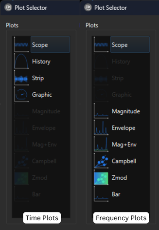
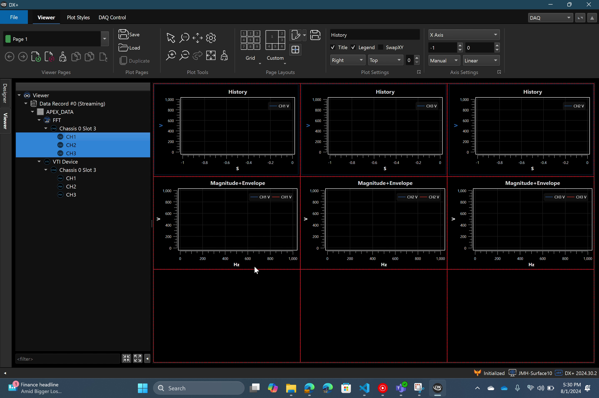

# Live Plotting & Interactions

Once streams appear in the left **Signal Tree** of **DX+ Remote Viewer** (or the embedded Viewer in **DX+ DAQ** / **DX+ Online Analysis**), drag signals onto any plot space to visualize live data in real time.

*Compatible plot types offered based on the dragged stream's domain*

---

## Building Live Monitoring Pages

1. Select a layout grid under **Plots → Page Layouts → Grid** (for example, `2x3` or `3x3`), or press `Ctrl+A` inside the plot canvas to populate multiple spaces at once (**`1 Trace Per`** splits multiple dragged signals automatically across selected cells).
2. Drag time-domain or frequency-domain channels from the **Signal Tree** into a plot space.
3. Choose any compatible plot representation from the **Plot Selector** popup:

| Incoming Stream Type | Available Live Plot Types |
| :--- | :--- |
| **Time-Domain / Scalar** | `Scope`, `History` *(rolling decimated window)*, `Strip` *(full test duration)*, `Scatter`, `Graphic` (`Gauge`, `Text`, `Thermometer`, `LED`, `Bar`), `Table` |
| **Frequency / Spectral (`FDFT` / `Order FFT`)** | `Scope`, `Magnitude`, `Envelope`, `Mag+Env`, `Campbell` *(Time or Speed)*, `Zmod`, `Bar`, `Tracking`, `Bode`, `Table` |
| **Modal / Camera *(when enabled)*** | 3D `Model Viewer`, `Video` |

For detailed configuration tabs, decimation formulas, and options screenshots for every plot type, refer to:

- **[Time-Based Plots Reference](../DX+DataViewer/time-based-plots.md)** (`Scope`, `History`, `Strip`, `Scatter`, `Gauge`, `Text`, `Thermometer`, `LED`, `Bar`, `Table`)
- **[Frequency-Based Plots Reference](../DX+DataViewer/frequency-based-plots.md)** (`Scope`, `Magnitude`, `Envelope`, `Mag+Env`, `Campbell`, `Zmod`, `Bar`, `Tracking`, `Bode`)

---

## Interactive Zoom & Picking Shortcuts

Inspect live waveforms smoothly without switching ribbon tools:

- **Mouse Wheel (no modifier or `Ctrl+Shift`)**: Zooms **both X and Y axes** together.
- **`Shift` + Mouse Wheel**: Zooms the **Y-Axis** only.
- **`Ctrl` + Mouse Wheel**: Zooms the **X-Axis** only.
- **Middle Mouse Button Click (`Mouse 3`)**: Resets zoom bounds immediately (**Zoom Reset**).
- **`Shift` + Click (with Pointer tool)**: Places multiple simultaneous point **Markers** *(equivalent to right-click → Markers → Multi Mode)*.

---

## Live Representations in DXNet-Rx Companion App

When monitoring live **DXNet** streams from **DXNet-Rx** (`DXPlus-ViewApp`), 9 hardware-accelerated Skia views are supported out of the box (up to **16 tiles per page**, preserving subscriptions silently across tab switches):

1. **`Strip Chart`**: Defaults to full-session elapsed time with automatic `4096`-point min/max envelope decimation *(or switchable `30s` / `300s` rolling windows)*.
2. **`Scope`**: Displays the latest received block with automatic X-axis units (`s`, `deg`, `Hz`, or `Point2D` XY).
3. **`Spectral / FFT`**: Plots **`STREAMED FFT (SERVER)`** directly from complex streams or computes **`LOCAL FFT (ON-DEVICE · Hann)`** locally from time waveforms with **Magnitude**, **PSD**, **dB**, peak annotations, and **Peak Hold**.
4. **`Session History`**: Full-session min/max envelope trend.
5. **`Digital Readout`**: High-contrast value readout with `OK`/`WARN`/`ALERT` badge and `MIN / RMS / MAX`.
6. **`Speedometer Dial`**: `270°` radial gauge with colored Warning/Alert arc bands.
7. **`Thermometer Gauge`**: Vertical bulb thermometer with limit ticks.
8. **`Bar Meter`**: Horizontal/vertical bar meter with RMS indicator.
9. **`LED Bar / Status Lamp`**: 16-segment color meter or boolean interlock lamp (`GOOD` / `WARN` / `ALERT` / `ACTIVE` / `CLEAR`).
