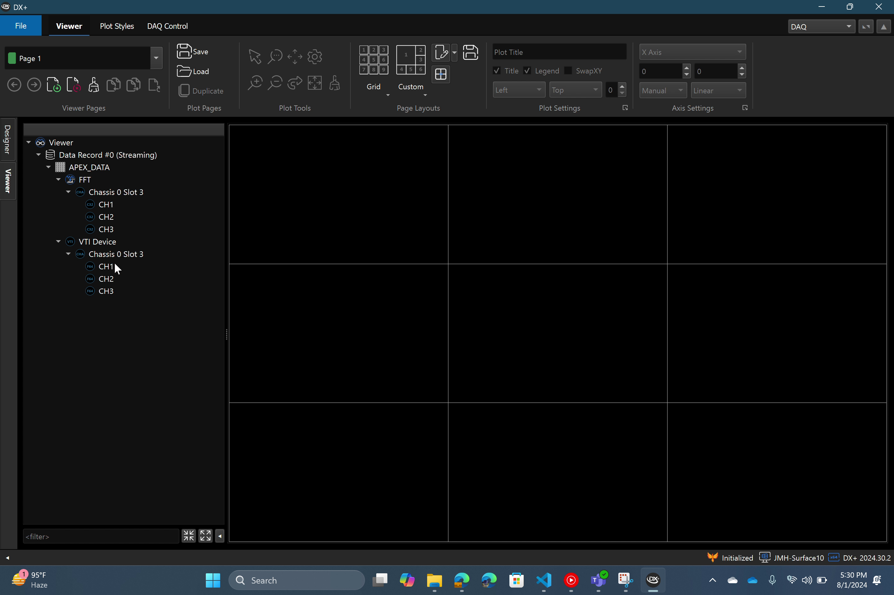
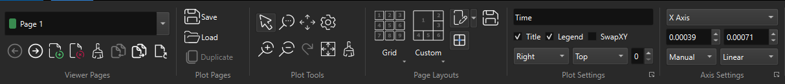
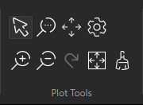

# Viewer Workspace & Ribbons

Once connected to a stream source (or viewing the embedded **Viewer** tab inside **DX+ DAQ** or **DX+ Online Analysis**), plots are arranged across named pages using the **Plots** and **Plot Styles** ribbon tabs.

*The Plots ribbon tab*

---

## Plots Ribbon Groups

Controls in **Plot Tools**, **Plot Settings**, and **Axis Settings** activate automatically whenever a plot space on the canvas is selected.

### 1. Pages

Manage multiple independent monitoring pages without disconnecting background streams:

- **Add Page** / **Delete Page**: Create or remove dashboard pages.
- **Prev Page** / **Next Page** and **Move Page Up** / **Move Page Down**: Navigate and reorder pages.
- **Popout Page**: Undock the selected page into an independent floating window (ideal for multi-monitor test stands; includes page zoom controls).
- **Clear All Pages**: Resets back to a single clean page *(prompts for confirmation)*.
- **Clear All Docks**: Removes plots from all docks on the active page *(enabled when plots exist)*.

### 2. Plot Actions

- **Save** / **Load**: Save viewer page layouts, plot types, and trace bindings to disk and reload them later — **including loading onto designs or receivers with matching logical channel names**.
- **Export**: Export or print the current viewer pages.

### 3. Plot Tools

- **Pointer**: Select traces and drop points/markers onto plots. Hold **`Shift`** while clicking to place multiple simultaneous markers.
- **Zoom** / **Zoom In** / **Zoom Out**: Box-zoom or step-zoom into regions of interest.
- **Pan**: Drag to pan across paused or zoomed axes.
- **Expand**: Maximizes the selected plot to fill the entire page; toggle again to restore the grid.
- **Settings**: Opens the full tabbed **Plot Options** dialog for the selected plot.
- **Plot Linking**: Links cursors/zoom ranges across plots on the current page.
- **Clear Current Traces** / **Reset Current Page Trace Data** / **Reset All Trace Data**: Clear traces or reset rolling buffers and Peak Hold envelopes on one plot, the current page, or every page.

### 4. Page Layouts

- **Grid**: Arrange plot spaces using preset grids (`2x2`, `2x3`, `3x3`, etc.).
- **Custom** / **Edit Layout** / **Show Layout Grid** / **Save Layout**: Switch to free-form placement mode, snap sizes cleanly on an alignment grid, and save custom dashboard geometry.
- **Show or hide plot docks**: Toggle plot dock frames cleanly for presentation views.

### 5. Plot Settings

Configure quick presentation options directly from the ribbon (or click the group expand arrow for full **Plot Options**):

- **Title** & **Auto Title**: Toggle title visibility *(Auto Title generates titles automatically from plotted traces when enabled)*.
- **Legend**, **Legend Alignment** (`Internal`: Left/Right/Center + Top/Bottom/Center; `External`: Right/Left/Top/Bottom), and **Legend Columns**.
- **Swap XY**: Swaps X and Y axes.

### 6. Axis Settings

- **Selected Axis**: Choose **X Axis**, **Y Axis**, or **Y2 Axis**.
- **Start Time / End Time**: Bounds for absolute-time axes.
- **Min Range / Max Range**: Manual numeric bounds.
- **Scaling Mode**: **Manual**, **Half Auto**, or **Full Auto**.
- **Scale Mapping**: **Linear** or **Logarithmic**.

---

## Plot Styles Ribbon

Use the **Plot Styles** ribbon tab to customize visual themes, background contrast, gridlines, and trace styling for the selected plot or page.
