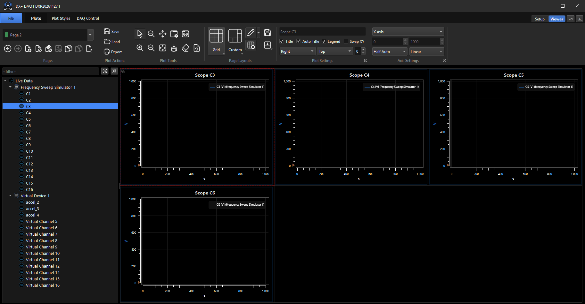

# Viewer General

These pages cover the viewer workspace shared by **DX+ Remote Viewer**, **DX+ Data Viewer**, and the embedded Viewer in **DX+ DAQ**, **DX+ Online Analysis**, and **DX+ Offline Analysis**.

*Viewer workspace — Signal Tree (left), ribbon, and plot canvas*

## In This Section

- [Workspace & Ribbons](workspace-and-ribbons.md) — the `Plots` ribbon (`Pages`, `Plot Actions`, `Plot Tools`, `Page Layouts`, `Plot Settings`, `Axis Settings`), `Plot Styles`, mouse and keyboard shortcuts, and `Plot Options`.
- [Building Plots](building-plots.md) — page layouts, dragging signals onto plots, the `Plot Selector` dialog, and which plot types suit which streams.
- [Time-Based Plots Reference](time-based-plots.md) — `Scope (Time)`, `History`, `Strip`, `Scatter`, `Graphic` (`Gauge`, `Text`, `Thermometer`, `LED`, `Bar`), and `Table`.
- [Frequency-Based Plots Reference](frequency-based-plots.md) — `Scope (Frequency)`, `Magnitude`, `Envelope`, `Mag+Env`, `Campbell`, `Zmod`, `Bar`, `Tracking`, and `Bode`.
- [DAQ Control, Status & Limits](daq-control-and-limits.md) — live viewing only (**DX+ DAQ** and **DX+ Online Analysis**): acquisition states, recording and events, `Item Monitor`, limit indicators, and system usage.
