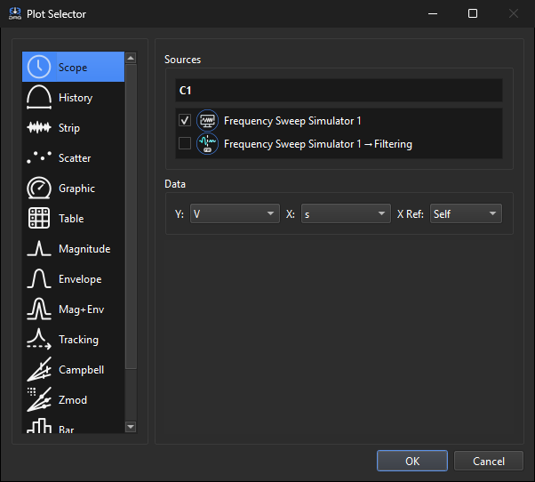
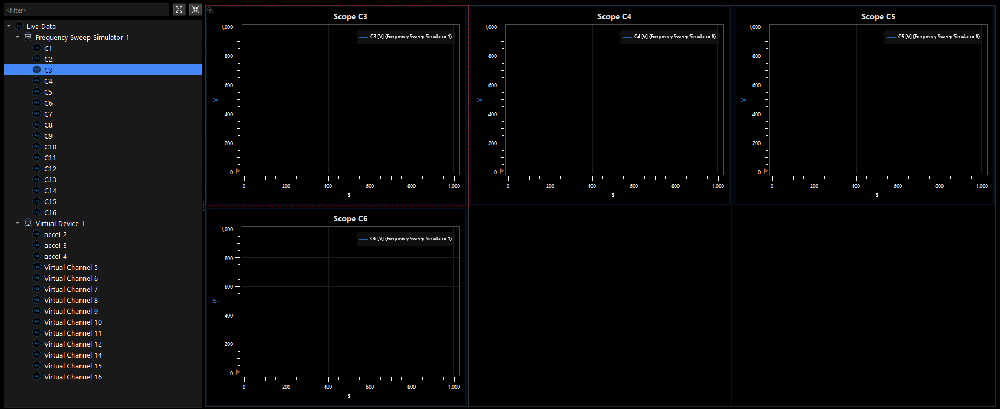

# Building Plots

Once streams appear in the left **Signal Tree** — live streams in **DX+ Remote Viewer** or the embedded Viewer in **DX+ DAQ** / **DX+ Online Analysis**, or recorded data in **DX+ Data Viewer** — drag signals onto any plot space to plot them.

*Plot Selector dialog — opens when you drop a signal onto a plot space*

---

## Building a Page

*A 2 x 3 page of Scope plots*

1. Choose a layout under **Plots → Page Layouts → Grid** (for example, `2 x 3` or `3 x 3`).
2. Drag time-domain or frequency-domain channels from the **Signal Tree** into a plot space.
   - To fill several plot spaces at once, click a plot space and press `Ctrl+A` to select them all, select several signals in the Signal Tree, and drag them onto the canvas. DX+ asks how to place them: **1 Trace Per** (one plot per signal) or **Overlay** (all signals on one plot). Plots that don't fit on the page are placed on new pages.
3. In the **Plot Selector** dialog, choose a plot type from the list on the left:
   - **Sources** lists where the signal can come from — for example the device itself or a processor output such as `Frequency Sweep Simulator 1 → Filtering`. If a plot type doesn't suit the signal, no sources are listed.
   - **Data** sets the axes (for example **Y**, **X**, and **X Ref**). Some plot types show extra options below it.
   - Click **OK** to create the plot.

| Incoming Stream Type | Available Plot Types |
| :--- | :--- |
| **Time-Domain / Scalar** | `Scope`, `History` *(rolling decimated window)*, `Strip` *(full test duration)*, `Scatter`, `Graphic` (`Gauge`, `Text`, `Thermometer`, `LED`, `Bar`), `Table`, `Tracking` |
| **Frequency / Spectral (`FDFT` / `Order FFT`)** | `Scope`, `Magnitude`, `Envelope`, `Mag+Env`, `Campbell` *(Time or Speed)*, `Zmod`, `Bar`, `Tracking`, `Bode`, `Table` |
| **Modal / Camera *(when enabled)*** | 3D `Model Viewer`, `Video` |

For detailed configuration tabs, decimation formulas, and options screenshots for every plot type, refer to:

- **[Time-Based Plots Reference](time-based-plots.md)** (`Scope`, `History`, `Strip`, `Scatter`, `Gauge`, `Text`, `Thermometer`, `LED`, `Bar`, `Table`)
- **[Frequency-Based Plots Reference](frequency-based-plots.md)** (`Scope`, `Magnitude`, `Envelope`, `Mag+Env`, `Campbell`, `Zmod`, `Bar`, `Tracking`, `Bode`)

> [!TIP]
> For zoom, pan, and marker shortcuts, see [Mouse & Keyboard Shortcuts](workspace-and-ribbons.md#mouse-keyboard-shortcuts).
