# Frequency-Based Plots Reference

Dragging spectral streams (such as **`FDFT`**, **`Order FFT`**, or **`OctaveBand`** outputs) onto a plot space opens the **Frequency-Based Plots** menu.

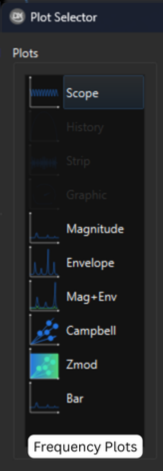
*Frequency-based plot types offered for spectral streams*

---

## 1. Scope (Frequency)

Displays frequency-domain spectral blocks on a per-block basis.

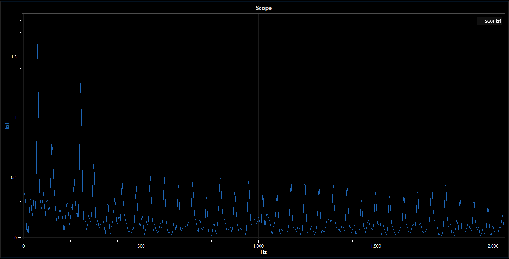

- **Axes**: X-axis displays `Hz`, angular `degrees`, or another dragged reference signal.
- **Plot Options**: Standard `General`, `Axes`, and `Traces` tabs ([Common Plot Options](workspace-and-ribbons.md#plot-options)).

---

## 2. Magnitude

Displays spectral amplitude block-by-block.

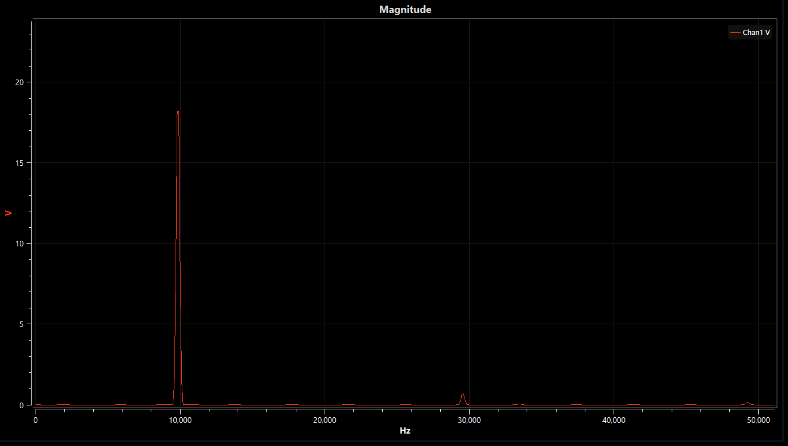

- **Display Modes**: View as **Magnitude** or **Power Density**, with an optional **dB** logarithmic scale toggle inside **Spectral Plot Options**.

---

## 3. Envelope

Tracks and plots the peak spectral envelope across blocks over time.

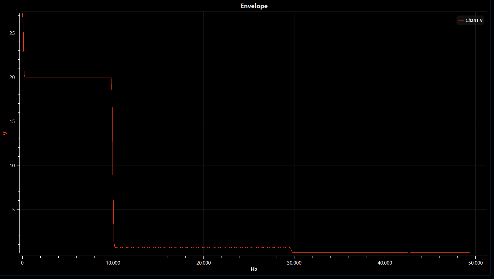

- **Plot Options**: Adds the **Spectral** options tab to switch between Magnitude, Power Density, and dB scaling.

---

## 4. Mag+Env

Combines live **Magnitude** and cumulative **Envelope** traces inside a single plot space. As playback or live acquisition runs, the envelope trace holds the highest spectral amplitude observed at every frequency bin up to the current timestamp.

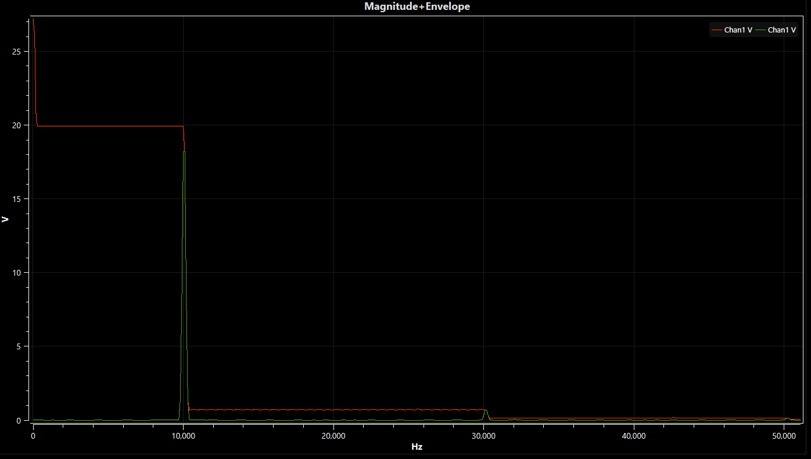

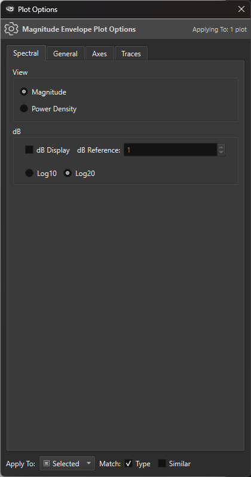

---

## 5. Campbell

Visualizes spectral frequency evolution over time or rotational shaft speed, with peak circle overlays and optional engine-order lines. Multiple spectral signals can be overlaid on the same Campbell diagram.

- **Time Campbell**: Created by dragging one or more spectral signals onto a plot (`Y` = Frequency in `Hz`, `X` = Time in `s` or **Absolute Time**).
- **Speed Campbell**: Created by dragging a spectral signal together with a speed/RPM parameter simultaneously (`Y` = Frequency in `Hz`, `X` = Speed in `RPM`, with tracked Engine Orders).

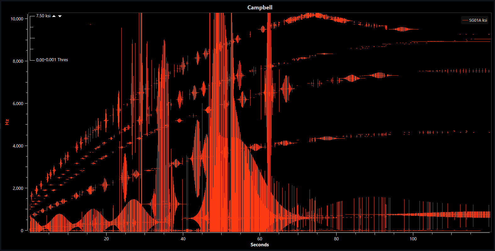
*Time Campbell plot*

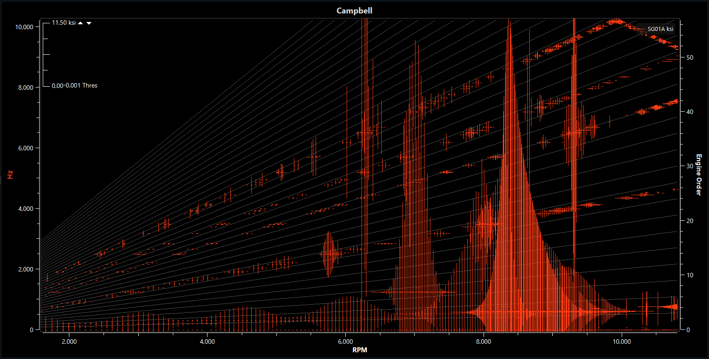
*Speed Campbell plot with speed parameter and order tracks*

### Campbell Plot Options

Campbell adds **Absolute Time** configuration to **Axes** plus a dedicated **Campbell** tab for peak sizing/thresholds and order lines:

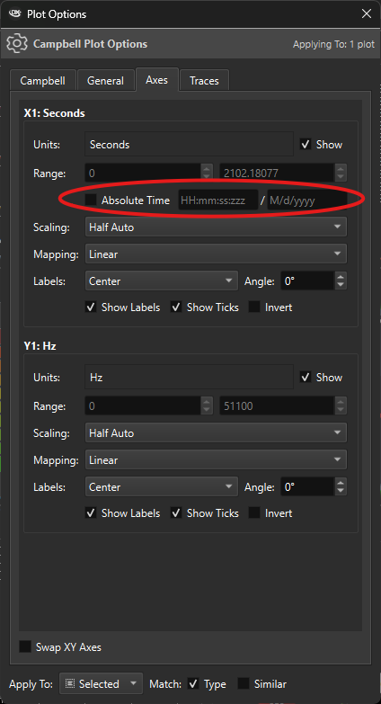

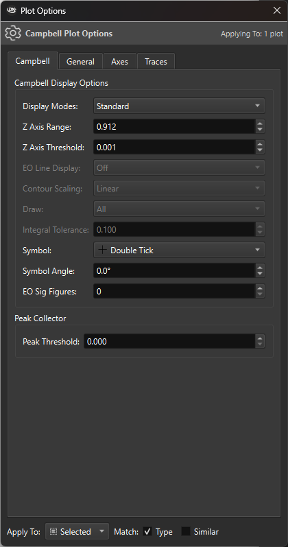

---

## 6. Zmod (Color Spectrogram)

Heatmap spectrogram plotting spectral magnitude by color intensity against Time (`s`) or Speed (`RPM`).

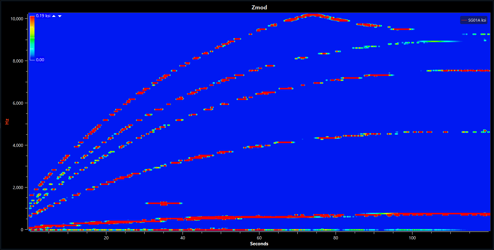

- **Limitation**: A **Zmod** plot displays **one trace at a time** (and see [Known Issues](../../release-notes/known-issues.md) for current Zmod marker clearing and export advisories).
- **Plot Options**: Includes **Absolute Time** on **Axes** plus a dedicated **Zmod** colormap/range options tab.

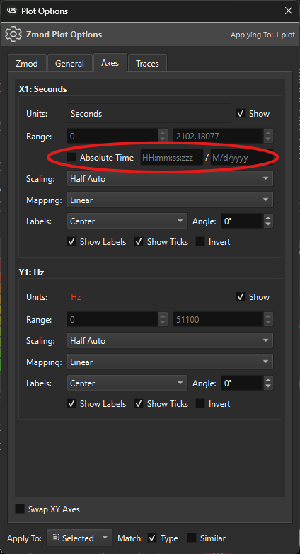

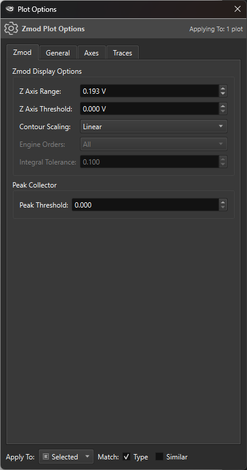

---

## 7. Bar (Frequency)

Displays per-block spectral or octave-band bins as vertical bars.

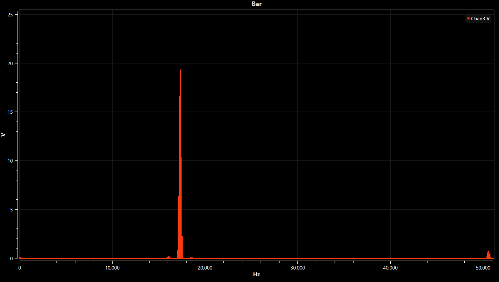

- **Limitation**: Displays **one trace at a time** and uses the [Common Plot Options](workspace-and-ribbons.md#plot-options) tabs.

---

## 8. Tracking

Tracks a signal's spectral amplitude/response at specific frequencies or Engine Orders (`EO`) against a time or speed reference stream.

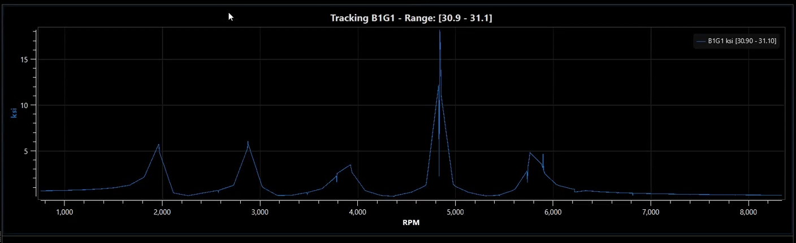

### Tracking Trace Configuration

- **Reference**: Signal supplying Time or Speed (RPM) values for the X-axis.
- **Tracking Values**: Discrete frequencies/orders (e.g., `1, 2, 3`) or intervals (e.g., `[1,2], [2,4]`) — one trace is generated per entry.
- **Tolerance**: Search window width centered around each tracking value.
- **Selection Method**: `Center Value`, `Max`, `Absolute Max`, `Average`, or `RMS` within the tolerance window.
- **Hz to EO**: Converts frequency bins to **Engine Order** when plotted against a speed reference.

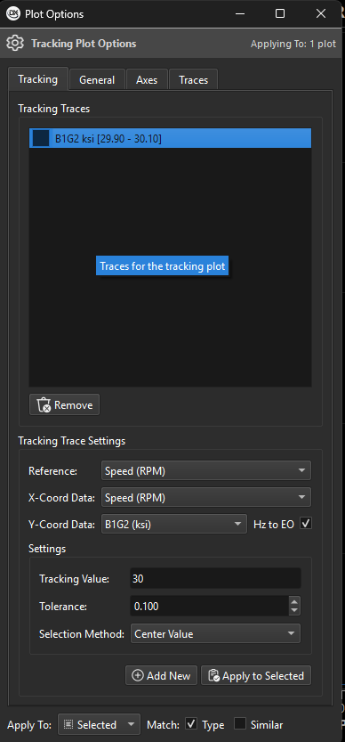

---

## 9. Bode

Combines two synchronized **Tracking** plots stacked vertically sharing a single X-axis — **Magnitude** on top and **Phase** underneath — for rotor critical-speed and phase-shift analysis. Accepts the same tracked data inputs and uses the same options as [Tracking](#8-tracking).
