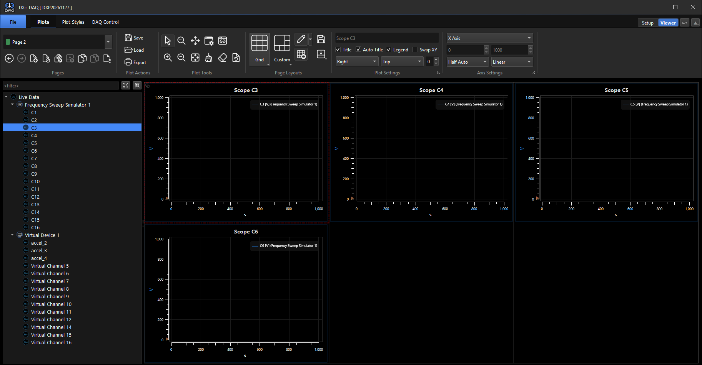
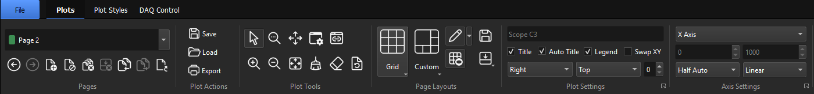
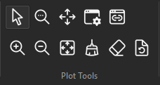
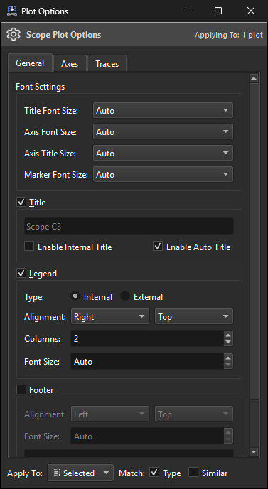
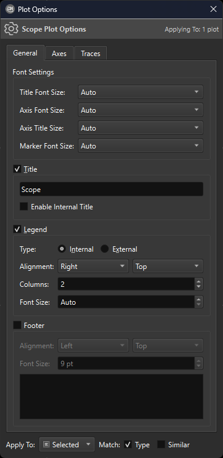
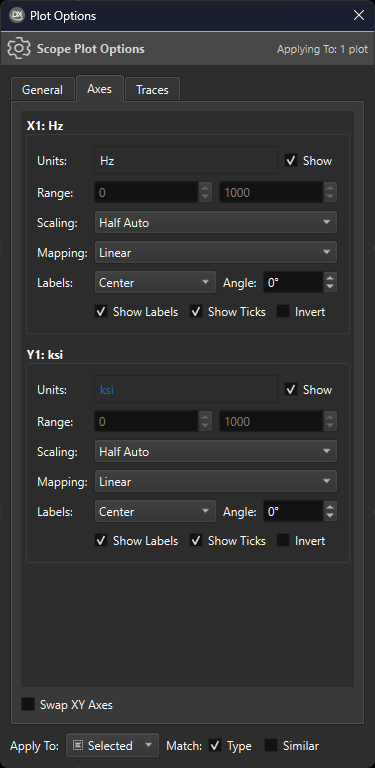
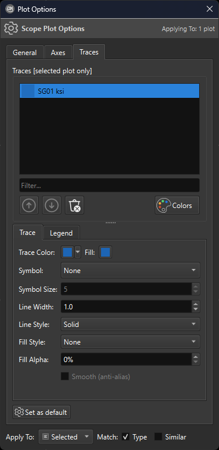

# Viewer Workspace & Ribbons

Every DX+ viewer — **DX+ Remote Viewer**, **DX+ Data Viewer**, and the embedded **Viewer** in **DX+ DAQ**, **DX+ Online Analysis**, and **DX+ Offline Analysis** — uses the same workspace: a **Signal Tree** on the left, a plot canvas arranged across named pages, and the **Plots** and **Plot Styles** ribbon tabs.

*Viewer workspace — Signal Tree (left), ribbon, and plot canvas*

*The Plots ribbon tab*

---

## Plots Ribbon Groups

Controls in **Plot Tools**, **Plot Settings**, and **Axis Settings** activate automatically whenever a plot space on the canvas is selected.

### 1. Pages

Manage multiple independent pages without disconnecting background streams:

- **Add Page** / **Delete Page**: Create or remove dashboard pages.
- **Prev Page** / **Next Page** and **Move Page Up** / **Move Page Down**: Navigate and reorder pages.
- **Popout Page**: Undock the selected page into an independent floating window (ideal for multi-monitor test stands; includes page zoom controls).
- **Clear All Pages**: Resets back to a single clean page *(prompts for confirmation)*.
- **Clear All Docks**: Removes plots from all docks on the active page *(enabled when plots exist)*.

### 2. Plot Actions

- **Save** / **Load**: Save viewer page layouts, plot types, and trace bindings to disk and reload them later — **including loading onto designs, receivers, or recordings with matching logical channel names**.
- **Export**: Export or print the current viewer pages *(see [Known Issues](../../release-notes/known-issues.md) for current ZMod/export advisories)*.

### 3. Plot Tools

*Plot Tools ribbon group*

- **Pointer**: Select traces and drop points/markers onto plots. Hold **`Shift`** while clicking to place multiple simultaneous markers.
- **Zoom** / **Zoom In** / **Zoom Out**: Box-zoom or step-zoom into regions of interest.
- **Pan**: Drag to pan across paused or zoomed axes.
- **Expand**: Maximizes the selected plot to fill the entire page; toggle again to restore the grid.
- **Settings**: Opens the [Plot Options](#plot-options) dialog for the selected plot.
- **Plot Linking**: Links cursors/zoom ranges across plots on the current page.
- **Time Sync**: Synchronizes playback timestamps across recorded plots *(**DX+ Data Viewer** and **DX+ Offline Analysis** only)*.
- **Clear Current Traces** / **Reset Current Page Trace Data** / **Reset All Trace Data**: Clear traces or reset rolling buffers and Peak Hold envelopes on one plot, the current page, or every page.

### 4. Page Layouts

- **Grid**: Opens a grid picker — move the pointer across it to choose the rows and columns (up to `6 x 6`, e.g. `2 x 3`), then click to apply.
- **Custom**: Opens the **Layouts** gallery — choose **Absolute** for free-form placement, or a preset layout with mixed plot sizes.
- **Edit Layout** / **Show Layout Grid** / **Save Layout**: Edit plot positions and sizes, snap them to an alignment grid, and save the custom layout.
- **Show or hide plot docks**: Toggle plot dock frames cleanly for presentation views.

### 5. Plot Settings

Configure quick presentation options directly from the ribbon (or click the group expand arrow for full [Plot Options](#plot-options)):

- **Title** & **Auto Title**: Toggle title visibility *(Auto Title is on by default and generates titles automatically from plotted traces)*.
- **Legend**, **Legend Alignment** (`Internal`: Left/Right/Center + Top/Bottom/Center; `External`: Right/Left/Top/Bottom), and **Legend Columns**.
- **Swap XY**: Swaps X and Y axes.

### 6. Axis Settings

- **Selected Axis**: Choose **X Axis**, **Y Axis**, or **Y2 Axis**.
- **Start Time / End Time**: Bounds for absolute-time axes.
- **Min Range / Max Range**: Manual numeric bounds.
- **Scaling Mode**: **Manual**, **Half Auto**, or **Full Auto**.
- **Scale Mapping**: **Linear** or **Logarithmic**.

---

## Plot Styles Ribbon

Use the **Plot Styles** ribbon tab to apply a color theme to the selected plot or page. Nine themes are available: **Chalk**, **Engineer**, **Midnight**, **Gray**, **Slate**, **White**, **Blue**, **Phosphor**, and **Amber**.

---

## Mouse & Keyboard Shortcuts

- **Mouse Wheel**: Zooms **both X and Y axes** together *(holding `Ctrl+Shift` behaves the same)*.
- **`Shift` + Mouse Wheel**: Zooms the **Y-Axis** only.
- **`Ctrl` + Mouse Wheel**: Zooms the **X-Axis** only.
- **Middle Mouse Button (`Mouse 3`)**: Resets zoom bounds immediately (**Zoom Reset**).
- **`Shift` + Pointer Click**: Places multiple simultaneous point **Markers** *(equivalent to right-click → Markers → Multi Mode)*.
- **`Ctrl+A` in the canvas**: Selects all plot spaces on the current page.

---

## Plot Options

Double-click a plot, or select it and click **Plot Tools → Settings**, to open **Plot Options**. Every plot type has **General** (fonts, title, legend, footer), **Axes**, and **Traces** tabs, plus any plot-specific tabs described in the [Time-Based](time-based-plots.md) and [Frequency-Based](frequency-based-plots.md) plot references.

*Plot Options dialog*

At the bottom of the dialog, **Apply To** chooses where the changes go — the **Selected** plot(s), the current **Page**, or **All Pages** — and **Match** limits them to plots of the same **Type** or **Similar** plots.

### General Tab

*Plot Options — General tab*

### Axes Tab

*Plot Options — Axes tab*

### Traces Tab

*Plot Options — Traces tab*
