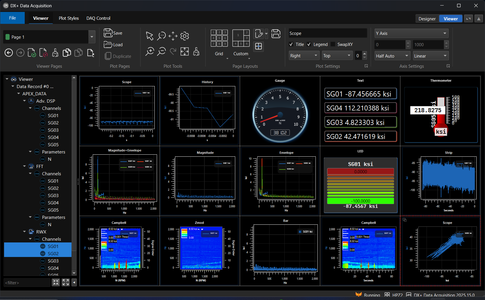

# DX+ Viewer

All DX+ plotting uses one viewer. The same workspace — Signal Tree, multi-page plot canvas, **Plots** and **Plot Styles** ribbons, and plot types — appears in five places; only the data source differs:

| Where | Data source |
| :--- | :--- |
| **[DX+ Remote Viewer](DX+RemoteViewer/README.md)** | Live streams over the network from DX+ DAQ, DX+ Online Analysis, or the DXNet Bridges |
| **[DX+ Data Viewer](DX+DataViewer/README.md)** | Recorded files and databases (`.dxdb`, PostgreSQL, `.datx`, `.rwx`, `.pkx`, `.h5`) |
| **Viewer tab in [DX+ DAQ](../DX+DAQ/README.md)** | The DAQ setup running on this machine |
| **Viewer tab in [DX+ Online Analysis](../DX+OnlineAnalysis/README.md)** | The analysis design running on this machine |
| **APEX Viewer output in [DX+ Offline Analysis](../DX+OfflineAnalysis/README.md)** | Processed results of an offline analysis design run against recorded data |

*DX+ Viewer displaying multiple time-domain and frequency-domain plot types*

---

## In This Section

- **[General](General/README.md)** — everything shared by every viewer: workspace and ribbons, building plots, plot-type references, and DAQ Control.
- **[DX+ Remote Viewer](DX+RemoteViewer/README.md)** — setting up Remote Viewer and connecting to live streams.
- **[DX+ Data Viewer](DX+DataViewer/README.md)** — setting up Data Viewer and opening recorded data.
