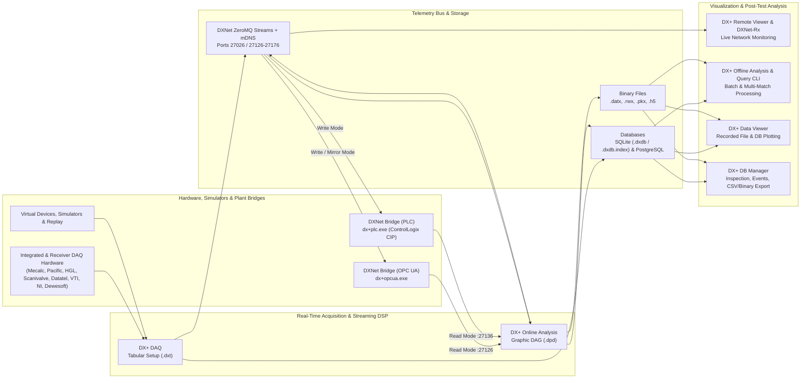

# APEX DX+ Documentation

> [!NOTE]
> DX+ licensing is managed by **[APEX License Manager](../License%20Manager/README.md)** (`ApexLM`); legacy FlexNet (`lmgrd`) will be discontinued in **October 2027**. For hardware (`x86-64` + **AVX2**), 18-month version support, and end-user license terms, see **[Software Release Policies](../Release%20Policies/README.md)**.

**APEX DX+** is a multi-purpose platform for high-speed data acquisition, real-time streaming signal processing, post-test engineering analysis, live remote monitoring, and industrial protocol bridging. Built on the native **Phoenix** C++20 processing engine and Qt 6 desktop applications, DX+ stores telemetry in open **SQLite (`.dxdb`)** and **PostgreSQL** databases alongside industry-standard binary file formats (`.datx`, `.rwx`, `.pkx`, `.h5`).

> [!TIP]
> New to DX+? Follow the **[APEX DX+ Quick Start Guide](quick-start.md)** to set up **ApexLM**, acquire and stream channels in `DX+ DAQ`, view live data, and inspect runs in `DX+ Data Viewer`.

---

## Platform Architecture

---

## Applications, Tools & Services

| Module | Description | Documentation |
| :--- | :--- | :--- |
| **Getting Started** | Platform overview, system requirements, installer, **ApexLM** licensing, quick starts, and file/DB formats. | [Getting Started](introduction/README.md) |
| **DX+ DAQ** | Table-driven hardware setup (`.dxt`), integrated devices, receivers, per-stream DSP, SQLite recording, and network transmit. | [DX+ DAQ Guide](DX+DAQ/README.md) |
| **DX+ Online Analysis** | Visual node-graph pipeline designer (`.dpd`), real-time streaming DSP, triggers, solution fits, models, and live outputs. | [DX+ Online Analysis Guide](DX+OnlineAnalysis/README.md) |
| **DX+ Offline Analysis** | Post-test database querying, multi-source/reference disambiguation, DSP pipelines, and headless CLI execution. | [DX+ Offline Analysis Guide](DX+OfflineAnalysis/README.md) |
| **DX+ Viewer** | The shared viewer workspace — ribbons, plot types, DAQ Control, and limit alarms — used by Remote Viewer, Data Viewer, DX+ DAQ, DX+ Online Analysis, and DX+ Offline Analysis. | [DX+ Viewer Guide](DX+Viewer/README.md) |
| **DX+ Remote Viewer** | Real-time remote telemetry client (`DX+RemoteViewer`) and cross-platform companion (`DXNet-Rx`) for connecting to live streams. | [DX+ Remote Viewer Guide](DX+Viewer/DX+RemoteViewer/README.md) |
| **DX+ Data Viewer** | Standalone post-test viewer (`DX+DataViewer`) for opening `.dxdb`, PostgreSQL, `.rwx`, `.pkx`, `.datx`, and `.h5` recordings. | [DX+ Data Viewer Guide](DX+Viewer/DX+DataViewer/README.md) |
| **DX+ DB Manager** | Desktop utility (`dx+dbmanager.exe`) for inspecting databases, editing ROI events, exporting columnar CSV/binary files, and DB maintenance. | [DX+ DB Manager Guide](Tools/DB%20Manager/README.md) |
| **DXNet Bridge (OPC UA)** | Bidirectional OPC UA $\leftrightarrow$ DXPNet bridge (`dx+opcua.exe`) with certificate auth and embedded read-only Mirror Server. | [DXNet Bridge (OPC UA)](Services/DXNet%20Bridge%20%28OPCUA%29/README.md) |
| **DXNet Bridge (PLC)** | Bidirectional Allen-Bradley ControlLogix EtherNet/IP (CIP) $\leftrightarrow$ DXPNet bridge (`dx+plc.exe`) with Poll/COV & boolean interlocks. | [DXNet Bridge (PLC)](Services/DXNet%20Bridge%20%28PLC%29/README.md) |

---

## Release Information & Legal

- [Release Notes & Version History](release-notes/README.md) — [Change Log](release-notes/change-log.md) and [Known Issues](release-notes/known-issues.md).
- [Legal & Licensing Notices](legal/README.md) — [Third-Party Attribution](legal/dx-plus-attribution.md), [Software License Agreement](legal/software-license-agreement.md), and [Software Maintenance Policy](legal/software-maintenance-policy.md).
- **Support Portal**: [https://users.apexturbine.com/](https://users.apexturbine.com/)
