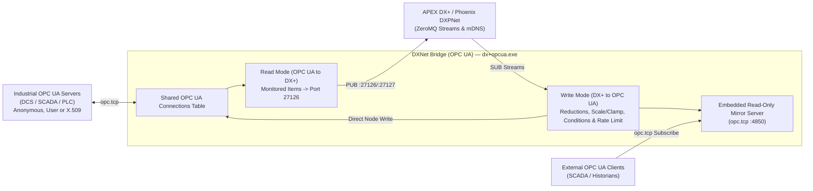

# DXNet Bridge (OPC UA)

**DXNet Bridge (OPC UA)** (`dx+opcua.exe`) is a bidirectional desktop gateway connecting industrial **OPC UA** automation servers and SCADA/DCS clients (`opc.tcp`) with **APEX DX+ / Phoenix DXPNet** high-speed ZeroMQ telemetry streams.

---

## Architecture & Operational Modes



1. **Read Mode (`OPC UA -> DX+`)**: Subscribes to selected OPC UA variable nodes using Monitored Items and broadcasts them as Phoenix binary telemetry streams over **DXPNet** (`tcp://127.0.0.1:27126` default, announced via mDNS `_dxnet._tcp.local`) for consumption by [DX+ Online Analysis](../../DX+OnlineAnalysis/README.md) or [DX+ Remote Viewer](../../DX+RemoteViewer/README.md).
2. **Write Mode (`DX+ -> OPC UA`)**: Subscribes to live **DX+Net** streams (including unrolling hierarchical `DATA_MESSAGES` containers such as `Statistics` `Max`/`Min`/`RMS`) and publishes them either:
   - Directly into writable nodes on external OPC UA servers (**`write` mode**), or
   - Into the built-in **Embedded Read-Only Mirror Server** (**`mirror` mode**, default `opc.tcp://0.0.0.0:4850/opcua/bridge/mirror/` under `Objects/BridgeMirror`) so external SCADA/DCS historians can subscribe without exposing writable tags on plant controllers.

---

## Ports & Licensing Reference

### Network Ports

| Service | Default Port | Port Range | Transport | Purpose |
| :--- | :--- | :--- | :--- | :--- |
| **DXNet Transmit (`OPC UA -> DX+`)** | `27126` | `27126` – `27176` | ZeroMQ REP + PUB | Control responder (`27126`) and high-rate data publisher (`27127`). |
| **DXNet Receive Target (`DX+ -> OPC UA`)** | `27126` | `27126` – `27176` | ZeroMQ REQ + SUB | Queries `get_streams` / `PUB_INFO` on DX+ transmitters *(note: `DX+Daq` defaults to `27026`)*. |
| **Embedded Mirror OPC UA Server** | `4850` | `1024` – `65535` | `opc.tcp` | Read-only mirror endpoint (`opc.tcp://0.0.0.0:4850/opcua/bridge/mirror/`). |
| **Standard OPC UA Server / Test Server** | `4840` | `1024` – `65535` | `opc.tcp` | Default external server and `--test-server` endpoint (`opc.tcp://127.0.0.1:4840/freeopcua/server/`). |
| **mDNS Discovery** | `5353` | Fixed | UDP Multicast | Advertises `_dxnet._tcp.local` on `224.0.0.251:5353`. |

### Licensing

- **ApexLM Entitlement**: Requires application token **`OPCUA`** and feature token **`OPCUA-BRIDGE-APP`** (`app_name = "opcua"`, `primary_feature = "opcua-bridge-app"`). See [Installing & Licensing](../../introduction/installing-and-licensing.md).

---

## Launching, Command-Line Flags & Tray Deployment

```powershell
# Standard interactive launch
dx+opcua.exe
```

| Flag / Environment Variable | Behavior |
| :--- | :--- |
| `--tray` / `--minimized` / `--hidden` *(or `PHOENIX_OPCUA_START_IN_TRAY=1`)* | Starts hidden/minimized in the Windows system tray for background operation (e.g., Windows Startup / Task Scheduler autostart). |
| `--no-splash` | Skips the startup splash screen. |
| `--single-instance` *(or `PHOENIX_OPCUA_SINGLE_INSTANCE=1`)* | Enforces single-instance lock (`phoenix_opcua.lock`). |
| `--force` / `--ignore-lock` / `--allow-multiple` | Overrides single-instance locking when running multiple parallel bridge instances. |
| `--test-server` *(or `--server-test`)* | Launches the standalone **OPC UA Test Server** GUI on `opc.tcp://127.0.0.1:4840/freeopcua/server/`. |
| `--test-client` *(or `--client-test`)* | Launches the standalone **OPC UA Test Client** GUI for browsing and testing read/write subscriptions. |

---

## Configuring Connections, Read Mode & Write / Mirror Mode

### 1. Shared OPC UA Connections & Security

In the top-left **OPC UA Connections** panel (shared across both modes), click **+ Add Connection**:

1. Enter **Host / IP** and **Port** (`4840`), or a full **`opc.tcp://...`** endpoint URL, and click **Find Servers** to verify advertised endpoints.
2. Select the **Authentication / Security** mode:
   - **Anonymous**
   - **Username / Password**
   - **Certificate (`Basic256Sha256`)** *(provide paths to your X.509 client certificate `.der`/`.pem` and private key)*.
3. Use **Save Config / Load Config** in the top header anytime to export or reload your complete `.json` bridge state (connections, subscriptions, and mappings). Click **Logs** to inspect timestamped diagnostics and warning/error counts.

### 2. Read Mode (`OPC UA -> DX+`)

1. Toggle the header switch to **Read (OPC UA -> DX+)**.
2. Browse the 6-column **Readable OPC UA Channels** table (`Source`, `Channel Name`, `Node ID`, `Type`, `Units`, `Live Value`). Diagnostic system nodes (`ServerStatus`, `NamespaceArray`, etc.) are filtered out by default (`Show System Nodes` unchecked) and never streamed over DX+.
3. Use **Search**, **OPC UA Connection Filter**, or **Subscribed Only** to locate tags, select rows (`Ctrl+Click`, `Shift+Click`, or **Select All**), and click **Subscribe Selected** *(active subscriptions highlight in amber `#3d2b0d`)*.
4. Confirm responder **Port** *(default `27126`)* in **DXNet Transmit Settings (OPC UA -> DX+)** and click **Start DX+ Transmit** (`Primary URI`: `dxnet://127.0.0.1:27126`).

### 3. Write & Mirror Mode (`DX+ -> OPC UA`)

1. Toggle the header switch to **Write (DX+ -> OPC UA)**.
2. In **DXNet Receive Settings**, click **Discover** *(or enter `Host:Port` manually, e.g., `127.0.0.1:27026` for `DX+Daq` or `127.0.0.1:27126`, and click **+ Add**)*.
3. **Choose Target Mode**:
   - **External Server Write (`write`)**: Double-click any writable node in **Writable OPC UA Channels** (or select and click **Map Selected...**).
   - **Embedded Read-Only Mirror (`mirror`)**: Click **Mirror Server...** to set bind host (`0.0.0.0` / `127.0.0.1`), port (`4850`), namespace URI, and optional Username/Password auth; then click **Add Mirror Mapping...** to expose streams read-only under `Objects/BridgeMirror` (e.g., `ns=2;s=BridgeMirror.Speed`).
4. Configure **Channel Mapping & Transformation**:
   - Select **DXNet Connection**, **Source Logical Name**, and **Stream Logical Name** *(including child fields of `DATA_MESSAGES` containers)*.
   - Pick **Vector / Array Reduction**: `Pass-Through`, `Max`, `Min`, `Average`, `RMS`, `Peak-to-Peak`, `Std Dev`, `Median`, `Sum`, `First [0]`, `Last [-1]`, or `Element at Index [i]`.
   - Pick **Value Transformation**: **Direct Value**, **Linear Scale / Clamp** (`y = m*x + b` + min/max bounds), or **Boolean Condition** (`Value > X && Value < Y` / `||` with hysteresis & `!` invert).
   - Set **Max Write Rate (Hz)** with trailing-edge flush and optional **Write on value change only**.
5. Click **Save Mapping**, then click **Start Inbound Bridge**.

---

## Testing Offline with Built-In Test Tools & Troubleshooting

```powershell
# Launch simulated OPC UA server with Sine/Square/Triangle/Noise signals & Write Audit Log (:4840)
dx+opcua.exe --test-server

# Launch diagnostic OPC UA client to inspect Mirror Server (:4850) or Test Server (:4840)
dx+opcua.exe --test-client
```

- **TX/RX Counters Not Incrementing**: Verify **Start DX+ Transmit** *(Read)* or **Start Inbound Bridge** *(Write)* has been toggled on (green indicator dot in header switch).
- **Certificate / `Basic256Sha256` Failures**: Verify server trust-store acceptance of your client `.der`/`.pem` certificate and matching private key permissions.
- **No Streams Discovered**: Confirm target DX+ transmitter port matches (`27026` vs `27126`–`27176`) and Windows Firewall allows ZeroMQ TCP connections and UDP `5353` mDNS.
