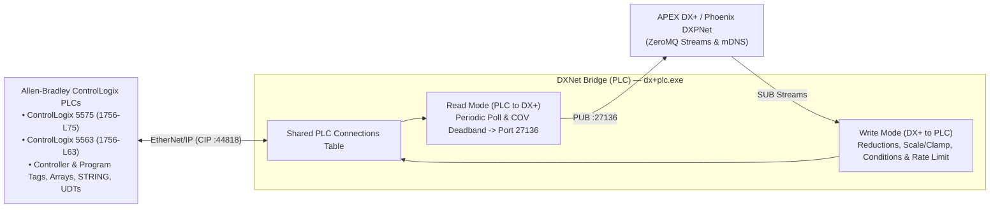

# DXNet Bridge (PLC)

**DXNet Bridge (PLC)** (`dx+plc.exe`) is a bidirectional desktop bridge connecting **Allen-Bradley ControlLogix 5575 (`1756-L75`)** and **ControlLogix 5563 (`1756-L63`)** Programmable Logic Controllers over **EtherNet/IP (CIP Port `44818`)** with **APEX DX+ / Phoenix DXPNet** high-speed ZeroMQ telemetry streams.

---

## Architecture & Protocol Scope



- **Protocol**: Native **EtherNet/IP Common Industrial Protocol (CIP)** over TCP/UDP port **`44818`** *(including CIP `ListIdentity` `0x0063` broadcast discovery and `1756` chassis backplane slot querying)*.
- **Packet Negotiation**: Automatically negotiates **4000-byte Extended Forward Open** on ControlLogix `1756-L75` / `1756-EN2T` hardware, falling back transparently to **500-byte Standard Forward Open** for legacy `1756-L63` / `1756-ENBT` modules.
- **Tag Coverage**: Discovers Controller-scoped and `Program:<name>` tags across scalars, 1D arrays, intact `STRING` tags, and expanded User-Defined Data Types (**UDTs**), honoring CIP `ExternalAccess` (`Read Only` vs `Read/Write`; excludes `None` and internal `"__*"` tags).

---

## Launching, CLI Arguments & Licensing

### Launching & CLI Options

```powershell
# Interactive launch
dx+plc.exe

# Auto-load configuration headless/tray
dx+plc.exe --config "C:\configs\dxnet_plc_bridge_config.json" --tray
```

| Flag / Environment Variable | Behavior |
| :--- | :--- |
| `--config <path.json>` *(or `--config=<path.json>`)* | Automatically loads a saved `dxnet-plc-bridge.v1` JSON configuration and connects all PLCs on startup. |
| `--tray` / `--minimized` / `--hidden` *(or `PHOENIX_PLC_START_IN_TRAY=1`)* | Starts hidden in the Windows system tray *(closing/minimizing the window keeps bridging active; right-click tray → **Exit** to stop)*. |
| `--no-splash` | Skips the startup splash screen. |
| `--single-instance` *(or `PHOENIX_PLC_SINGLE_INSTANCE=1`)* | Enforces single-instance lock (`phoenix_plc.lock`). |
| `--force` / `--ignore-lock` / `--allow-multiple` | Bypasses single-instance lock checks. |
| `--test-server` *(or `--server-test`, `--test-plc`)* | Launches the built-in **ControlLogix CIP Test Server** GUI on port `44818` with Turbine Demo presets and Write Audit Log. |
| `--test-client` *(or `--client-test`)* | Launches the built-in **ControlLogix CIP Test Client** GUI for tag exploration and interactive reads/writes. |

### Licensing

- Checked out via `PhoenixLic` at launch (`app_name = "plc"`, `primary_feature = "plc-bridge-app"`). Verify your **ApexLM** service grants PLC bridge access; see [Installing & Licensing](../../introduction/installing-and-licensing.md) and **[APEX License Manager](../../../License%20Manager/README.md)** (legacy FLEXlm discontinued **October 2027**).

---

## Step-by-Step Bridge Setup

### 1. Discovering & Adding ControlLogix PLCs

1. In **Allen-Bradley ControlLogix Connections (Shared)**, click **+ Add PLC**.
2. Set optional **Controller Alias**, **Primary IP Address** *(or `IP:Port` such as `127.0.0.1:44818` for local simulation)*, or click **Discover...** to scan adapters via CIP `ListIdentity` (`0x0063`).
3. Set **CPU Chassis Slot** (`0`–`16`), or click **Scan Backplane Slots...** to enumerate installed chassis modules (e.g., `Slot 0: 1756-L75/A LOGIX5575`).
4. Leave **CIP Route Path** blank for standard `IP/Slot` routing, tune **Socket Timeout** (`1.0 s`–`30.0 s`, default `5.0 s`), keep **Load Program-Scoped Tags** checked if needed, and click **Connect & Load Tags**.

### 2. Read Mode: Streaming PLC Tags to DX+ (`PLC -> DX+`)

1. Set the top header switch to **Read (PLC -> DX+)** *(or press `Left`/`R`)*.
2. Locate tags using **Search**, **PLC Filter**, **Scope Filter**, and **Subscribed Only**.
3. Configure per-tag (or bulk-selected via **Apply to Selected**) metadata and acquisition mode:
   - **`Units` & `Unit Domain`**: Auto-inferred when recognizable from tag metadata or suffixes *(e.g., `_RPM`, `_DegC`, `_kPa`, `STRING` -> `txt`)* with full manual dropdowns across standard Phoenix engineering units (`time - seconds (s)` domain by default).
   - **`Mode` & `Rate / Deadband`**:
     - **`Poll`**: Periodic CIP sampling from **`20 ms`** to **`60,000 ms`** *(default `100 ms`)*.
     - **`On-Change (COV)`**: Publishes only when a tag value shifts beyond the configured **± deadband**.
4. Select rows and click **Subscribe Selected** *(subscribed rows highlight in amber `#3d2b0d`)*.
5. Confirm responder **Port** *(default **`27136`**; PUB on `27137`)* in **DXNet Transmit Settings (PLC -> DX+)** and click **Start DX+ Transmit**. Streams publish cleanly using the PLC variable name under the PLC connection Group/Source name and announce via `_dxnet._tcp.local` mDNS.

### 3. Write Mode: Writing DX+ Streams to PLC Tags (`DX+ -> PLC`)

1. Toggle to **Write (DX+ -> PLC)** *(or press `Right`/`W`)*.
2. In **DXNet Receive Settings**, click **Discover** or manually add a publisher `Host:Port` *(default `127.0.0.1:27126` or `27026` from `DX+Daq`)*.
3. Double-click any `Read/Write` tag in **Writable ControlLogix Tags** (or click **Map Selected Tag...**) to configure:
   - **DXNet Source Stream**: Pick Connection, Source, and Stream *(or `Manual Topic / Long ID Entry`)*.
   - **Vector / Array Reduction**: `Pass-Through`, `Max`, `Min`, `Average`, `RMS`, `Peak-to-Peak`, `Std Dev`, `Median`, `Sum`, `First [0]`, `Last [-1]`, or `Element at Index [i]`.
   - **Transform & Boolean Interlocks**:
     - **Direct Value** *(coerced to CIP tag type)*
     - **Linear Scale / Clamp** (`Scale (m)`, `Offset (b)`, `Clamp Min` / `Clamp Max`)
     - **Boolean Condition (BOOL Output)**: Combine up to two threshold comparisons (`>`, `>=`, `<`, `<=`, `==`, `!=` joined by `&&` or `||`), configurable **Hysteresis / Deadband** to prevent relay chatter, and optional **`!` Invert**, previewed live in **Expression Preview**.
   - **Backplane Protection (Rate Limiting)**: Set **Max Write Rate (Hz)** (`0 Hz` = unlimited, e.g., `10.00 Hz` = 100 ms min interval), keep **Flush trailing value after rate window** checked so final steady values land cleanly, and optionally enable **Write on value change only**.
4. Click **Save Mapping**, toggle mappings on/off individually with the **Active** checkbox, and click **Start Inbound Bridge**.

---

## Saving Configs, Offline Resilience & Local Simulation Testing

- **JSON Configuration (`dxnet-plc-bridge.v1`)**: Use **Save Config / Load Config** to persist connections, Poll/COV rates, DXNet endpoints, and Write transforms. If a PLC is offline at config load time, `DXNet Bridge (PLC)` preserves its saved subscriptions/mappings as `Offline` and activates them automatically once **Refresh Tags** succeeds.
- **Built-In ControlLogix CIP Test Server & Client**:
  ```powershell
  # Simulate ControlLogix L75/L63 hardware on 127.0.0.1:44818 (--model 1756-L63 for 500B legacy test)
  dx+plc.exe --test-server --model 1756-L75 --channels 0

  # Inspect tags & test writes directly
  dx+plc.exe --test-client --ip 127.0.0.1:44818 --slot 0 --auto-connect
  ```
- **Diagnostics**: Click **Logs** *(unread warning/error badge)* to filter (`All`, `Warnings & Errors`, `Errors Only`), search, and copy diagnostic logs.
