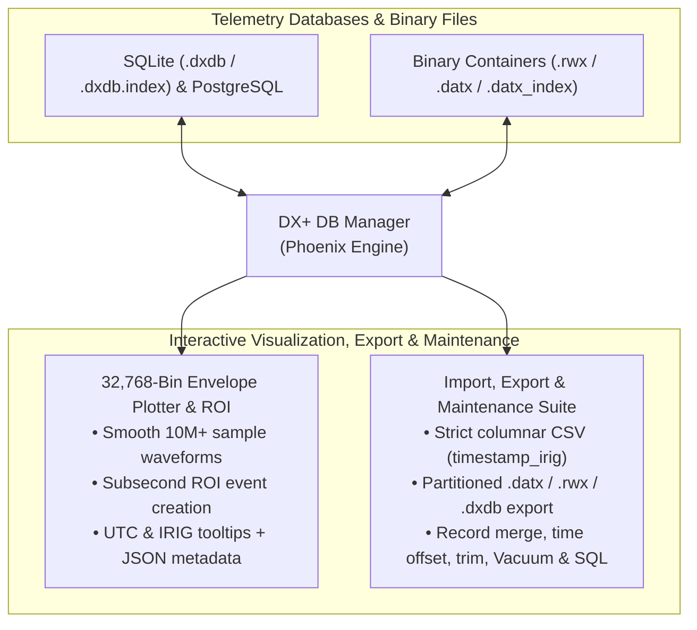

# DX+ DB Manager

**DX+ DB Manager** (`dx+dbmanager.exe`, built on *PhoenixFoundry*) is the desktop engineering application for inspecting, plotting, event-tagging, maintaining, converting, and exporting **APEX DX+** telemetry databases (`.dxdb`, `.dxdb.index`, SQLite, PostgreSQL) and binary recordings (`.rwx`, `.datx`, `.datx_index`).

---

## System Overview & Capabilities



### Supported Adapters

| Adapter Name | Native Identifier | Formats / Transport | Role |
| :--- | :--- | :--- | :--- |
| **DXDB / SQLite Reader** | `DXDBReader` | `.dxdb`, `.dxdb.index`, `.db`, `.sqlite` | Reads SQLite databases including multi-part sharded archives. |
| **DXDB / SQLite Writer** | `DXDBWriter` | `.dxdb`, `.db`, `.sqlite` | Creates or clones SQLite stores (`Single`, `Per Source`, `Per Stream`). |
| **PostgreSQL Database Reader** | `PostgreSQL Database Reader` | Network / URI | Reads enterprise PostgreSQL telemetry databases. |
| **PostgreSQL Database Writer** | `PsqlDBWriter` | Network / URI | Writes records into PostgreSQL stores. |
| **RWX File Reader / Writer** | `RwxReader` / `RWXWriter` | `.rwx` | Reads and exports high-throughput APEX RWX containers. |
| **DATX File Reader / Writer** | `DatxReader` / `DatxWriter` | `.datx`, `.datx_index` | Reads and exports Dewesoft/DSPCon DATX containers. |

---

## Launching & Licensing

```powershell
# Desktop executable
dx+dbmanager.exe
```

- **Licensing**: In **ApexLM**, DX+ DB Manager uses application token **`DBMANAGE`** and feature token **`DBMANAGE-APP`** (`app_name = "dbmanage"`, `primary_feature = "dbmanage-app"`; some legacy packages may reference `FOUNDRY-APP`). Ensure **ApexLM** is running and holds an active `DBMANAGE` entitlement; see [Installing & Licensing](../../introduction/installing-and-licensing.md).

---

## Operator Guide

### 1. Connecting to & Switching Between Databases

1. Click **Connect DB** on the top ribbon.
2. In **Connect to Database**, choose **`DXDB / SQLite Reader`** *(or **`PostgreSQL Database Reader`**)*:
   - **SQLite / `.dxdb` / `.dxdb.index`**: Click **Browse...** to select your local database file.
   - **PostgreSQL**: Complete the generated connection fields (`host`, `port`, `user`, `password`, `database`).
3. Click **Connect**. The session appears in the ribbon's **Active DB** dropdown, allowing multiple open databases simultaneously, while the left tree lists every **Record** (`Record 1`, ...) and child **Event** (`Event 1`, ...).
4. Use **Active DB** to switch sessions or **Close DB** to disconnect.

### 2. Inspecting Metadata, Schemas & Interactive ROI Plotting

- **Overview View**: Select any Record or Event in the sidebar to view start/end times in both **UTC** and **IRIG**, duration, channel counts, and partition tables. Click **View Graph Schema** to inspect `graph_json` and `tables_json` descriptors in raw and tree views.
- **Plot View & 10M+ Point Envelope Plotting**:
  1. Switch to **Plot**, choose a **Source** and **Stream**, and click **Plot Stream**. *(Uses two-pass memory-bounded `32,768`-bin min/max envelope decimation so even 10,000,000+ sample waveforms pan and zoom smoothly.)*
  2. Left-click drag to pan; right-click drag or mouse wheel to zoom.
  3. Toggle **Show Events** to overlay vertical event markers (`E1>`, `<E1`).
  4. Drag the shaded **Region of Interest (ROI)** boundary handles *(or type exact start/end timestamps)* for targeted exports or event creation.

### 3. Creating, Editing & Deleting Events (`APEX_DATAPOINT`)

- **Create Event from ROI**: Position the ROI handles over the window of interest, click **Create Event from ROI**, enter an **Event Number**, comma-separated **Event Flags** (e.g., `burn,maxq`), and custom typed key/value metadata rows, then click **OK**.
- **Edit Event**: Select an event in the sidebar and click **Edit Event** to modify its number, timestamps, flags, or metadata.
- **Delete Event**: Select an event and click **Delete Event** *(prompts for confirmation)*.

### 4. Exporting to Strict Columnar CSV

Click **Export CSV** on the ribbon:

1. Select the **Target Record**, channels, and **Range Mode**:
   - **Full Record**, **Event Range** *(exact selected event ns bounds)*, **Time Range (ROI)**, or **Custom Time Range**.
2. Choose the **Time Format** *(column 1 header)*:
   - **IRIG *(Default)***: `YYYY:DDD:HH:MM:SS.fffffffff` (`timestamp_irig`)
   - **IRIG (Day of Year)**: `DDD:HH:MM:SS.fffffffff` (`timestamp_irig`)
   - **ISO 8601 (UTC)**: `YYYY-MM-DD HH:MM:SS.fffffffff` (`timestamp_utc`)
   - **Unix Epoch (ns)**: Raw integer nanoseconds (`timestamp_ns`)
3. Choose the **Export Mode**:
   - **Full Rate**: The highest-rate channel (smallest positive `delta`) drives the timeline; lower-rate channels remain synchronized via sample-and-hold carry-forward *(outputting `0` before a delayed channel's first sample)*.
   - **Downsampled**: Specify a bin **Duration (s)** (e.g., `0.1` for 100 ms) and statistic (**`Average`**, **`Min`**, **`Max`**, **`Peak-to-Peak`**, **`RMS`**) to produce monotonically increasing binned rows with `"Source.Stream"` column headers.
4. Select an output `.csv` destination and click **Export**.

### 5. Exporting & Importing Binary Files (`.datx`, `.rwx`, `.dxdb`)

- **Export File (`.datx` / `.rwx`)**: Click **Export File**, select `DATX File Writer` *(requires identical sample rates within a single `.datx`)* or `RWX File Writer` *(requires identical or power-of-2 rates within one `.rwx`)*, select the layout (**`Single File`**, **`Channels`**, or **`Sample Rate`**), and click **Export**. Part filenames inherit `GraphJson` logical channel names automatically.
- **Export DXDB**: Click **Export DXDB**, select `DXDBWriter` or `PsqlDBWriter`, target path, and SQLite partition mode (**`Single`**, **`Per Source`**, **`Per Stream`**).
- **Import File**: Click **Import File**, pick `RWX File Reader` or `DATX File Reader`, select your `.rwx` / `.datx` / `.datx_index` source, and import into the **Current Active DB** or synthesize a **New Database** *(auto-connected in-session upon completion)*.

### 6. Database Maintenance, Merging & SQL Console (`Database Tools`)

Click **Database Tools** on the ribbon to perform database engineering operations:

- **Vacuum / Optimize**: Compact database pages and update query planner indexes/statistics.
- **Time Offset**: Apply timezone or custom second/millisecond/microsecond shifts across a whole record, a single source, or a specific stream.
- **Sync Record Bounds**: Realign `DS_INDEX.create_time` and `DS_INDEX.complete_time` with actual min/max sample timestamps in `APEX_DATA`.
- **Reduce Data to Event Ranges**: Permanently prune raw sample data falling outside defined event intervals to reclaim storage *(prompts for confirmation)*.
- **Delete Record + Related Data**: Cascade-delete a record, its events, and its data partitions *(prompts for confirmation)*.
- **Merge Records**:
  - **Same-Database Merge**: Consolidate all overlapping records within a `[start, end]` window into one unified record.
  - **Cross-Database Merge**: Combine records from multiple source databases into a single destination database.
- **SQL Query Console**: Switch to the **Query** view on the ribbon to run ad-hoc diagnostic SQL queries and inspect tabular results.
