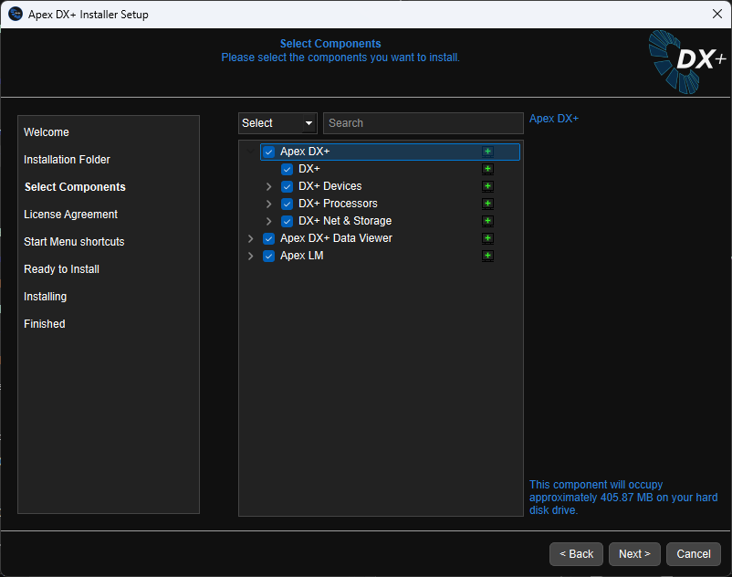

# Getting Started with APEX DX+

Use the guides in this section to understand the **DX+** architecture, verify system requirements, install and license the software with **APEX License Manager (ApexLM)**, and walk through your first acquisition and viewing session.

## In This Section

- [APEX DX+ Quick Start Guide](../quick-start.md) — install DX+, verify licensing, and run your first acquisition, live view, and data review end to end.
- [Introduction](introduction.md) — overview of the DX+ platform and its domain-split applications.
- [Features Overview](features-overview.md) — summary of hardware interfaces, DSP processing, visualization, storage, and bridges.
- [System Requirements](system-requirements.md) — operating system, CPU (AVX2), memory, graphics, and network port requirements.
- [Installing & Licensing](installing-and-licensing.md) — Windows/Linux deployment, ApexLM web admin UI (`http://127.0.0.1:27887/`), operating modes, application/feature tokens, and hardware serial validation.
- [Quick Start — Datatel Device](quick-start-datatel.md) — step-by-step walkthrough with Datatel telemetry & Designer/Viewer basics.
- [Quick Start — VTI Device](quick-start-vti.md) — step-by-step walkthrough connecting a VTI DSA system, adding FFT processing, and plotting live data.
- [Data Formats & Storage](data-formats.md) — guide to `.dxdb`/`.dxdb.index`, PostgreSQL schemas, `.h5`, `.datx`, `.rwx`, `.pkx`, `.dpd`, `.dxt`, and CSV exports.
