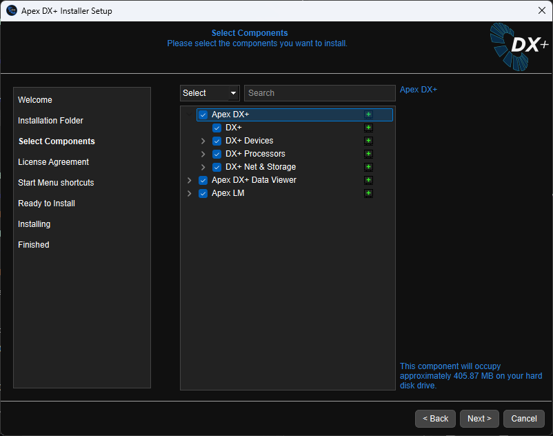
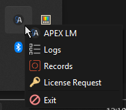
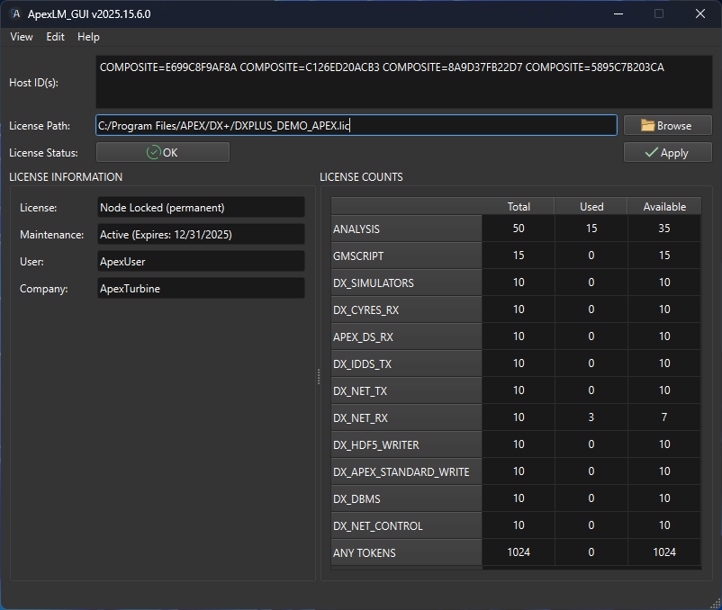

# Installing & Licensing

**APEX DX+** uses **[APEX License Manager (ApexLM)](../../License%20Manager/README.md)** (`APEX LM Daemon` and `APEX LM Server Daemon`) for node-locked, floating network, and reserved offline licensing across Windows and Linux systems.

> [!WARNING]
> **Legacy FLEXlm / FlexNet Discontinuation — October 2027**
> Legacy licensing powered by **FLEXlm / FlexNet** (`lmgrd`, `lmtools`, `lmutil`, `.lic` files, and `27000@host` servers) will be **discontinued as of October 2027**. All APEX product versions going forward exclusively use **[APEX License Manager](../../License%20Manager/README.md)** (`ApexLM`), the **APEX LM Daemon (`ApexLM_Service`)**, and the **APEX LM Server Daemon (`ApexLM_Server_Service`)**.

---

## Windows Installation


*DX+ Windows Installer component selection*

1. Confirm your workstation meets **[System Requirements](../../Release%20Policies/system-requirements.md)** (`x86-64` CPU with mandatory **AVX2** support, Windows 10/11 or Windows Server).
2. Run the DX+ installer executable on a 64-bit Windows workstation (administrator privileges required if installing system-wide services).
3. Choose the **Installation Folder** (by default, core runtimes, plugins, `CrashReporter.exe`, and application executables install into `dx+/bin/`).
4. Select the DX+ packages to install:
   - Core **DX+** runtime, **Devices**, **Processors**, and **Net & Storage** plugins
   - Domain applications (**DX+ DAQ**, **DX+ Online Analysis**, **DX+ Offline Analysis**, **DX+ Data Viewer**, **DX+ Remote Viewer**)
   - Supporting tools and bridges (**DX+ DB Manager**, **DXNet Bridge (OPC UA)**, **DXNet Bridge (PLC)**)
5. Ensure **ApexLM** (the required license manager service and system-tray companion `ApexLM_Tray`) is selected.
6. Complete the installation. Launch applications from **Start → APEX DX+**.

> [!NOTE]
> Unhandled exceptions in any DX+ desktop application invoke `CrashReporter.exe` to generate a forensic `.rpt` log and minidump for support submission at [https://users.apexturbine.com/](https://users.apexturbine.com/) (see [Maintenance & Technical Support](../../Release%20Policies/maintenance-and-support.md)).

---

## Linux Service & Server Deployment

On 64-bit Linux systems, **ApexLM** can run in the foreground (`ApexLM_Service` / `ApexLM_Server_Service`) or be registered as a **systemd** unit (`apexlm.service` for local/passthrough workstations or `apexlm-server.service` for central floating license servers) — see [Workstation & Server Setup](../../License%20Manager/setup-and-server.md) and the [CLI Reference](../../License%20Manager/cli-reference.md):

```bash
# Run as root to install /etc/systemd/system/apexlm.service
sudo ApexLM_CLI service install
sudo ApexLM_CLI service start
sudo ApexLM_CLI service status

# Or for the central APEX LM Server Daemon (apexlm-server.service):
sudo ApexLM_Server_CLI service install
sudo ApexLM_Server_CLI service start
sudo ApexLM_Server_CLI service status
```

| Environment | Local Service Database Path | Server Service Database Path |
| :--- | :--- | :--- |
| **Windows** | `C:\ProgramData\APEX\ApexLM\apexlm.db` *(fallback `%APPDATA%\APEX\ApexLM\apexlm.db`)* | `C:\ProgramData\APEX\ApexLM_Server\apexlm_server.db` *(fallback `%APPDATA%\APEX\ApexLM_Server\apexlm_server.db`)* |
| **Linux** | `/var/lib/apexlm/apexlm.db` *(fallback `~/.local/share/apexlm/apexlm.db`)* | `/var/lib/apexlm-server/apexlm_server.db` *(fallback `~/.local/share/apexlm-server/apexlm_server.db`)* |

> [!TIP]
> On Windows, running `ApexLM_CLI service install` / `start` / `stop` / `restart` / `uninstall` (or interactive mode) inside an **elevated** PowerShell prompt manages the native `ApexLMService` Windows service (and `ApexLMServerService` via `ApexLM_Server_CLI`).

---

## Managing Licenses with ApexLM

**ApexLM** runs a background license service plus a **loopback-only embedded Web Admin UI** (no password or session token required; loopback reachability authorizes local administration) and the interactive/one-shot CLI (`ApexLM_CLI` / `ApexLM_Server_CLI`). See **[Web UI & Offline Reservations](../../License%20Manager/web-ui-and-reservations.md)** for full details.


*Right-click the **A** icon in the Windows notification area (`ApexLM_Tray`) and open **ApexLM** / **Open Configuration***


*ApexLM status, license loading, and active token checkout view*

### Step-by-Step Activation (Workstation / Local License)

1. Ensure the ApexLM service is running.
2. Right-click the **A** icon in the system tray and choose **Open Configuration** (or navigate directly in a local browser on loopback to **`http://127.0.0.1:27887/`** for the local service, or **`http://127.0.0.1:27888/`** locally/via SSH tunnel on a floating license server host; `/api/v1/ui` is also supported).
3. In the **Overview** tab, upload or browse to your signed **Format Version 2** license file (`.lic` / `.json`), or load it from the CLI:
   ```text
   ApexLM> setsrvmode LOCAL
   ApexLM> loadlic C:\path\to\license.json
   ApexLM> status
   ```
4. Once applied, licensed applications and feature pools immediately become active without restarting the service.

> [!WARNING]
> **Format Version 2 Requirement & Legacy Licensing:** ApexLM requires cryptographically signed **Format Version 2** JSON license files (host-bound to uppercase hexadecimal MAC addresses without separators, e.g. `00155D2B5AB4`, or wildcard `*`/`demo` for portable evaluation keys). Format Version 1 keys and legacy FlexNet (`lmgrd`) `.lic` files are **not accepted** by ApexLM; contact APEX support to issue updated Format Version 2 licenses ahead of the **October 2027** FlexLM discontinuation.

---

## Operating Modes & Ports

| Mode | Purpose | Bind Address & Port | Notes |
| :--- | :--- | :--- | :--- |
| **`LOCAL`** | Single workstation, offline node-locked license | `127.0.0.1:27884` (`APEXLM_PORT`) | Validates local license file against machine MAC addresses. |
| **`PASSTHROUGH`** | Local proxy forwarding to a remote floating server | `127.0.0.1:27884` $\rightarrow$ `<Server IP>:27886` (`APEXLM_SERVER_LISTEN`) | Supports **reserving** counted features & hardware serials offline for **up to 30 days** via the **Reserve** tab. |
| **`SERVER`** | Central floating license server | Loopback `127.0.0.1:27885` (`APEXLM_SERVER_PORT`)<br>External listen `0.0.0.0:27886` (`APEXLM_SERVER_LISTEN`) | Rejects direct unproxied app clients; workstation clients connect via `PASSTHROUGH`. Admin UI stays restricted to `127.0.0.1:27888`. |

### Environment Variables

Applications and services read connection settings from system environment variables or a local `.env` / `.env.apexlm` file in the application folder:

- `APEXLM_HOST` *(default `127.0.0.1`)* — hostname or IP of the ApexLM service.
- `APEXLM_PORT` *(default `27884`)* — standard service CurveZMQ port (`27885` for server mode).
- `APEXLM_MANAGEMENT_PORT` / `APEXLM_ADMIN_PORT` *(default `27887`)* — local web admin HTTP port.
- `APEXLM_SERVER_MANAGEMENT_PORT` / `APEXLM_SERVER_ADMIN_PORT` *(default `27888`)* — server web admin HTTP port.
- `APEXLM_TIMEOUT` *(default `5000` ms)* — request timeout.

---

## Application & Feature Tokens Reference

Every DX+ application checks out an **application seat** at startup and maintains a **5-second heartbeat**. If transient network interruptions drop the license connection, running applications automatically reconcile and re-checkout active features and hardware serials when connectivity resumes.

### Application Tokens (`ApexApps.csv` & Runtime Checkouts)

| Application | License Catalog Token | Runtime `appname` / Primary Feature |
| :--- | :--- | :--- |
| **DX+ Suite Bundle** | `DXPLUS` | Master DX+ framework entitlement |
| **DX+ Data Acquisition** | `DX+DAQ` | `"dx+daq"` |
| **DX+ Online Analysis** | `DX+ONLINEANALYSIS` | `"dx+onlineanalysis"` |
| **DX+ Offline Analysis** | `DX+OFFLINEANALYSIS` | `"dx+offlineanalysis"` |
| **DX+ Remote Viewer** | `DX+REMOTEVIEWER` | `"dx+remoteviewer"` |
| **DX+ Data Viewer** | `DX+DATAVIEWER` | `"dx+dataviewer"` |
| **DX+ DB Manager** | `DBMANAGE` | `"dbmanage"` (`DBMANAGE-APP`) |
| **DXNet Bridge (OPC UA)** | `OPCUA` | `"opcua"` (`OPCUA-BRIDGE-APP`) |
| **DXNet Bridge (PLC)** | *(runtime bridge token)* | `"plc"` (`plc-bridge-app`) |
| **Wildcard / Multi-App** | `ANY` | Wildcard entitlement covering all applications |

### `ANALYSIS` Token Pool & Add-On Feature Catalog (`ApexFeatures.csv`)

Processors, sinks, and file/stream modules check out named features when initialized (unless included in the app's base bundle):

| Feature Token | Checkout Model | Token Cost (`ANALYSIS` Pool) | Covered Capabilities |
| :--- | :--- | :--- | :--- |
| `BASIC-PROCESSING` | `COUNTED` | `5` | Core filtering (FIR/IIR), scalar EU conversion, resampling, time align, triggers, statistics |
| `LIMITS-PROCESSING` | `COUNTED` | `3` | Range & modal/frequency limits evaluation (`Freq Limits`) |
| `ROTATINGMACHINERY-PROCESSING` | `COUNTED` | `10` | Spectral FFT/DFT, Order FFT, Order Filter, Tachometer, Rev Resample, Relative Phase |
| `ACOUSTICS-PROCESSING` | `COUNTED` | `10` | Octave Band (`1/N`-octave, Z/A/C weighting) |
| `SIGNAL-MATH-PROCESSING` | `COUNTED` | `10` | Signal Math algebraic expressions across streams |
| `SOLUTIONFIT-PROCESSING` | `COUNTED` | `10` | Mode Fit & Static Fit modal/static comparison against FEA limits |
| `VIRTUAL-MODELS` | `COUNTED` | `10` | 3D Model Viewer & Model Publisher |
| `VIDEO-STREAM` | `COUNTED` | `10` | Synchronized video capture, storage, and playback |
| `AEROMECHANICS-PROCESSING` | `COUNTED` | `15` | Aeromechanics analysis components |
| `DBMS` | `COUNTED` | `30` | Database writer/reader access (`SQLite` `.dxdb` & `PostgreSQL`) |
| `DXNET-TX` | `INCLUDED` | — | `DX+Net Transmitter` output |
| `DXNET-RX` | `ACCRUAL` | — | `DX+Net Receiver` / remote subscription seats |
| `DXNET-CONTROL` | `ACCRUAL` | — | Remote DAQ control |
| `DS-RX` / `CYRES-RX` | `ACCRUAL` | — | Legacy `APEX DS` / `Cyres WebSocket` receivers |
| `IDDS-TX` / `IDDS-RX` | `ACCRUAL` | — | iDDS publishing and receiving |
| `APEX-FILE-STANDARD` | `INCLUDED` | — | `.rwx`, `.pkx`, `.datx`, and `.h5` file readers and writers |
| `APEX-DEVICES` | `ACCRUAL` | — | Physical hardware device access |
| `APEX-SIMULATORS-PREMIUM` | `COUNTED` | — | Advanced simulation sources |

---

## Hardware Serial Validation

Hardware drivers validate chassis/card serial numbers against the **`hardware`** section of your ApexLM license before streaming starts:

- **Supported Vendor Keys**: `pacific`, `hgl`, `mecalc`, `datatel`, `scanivalve`, `dewesoft`, `ni`, `ps9016`, `vti`.
- **Enabled-Stream Scoping**: DX+ collects hardware serial numbers **only from currently enabled channels/streams**. Unconfigured or disabled spare cards installed in a chassis do not require serial entries in your license.
- **Wildcard Hardware Licenses**: Licenses configured with `*` for a vendor authorize any hardware serial from that vendor.
- **Disconnecting Between Runs**: Disconnecting an idle socket does not drop the hardware license reservation until the device setup is reset or closed, preventing seat churn between consecutive test runs.
