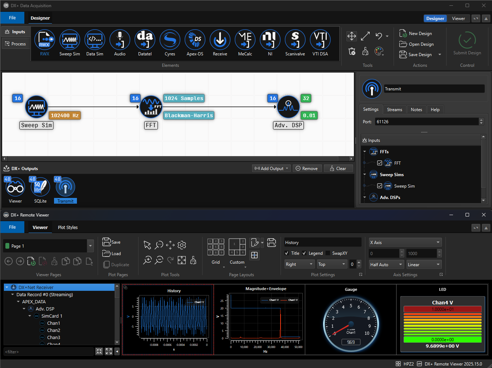

# Introduction

**DX+** is a multi-purpose test, measurement, analysis, and reporting platform created by **APEX Turbine Testing Technologies** for aerospace, turbomachinery, and general mechanical engineering testing and data acquisition.

*DX+ Designer (top) and DX+ Viewer (bottom): build acquisition and processing pipelines and monitor live or recorded data in customizable multi-page plots.*

## Core Capabilities

- **Multi-Vendor Hardware Support**: Connects directly to high-channel-count DAQ hardware from Mecalc, Pacific Instruments, HGL Dynamics, Scanivalve, Datatel, VTI, National Instruments, Dewesoft, and PSI 9016 — running mixed sample rates concurrently in the same setup.
- **Open, Queryable Storage**: Records high-rate time series, spectra, logs, and events directly into **SQLite (`.dxdb` / `.dxdb.index`)** for portable, shareable test archives or **PostgreSQL** for enterprise multi-user test cell repositories, as well as **`.datx`**, **`.rwx`**, and **`.h5`** binary files.
- **Modular Applications**: Each stage of a test workflow uses a focused application so operators, test engineers, and analysts only run the tools they need:

| Application | Executable | Primary Role |
| :--- | :--- | :--- |
| **DX+ DAQ** | `DX+Daq.exe` | Table-driven hardware setup (`.dxt`), per-channel DSP, live recording, and network streaming. |
| **DX+ Online Analysis** | `DX+AnalysisOnline.exe` | Free-form node-graph pipeline builder (`.dpd`) for real-time streaming DSP and multi-sink routing. |
| **DX+ Offline Analysis** | `DX+AnalysisOffline.exe` | Post-test database and file processing with multi-source/reference resolution and batch CLI support. |
| **DX+ Remote Viewer** | `DX+RemoteViewer.exe` | Standalone live telemetry viewer subscribing over ZeroMQ (`DXPNet` / `DSNet`). |
| **DXNet-Rx** | `DXNet-Rx` | Cross-platform (Windows & Android) live dashboard viewer for `DXPNet` publishers. |
| **DX+ Data Viewer** | `DX+DataViewer.exe` | Standalone post-test viewer for `.dxdb`, PostgreSQL, `.rwx`, `.pkx`, `.datx`, and `.h5`. |
| **DX+ DB Manager** | `dx+dbmanager.exe` | Database inspection, ROI event creation/editing, columnar CSV & binary export, and DB maintenance. |
| **DXNet Bridge (OPC UA)** | `dx+opcua.exe` | Bidirectional OPC UA $\leftrightarrow$ `DXPNet` gateway and embedded read-only OPC UA mirror server. |
| **DXNet Bridge (PLC)** | `dx+plc.exe` | Bidirectional Allen-Bradley ControlLogix EtherNet/IP (CIP) $\leftrightarrow$ `DXPNet` gateway. |
