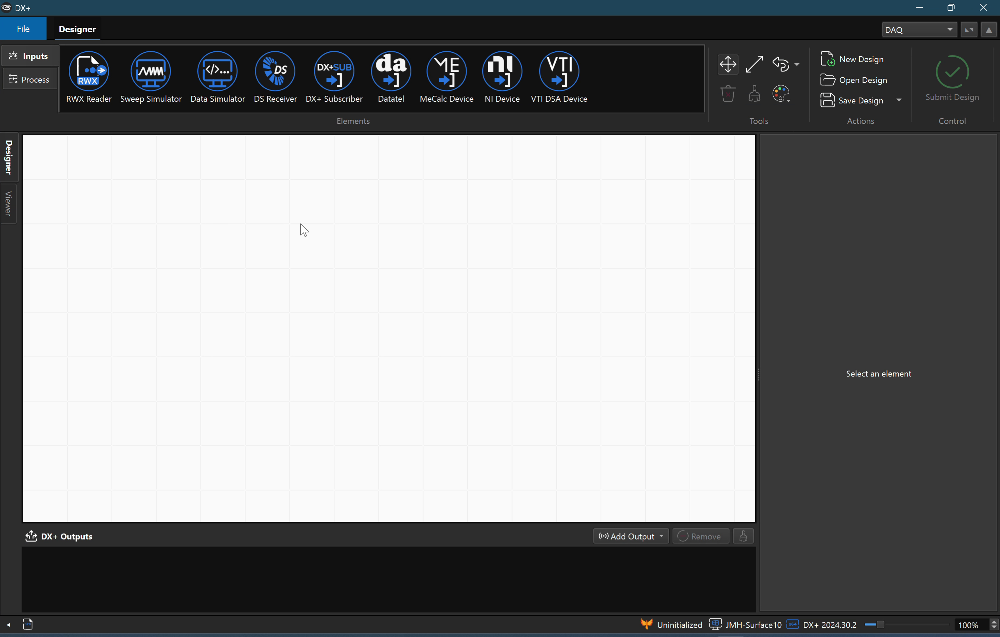
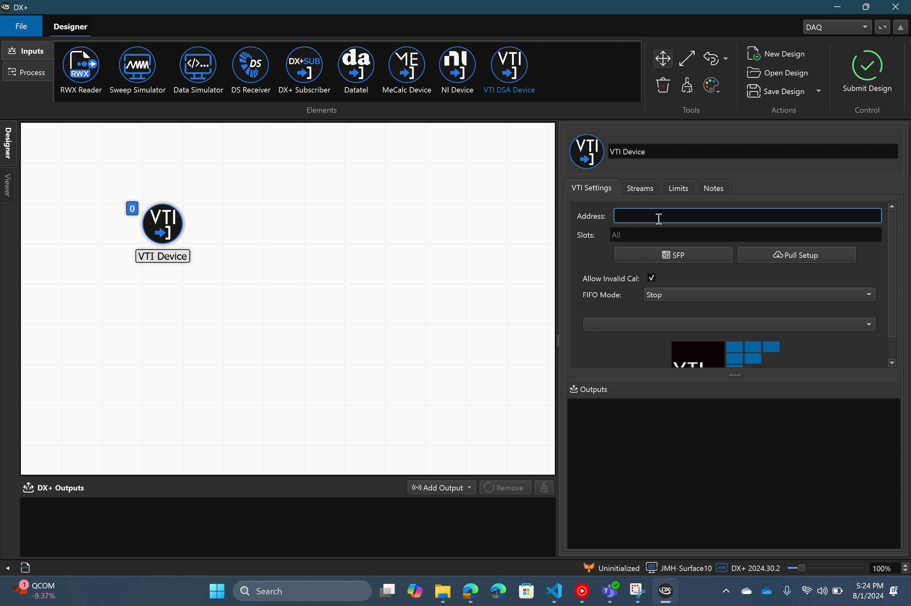
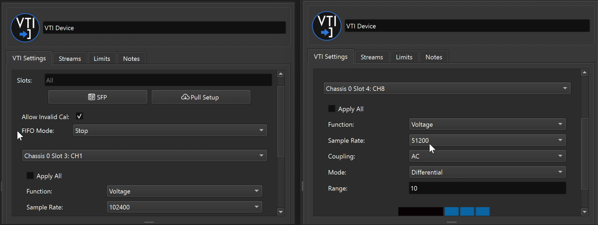
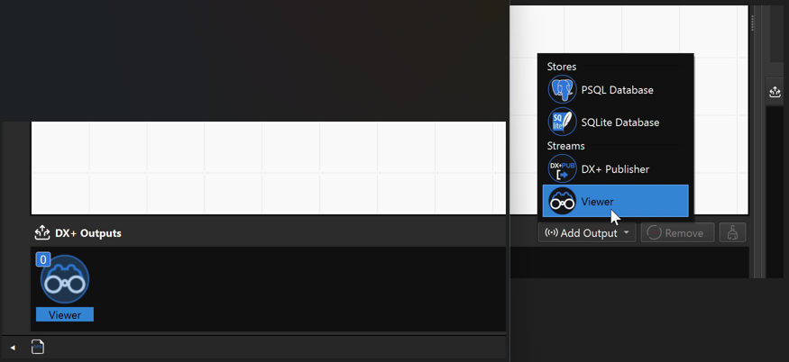
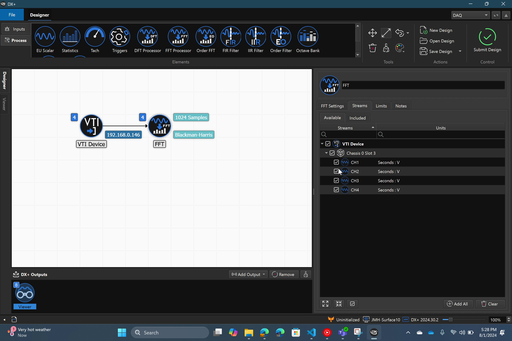
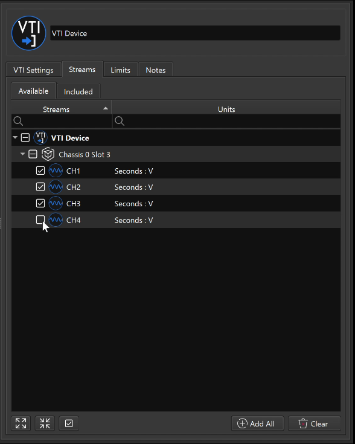
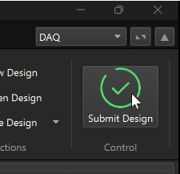
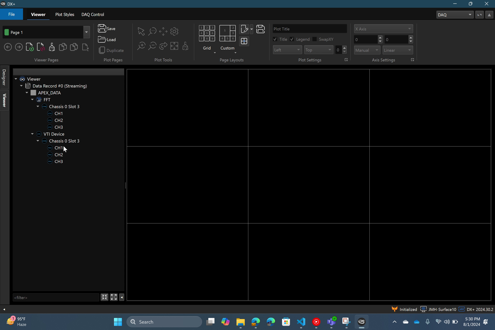
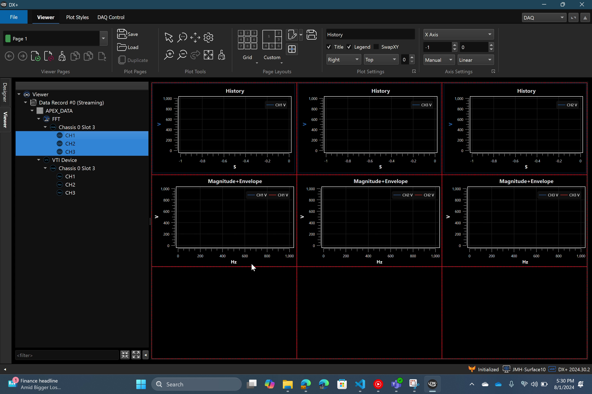
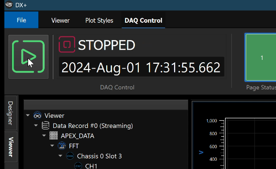

# Quick Start — Datatel Device

This Quick Start introduces **DX+** by building a processing design, streaming to the **Viewer**, and controlling live acquisition. The walkthrough below follows the Designer-to-Viewer flow (video and screenshot steps use a VTI DSA chassis to illustrate connecting, adding FFT processing, and plotting; for Datatel units, connect using **Datatel Setup** on port `80` as noted below).

1. [Watch the Video Walkthrough](#1-quick-start-video)
2. [Follow the Step-by-Step Guide](#2-step-by-step-text--screenshot-guide)

---

## 1. Quick Start Video

- **YouTube Walkthrough**: [APEX DX+ Quick Start & Overview](https://youtu.be/rkK3mgWYRoQ?si=l4FPtmFeR6gKMDHo)

---

## 2. Step-by-Step Text & Screenshot Guide

### Connect a Datatel Telemetry Unit (In DX+ DAQ / Online Analysis)

When using a **Datatel** telemetry device:

- In **DX+ DAQ** ([Integrated Devices](../DX+DAQ/devices/integrated.md#datatel)), add a **Datatel** device, enter its **IP Address** and **Port** (default `80`), click **Launch Datatel Setup** to configure channels in Datatel's built-in web page, and click **Pull Setup** to load those channels into DX+.
- Re-click **Pull Setup** anytime you modify channel configuration on the Datatel unit.

The screenshots below demonstrate the full node-graph **Designer** + **Viewer** workflow using a VTI DSA device element as an example.

### DX+ Designer

Upon launching DX+ Analysis, the **Designer** canvas opens. Drag input elements from the left **Elements** pane onto the canvas to begin building a design.

### Input: Device Element

Once the device element is placed on the canvas, connect to the hardware:

1. Enter the **IP Address** of the device.
2. Leave the **Slots** field blank to enable all slots, or enter a comma-separated list of slot numbers.
3. Click **Pull Setup** to retrieve current channel settings, timestamps, and metadata from the device.
4. Confirm the element's badge updates to show the total channel count.

#### Device Configuration Settings

- **Allow Invalid Calibration**: Enable if testing with cards that do not currently hold a valid calibration state; otherwise setup validation halts with an error.
- **FIFO Mode** *(VTI)*:
  - **Stop** *(default)*: Halts acquisition on FIFO overflow.
  - **Overwrite**: Overwrites oldest buffered samples to prevent overflow (allows data loss).
  - **Wait**: Stalls until samples are read (prevents data loss, but increases host memory consumption if the consumer falls behind).
- **Channel List Dropdown**: Modify individual channels or use **Apply All** for **Function** (IEPE excitation current, Strain bridge parameters), **Sample Rate**, **Coupling**, **Mode**, and **Range**.

### Output: Viewer Element

1. In the **DX+ Outputs** pane on the right, click the **Add Output** dropdown.
2. Select **Viewer**.

> [!NOTE]
> You can add multiple outputs simultaneously — for example **SQLite Output** to record `.dxdb` files to disk and **DX+ Transmit** to publish live streams to [DX+ Remote Viewer](../DX+RemoteViewer/README.md).

### Processing: FFT Element

1. In the **Elements** pane, switch from **Inputs** to the **Process** tab.
2. Drag an **FFT / DFT (`FDFT`)** element onto the canvas next to your input element.
3. Click the diagonal arrow icon in the **Tools** ribbon to enter **Connect Mode**.
4. Click and drag from the input element to the **FFT** element and release to wire data flow.

### Disabling Channels

- Uncheck channels inside any element's **Output Streams** panel to exclude them from downstream processing and display.
- The blue badge on each element shows the active stream count.

### Save Design

1. Open the **File** menu.
2. Click **Save Design** (saves as a `.dpd` project file).
3. Choose a destination filename and click **Save**.

### Submit Design

1. Click **Submit Design** in the upper-right **Control** group of the ribbon.
2. DX+ validates all connections, applies device settings, and initializes the pipeline.
3. Wait for the green spinner on **Submit Design** to finish before starting acquisition.

> [!NOTE]
> Any edits to element settings or connections require clicking **Submit Design** again before running.

### DX+ Viewer

1. Switch to the **Viewer** workspace (or click the **Viewer** tab on the left navigation bar).
2. Both raw device channels and processed FFT channels appear in the left **Signal Tree**.
3. Click a plot space in the canvas and press `Ctrl+A` to select all spaces (or pick a `3x3` layout under **Plots → Page Layouts → Grid**).
4. Drag 3 time-domain signals onto the top-left space, then click **1 Trace Per** and select **History**.
5. Repeat for 3 FFT-processed signals and choose **Mag+Env**.

> [!NOTE]
> Offered plot types depend on the stream's domain:
> - **Frequency-domain streams**: Magnitude, Envelope, Mag+Env, Campbell, Zmod, Bar, Scope, Tracking, Bode, Table
> - **Time-domain streams**: Scope, History, Strip, Scatter, Graphic (`Gauge`, `Text`, `Thermometer`, `LED`, `Bar`), Table

### DAQ Control

1. Select the **DAQ Control** ribbon tab at the top.
2. Click **Start** to begin live acquisition (**RUNNING**).
3. Watch live traces update in the **Viewer** (and switch **Grid** to `2x3` to maximize chart area).
4. Monitor **System Usage** (`RAM`, `CPU`, `NET`) and **Limits** (`R` / `F`) while running.
5. Click **Stop** to halt acquisition cleanly.

---

## Next Steps

- Hardware table workflows: [DX+ DAQ Guide](../DX+DAQ/README.md)
- Advanced visual graphs: [DX+ Online Analysis Guide](../DX+OnlineAnalysis/README.md)
- Detailed plot settings: [DX+ Data Viewer Guide](../DX+DataViewer/README.md)
