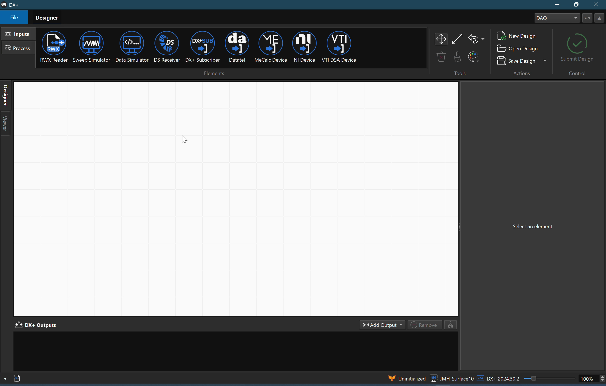
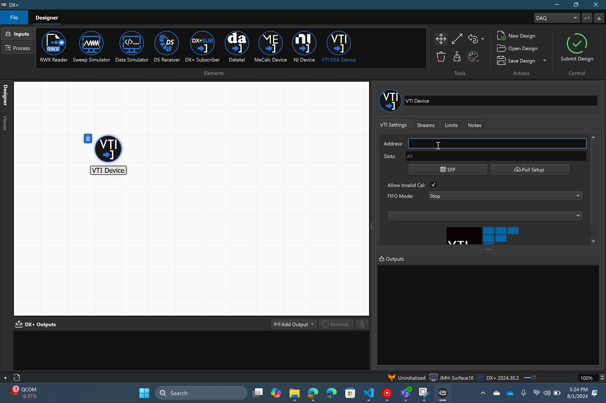
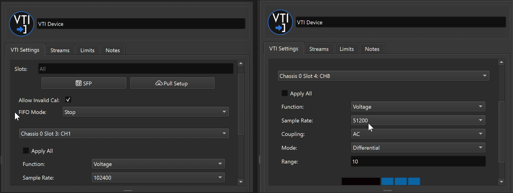
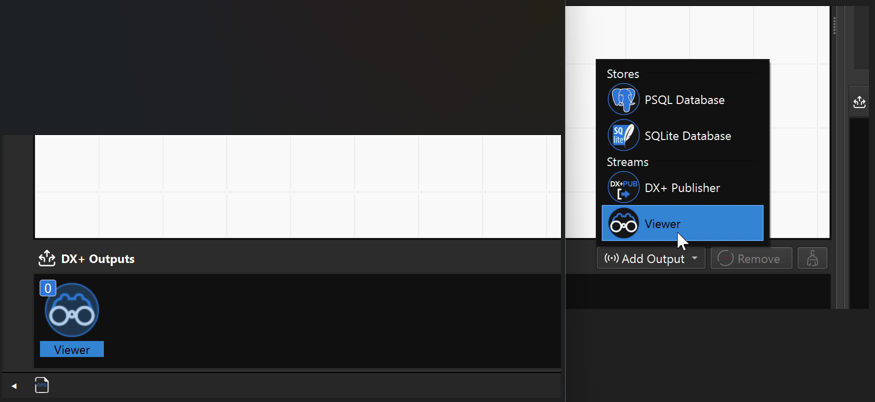
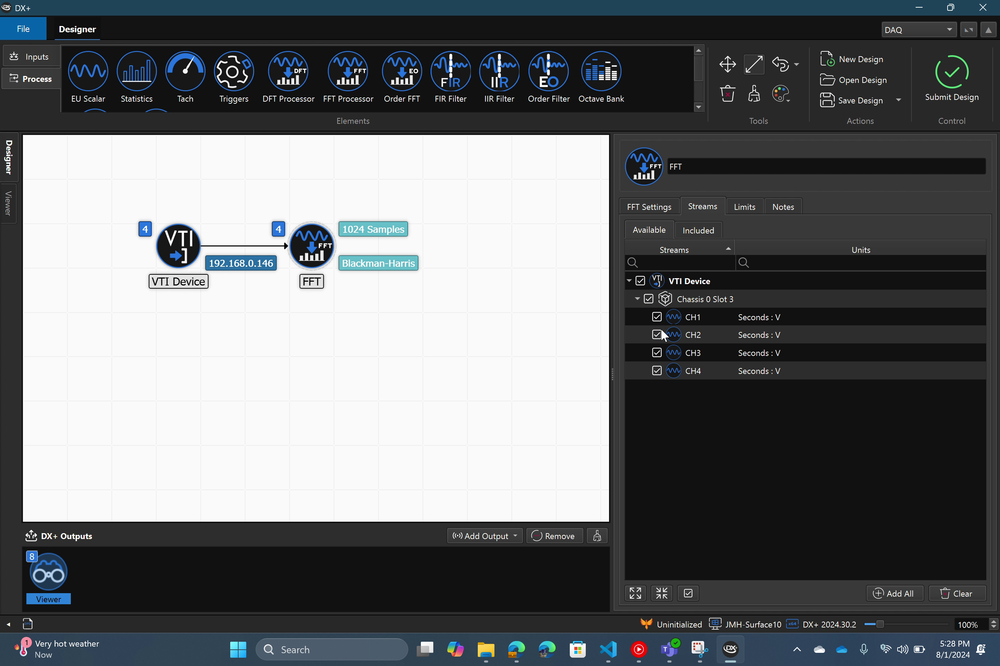
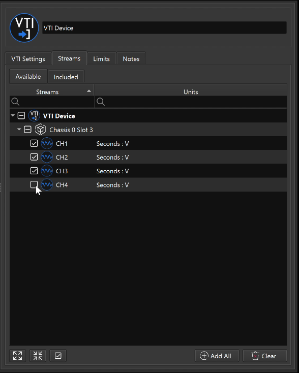
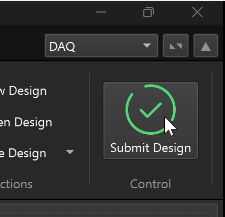
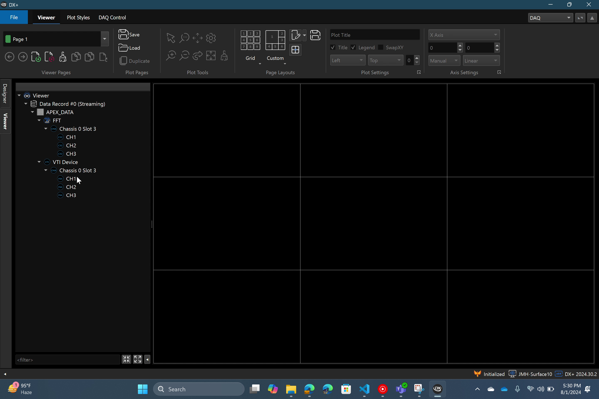
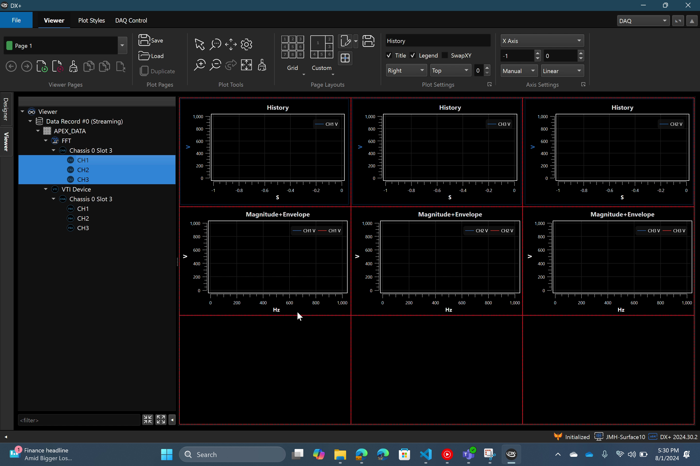
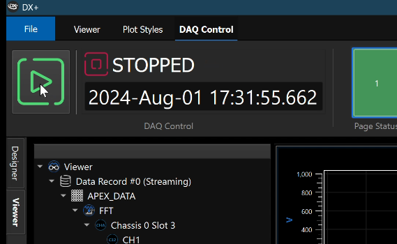

# Quick Start — VTI Device

This Quick Start walks through connecting a **VTI Instruments DSA** acquisition device, wiring real-time **FFT** processing and **Viewer** outputs in the **Designer**, submitting the setup, and plotting live data.

1. [Watch the Video Walkthrough](#1-quick-start-video)
2. [Follow the Step-by-Step Guide](#2-step-by-step-text--screenshot-guide)

---

## 1. Quick Start Video

- **YouTube Walkthrough**: [APEX DX+ Quick Start & Overview](https://youtu.be/rkK3mgWYRoQ?si=l4FPtmFeR6gKMDHo)

---

## 2. Step-by-Step Text & Screenshot Guide

### DX+ Designer

Upon launching DX+ Analysis, the **Designer** opens. Drag input elements onto the canvas to begin constructing your acquisition graph.

### Input: VTI DSA Device Element

Add the **VTI DSA Device** element and connect to the chassis:

1. Enter the **IP Address** of the VTI chassis.
2. Leave **Slots** blank to enable every card slot, or provide a comma-separated list of slot numbers.
3. Click **Pull Setup** to retrieve active channels, timestamps, and card capabilities from the device.
4. Check that the element badge updates with the total channel count.

#### Key VTI Device Settings

- **Allow Invalid Calibration**: Must be checked to acquire from cards without an active valid calibration certificate (for example, certain 4380 configurations). When unchecked, invalid calibration aborts setup with an error.
- **FIFO Mode**:
  - **Stop** *(default)*: Halts acquisition if the hardware FIFO overflows.
  - **Overwrite**: Overwrites unread FIFO samples to avoid stopping acquisition (can drop samples under heavy load).
  - **Wait**: Pauses FIFO writes until the host drains buffered samples (zero sample loss, but host memory grows if consumers lag).
- **Channel List Dropdown**: Adjust per-channel settings or click **Apply All**:
  - **Function**: Choose **IEPE** (exposes **Excitation Current**) or **Strain** (exposes gage resistance, gage factor, excitation, and bridge settings).
  - **Sample Rate**: Applied uniformly across all channels on a given card.
  - **Coupling**, **Mode**, and **Range**: Configured per channel according to card capabilities.

### Output: Viewer Element

1. In the **DX+ Outputs** pane on the right, click **Add Output**.
2. Select **Viewer**.

> [!NOTE]
> Additional outputs can run alongside **Viewer**, including **SQLite Database** (records `.dxdb` files to disk) and **DX+ Transmit** (publishes live telemetry for [DX+ Remote Viewer](../DX+RemoteViewer/README.md)).

### Processing: FFT Element

1. Switch the **Elements** pane from **Inputs** to **Process**.
2. Drag an **FFT / DFT (`FDFT`)** element onto the canvas next to the VTI element.
3. Select the diagonal arrow icon in the **Tools** ribbon to activate **Connect Mode**.
4. Drag a connection arrow from the VTI device element to the **FFT** element.

### Disabling Channels

- Uncheck unneeded channels inside any element to prevent unnecessary processing downstream.
- Each element's blue badge shows how many active channels it outputs.

### Save Design

1. Open the **File** menu and select **Save Design**.
2. Save the `.dpd` design file to disk so it can be reopened or modified later.

### Submit Design

1. Click **Submit Design** on the upper-right **Control** group of the ribbon.
2. DX+ validates the graph topology and pushes hardware settings to the VTI chassis.
3. Wait for the status indicator on **Submit Design** to complete.

> [!NOTE]
> Whenever you modify element settings or wiring, click **Submit Design** again before acquiring data.

### DX+ Viewer

1. Click the **Viewer** tab on the left navigation strip.
2. Expand the **Signal Tree** on the left to locate both raw VTI time channels and processed FFT channels.
3. Select all plot spaces with `Ctrl+A` (use **Plots → Page Layouts → Grid → 3x3** if needed).
4. Drag 3 raw signals onto the top-left space, click **1 Trace Per**, and pick **History**.
5. Repeat with 3 FFT signals and pick **Mag+Env**.

> [!NOTE]
> Available plot options depend on the dragged stream's data domain:
> - **FFT / Frequency streams**: Magnitude, Envelope, Mag+Env, Campbell, Zmod, Bar, Scope, Tracking, Bode, Table
> - **Time-domain streams**: Scope, History, Strip, Scatter, Graphic (`Gauge`, `Text`, `Thermometer`, `LED`, `Bar`), Table

### DAQ Control

1. Switch to the **DAQ Control** ribbon tab at the top.
2. Click **Start** to begin live data acquisition (**RUNNING**).
3. Observe live plots updating (set **Grid** to `2x3` to enlarge the plots).
4. Check **System Usage** (`RAM`, `CPU`, `NET`) during acquisition.
5. Click **Stop** when finished.
